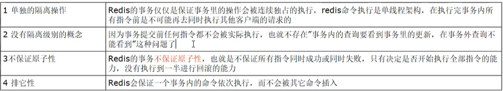
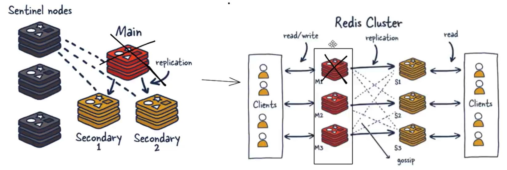
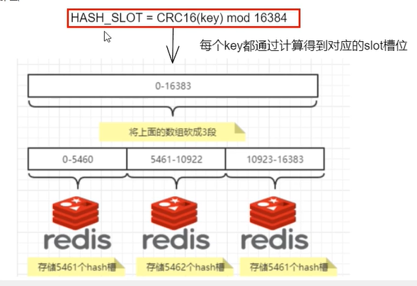
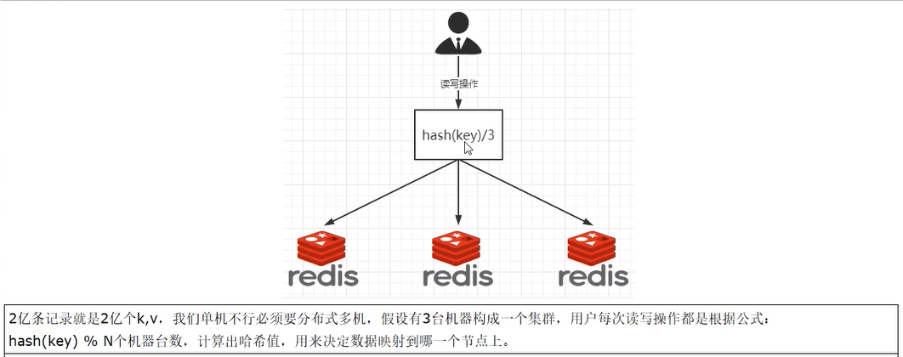
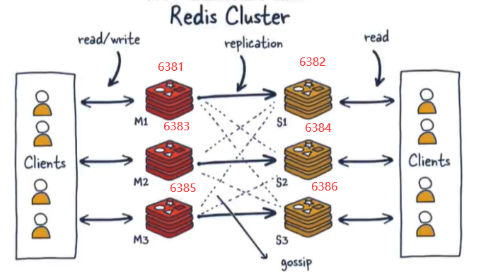

## Redis安装

### 安装前准备

请确保当前Linux环境下有gcc编译器（原因：因为redis底层是由c语言编写）可以通过下面这条命令查看

```shell
gcc -v
```

### 安装步骤

1、先到官网下载安装包到本地 \[下载地址\]([Download \| Redis](https://redis.io/download/))

2、将安装包通过远程连接（FinalShell，或xshell）传到Linux，一般传到 <code>/opt</code>目录下

3、解压：

```shell
tar -zxvf redis redis-7.0.11.tar.gz   # 加了v
或
tar -zxf redis redis-7.0.11.tar.gz  # 不加v
```

4、进入解压后的redis文件夹，并执行<code>make</code>命令

```shell
make && make install  # 这里会同时执行，也可先执行make，然后再执行make install
```

如果出现 <code>Hint: It's a good idea to run 'make test'</code>则说明安装成功。默认安装目录：<code>use/local/bin</code>类似于Windows系统下的<code>C:/Program Files</code>文件夹

5、进入<code>use/local/bin</code>，查看文件

- redis-benchmark:性能测试工具，服务启动后运行该命令，看看自己本子性能如何
- redis-check-aof:修复有问题的AOF文件，rdb和aof后面讲
- redis-check-dump:修复有问题的dump.rdb文件
- redis-cli:客户端，操作入口
- redis-sentinel: redis集群使用
- redis-server: Redis服务器启动命令

6、将默认的redis.confi拷贝一份，保存到自定义的路径下，比如：/mybatis

```shell
cp redis.conf /myredis/redis7.conf
```

7、修改/myredis目录下的redis.conf配置文件做初始化设置

```txt
redis.conf配置文件，改完后确保生效，记得重启，记得重启
1、默认daemonize no 改为 daemonize yes
2、默认protected-mode yes 改为 protected-mode no
3、默认bind 127.0.0.1       改为直接注释掉(默认bind 127.0.0.1只能本机访问)或改成本机IP地址，否则影响远程IP连接
4、添加redis密码      改为 requirepass你自己设置的密码
```

8、启动服务

```shell
redis-server /myredis/redis7.conf
```

9、连接服务

```shell
redis-cli -a 密码 -p 指定端口号
```

10、此时就安装好redis了，可以在客户端操作了

输入<code>ping</code>出现PONG就说明没问题了

```shell
127.0.0.1:6379> ping
PONG
127.0.0.1:6379>
```

## Redis 数据持久化

redis提供了两种持久化操作，分别是 <b>RDB（Redis Database）</b> 和 <b>AOF（Append Only File）</b>

RDB持久化：是将redis上存储的数据在指定的时间间隔内执行的次数来将之前操作的数据集保存到指定的磁盘位置。

AOF持久化：与RDB不同的是，RDB保存的是数据集，而AOF则保存的是写操作的命令，每次写入都会被Redis放入AOF保存的缓冲区，等待被保存到磁盘上。

同时官方文档还有关于，不使用持久化操作和RDB+AOF组合使用的操作介绍。

<b>OK，我们知道了数据持久化的两种方式，那我们应该如何使用呢？</b>

有两种使用方法，一种是自动持久化，另一种是手动持久化。

### 自动持久化方式

\*\*RDB：\*\*在redsi.config配置文件里面配置

```txt
save ""          # 表示不使用RDB存储
save 900 1
save 300 10
save 60 10000
```

上面意思是，表示在15分钟（900秒）内至少有1个键被修改就进行快照存储，其他两个意思相同。

\*\*AOF：\*\*同样在redis.cofig配置文件中配置

```txt
appendonly yes    # 通过修改参数来表示是否开启（yes/no）

# appendfsync always
appendfsync everysec
# appendfsync no
```

这里主要解释以下下面三段代码，表示的是保存策略，默认是<code>everysec</code>每秒保存一次，<code>always</code>是一直执行保存，<code>no</code>是不保存。

### 手动持久化方式

\*\*RDB：\*\*在redis服务端通过命令的方式保存，保存路径默认是<code>./</code>，保存的名称默认为<code>dump.rdb</code>

- <code>save</code>：（不推荐使用）输入save命令后，会对redis进行进程阻塞，然后进行备份，备份完成之后恢复正常。在<b>生产环境</b>中不允许使用此命令！！！
- <code>bgsave</code>：（推荐使用）输入bgsave命令后，不影响redis正常服务，后台会fork出一个子进程，不会阻塞，以异步的方式进行备份。

\*\*AOF：\*\*在redis服务端通过命令的方式保存，保存路径默认<code>是RDB存储路径下出现的appendonlydir文件夹</code>，保存的名称默认为<code>appendonly.aof</code>

- <code>bgrewriteaof</code>：此命令与<code>bgsave</code>命令执行操作差不多。

### RDB和AOF混合使用

两种方式可以同时打开，但是由AOF说了算。RDB作为备用恢复手段，也可以保持启用。

在同时开启RDB和AOF持久化时，重启时只会加载AOF文件，不会加载RDB文件。

通过设置redis.conf的<code>aof-use-rdb-preamble yes</code>启用混合方式，设置为no表示禁用。

## Redis事务（Transactions）

### 简言

说到数据库事务，我们先能够想到<b>关系型数据库</b>里的事务，它包括四大特性（ACID）：原子性、一致性、隔离性、持久性。由一个或则多个SQL语句组成的、逻辑上的工件单元，必须将其视为一个不可分割的“操作序列”，这个序列中的所有SQL语句只能全部执行成功，或者全部不执行。用通俗易懂的话来说就是，在事务里的SQL语句要么全部执行，要么全部不执行。

那<b>非关系性数据库</b>（比如：Redsi）中的事务是什么呢？

他们执行的事情其实都是差不多的，都是为了保证命令的一致性。但是他们还是有<b>区别</b>的：

- 关系型数据库采用悲观锁机制来保证了事务的隔离性和原子性；而非关系型数据库通常采用乐观锁来控制并发和保持数据一致
- 关系型数据库通常支持复杂的事务处理和多表关联查询，而非关系型数据库通常不支持多表关联的查询操作。Redis的事务操作采用<code>multi</code>和<code>exec</code>命令配合使用，通过一系列的命令操作来实现事务。



### 操作命令

- <code>DISCARD</code>：取消事务，放弃执行事务块内全部命令
- <code>EXEC</code>：执行所有事务块内的命令
- <code>MULTI</code>：标记一个事务块的开始（开启事务）
- <code>WATCH key [key...]</code>：监视一个或多个key，如果在事务执行之前在这个key被其他命令所改动，则事务将被打断
- <code>UNWATCH</code>：取消<code>WATCH</code>命令对所有key的监视

正常执行：

```txt
127.0.0.1:6379> MULTI   # 开启事务
OK
127.0.0.1:6379(TX)> set k1 v1
QUEUED
127.0.0.1:6379(TX)> set k2 v2
QUEUED
127.0.0.1:6379(TX)> set k3 v3
QUEUED
127.0.0.1:6379(TX)> incr count
QUEUED
127.0.0.1:6379(TX)> EXEC  # 执行事务
1) OK
2) OK
3) OK
4) (integer) 3
127.0.0.1:6379> mget k1 k2 k3 count  # 查看，全部执行成功
1) "v1"
2) "v2"
3) "v3"
4) "3"
127.0.0.1:6379>
```

中断执行

```txt
127.0.0.1:6379> multi       # 开启事务
OK
127.0.0.1:6379(TX)> set k1 v11
QUEUED
127.0.0.1:6379(TX)> set k2 v22
QUEUED
127.0.0.1:6379(TX)> DISCARD# 终止事务
OK
127.0.0.1:6379> mget k1 k2
1) "v1"
2) "v2"
127.0.0.1:6379>
```

## Redis主从复制（replication）

高并发机制

主服务称为master，从服务称为salve。主从复制主要针对解决高并发问题。master主要负责写，slave主要负责读。

### 主从复制如何实现

#### 方式一：修改配置文件

在配置文件redis.config中修改

```txt
# 老版本，redis 5 之前配置
slaveof <masterip> <masterport>
# 新版本，redis 5 之后使用 replicaof 替代 slaveof
replicaof <masterip> <masterport>
```

#### 方式二：启动服务参数配置

在开启服务时输入

```shell
# 老版本，redis 5 之前配置
redis-server -slaveof <masterip> <masterport>
# 新版本，redis 5 之后使用 replicaof 替代 slaveof
redis-server -replicaof <masterip> <masterport>
```

#### 方式三：客户端发送命令连接

进入客服端之后通过输入命令的方式

```txt
# 老版本，redis 5 之前配置
127.0.0.1:6380> slaveof <masterip> <masterport>
# 新版本，redis 5 之后使用 replicaof 替代 slaveof
127.0.0.1:6380> replicaof <masterip> <masterport>
```

所有方式都可以在进入客户端之后，输入<code>info replication</code>查看信息。

### 取消主从关系命令

<code>slaveof no one</code>：取消当前数据库的主从关系，使当前数据库为master身份

### 主从复制优缺点

<b>优点：</b>

- 一个master，可同步多个slave
- 读写分离，读取效率高
- 数据热备份，有多个数据副本

<b>缺点：</b>

- 主机宕机，则所有的从机都无法工作
- 主机写操作压力大
- 主节点存储能力受到单机限制

为了改善缺点则引入了哨兵和集群

## Redis哨兵模式（sentinel）

高可用机制

### 是什么？

哨兵模式是一种特殊的模式，redis提供了开启哨兵的命令。哨兵是一个独立的进程，负责监控运行中的redis服务。在服务宕机后给出响应的操作。

### 有什么作用？

- 监控redis运行的状态
- 当master服务宕机后，通过一种投票算法将某一个slave选举为新的master

### 能干嘛 ？

- 监控：监控redis主从机是否正常运行
- 通知：通过api接口将故障转移的结果发送给客户端或系统管理员
- 自动故障切换：如果主机master宕机，sentinel启动故障转移，将某一个slave升级为master，并使其他的salve重新指向新的master，并通知使用redis服务器的应用程序连接时要使用新的master服务地址
- 配置中心：客户端通过连接哨兵来获得当前redis服务的master节点

### 怎么配置？

- 配置<code>sentinel.conf</code>哨兵配置文件里的下面这条命令

```txt
# 在配置文件中配置这段命令
# 其中各个参数的意思如下 
sentinel monitor <master-name> <ip> <port> <quorum>
```

<code>master-name</code>：要监控的master服务器的名称

<code>ip</code>：其IP地址

<code>port</code>：其端口号

<code>quorum</code>：（重点）表示最少需要几个哨兵认为此master主机为客观下线，然后才允许故障迁移（说通俗点就是选举的数量）

- 如果master设置了密码，则需要配置以下命令

```txt
sentinel auth-pass <master-name> <password>
```

<b>配置文件里其他的命令</b>

```txt
# 指定多少毫秒之后，主节点没有应答哨兵，此时哨兵主观上认为主节点下线
sentinel down-after-milliseconds <master-name> <milliseconds>

# 表示允许并行同步的slave个数，当Master挂了后，哨兵会选出新的Master，剩余的slave会向新的master发起同步数据
sentinel parallel-syncs <master-name> <nums>

# 故障转移的超时时间，进行故障转移时，如果超过设置的毫秒，表示故障转移失败
sentinel failover-timeout <master-name> <milliseconds>

# 配置当某一事件发生时所需要执行的脚本
sentinel notification-script <master-name> <script-path>

# 客户端重新配置主节点参数脚本
sentinel client-reconfig-script <master-name> <script-path>
```

### 怎么用?（怎么运行）

在命令窗口启动

```shell
redis-server 你的sentinel配置文件 --sentinel
```

说明：启动哨兵一般是以集群的方式启动，一般不单独启动一个（推荐奇数个）

此时可以通过linux命令查看redis进程（不出意外是有三个哨兵进程运行）

```txt
ps -ef | grep redis
```

另外：如果sentinel出现问题，还可以查看日志文件<code>sentinel.log</code>（路径到配置文件中查看）

思考？？如果此时master宕机之后，sentinel将会选举哪一个slave为新的master<br />回答：通过选举算法选举，权限（priority）>复制偏移量（replication offset）> Run ID<br />思考？？如果此时master宕机之后，sentinel将会选举了一个新的master，此时原来的master连上来，会出现什么情况？<br />回答：会变为新的master的slave

### 哨兵使用建议

- 哨兵节点的数量应该为多个，哨兵本身就是一个集群，保证高可用
- 哨兵节点的数量应该是单数
- 各个哨兵节点的配置应该保持一致
- 如果哨兵节点部署在Docker等容器中，尤其要保证端口的正确映射
- 哨兵集群+主从 复制没并不能保证数据的零丢失（因此引入了集群）

## Redis集群（cluster）

### 概述

Redis集群是一个可以在多个Redis节点之间进行数据共享的程序集。并且Redis集群可以支持多个master节点。



### 作用

- Redis集群支持多个master，每个master又可以挂载多个slave。
- 支持数据的读写分离，
- 支持高可用
- 支持海量数据的读写存储
- 由于cluster自带sentinel的故障转移机制，内置了高可用的支持，所以再去使用哨兵功能
- 客户端与redis的节点连接，不再需要连接集群中的所有节点，只需要任意连接集群中的一个可用节点即可
- 槽位slot负责分配各个物理服务节点，由对应的集群来负责维护节点、插槽和数据之间的关系

### 集群算法 -分片 -槽位slot

集群的密钥空间被分成16384个槽，有效地设置了16384个主节点的集群大小上限（但是，建议的最大节点大小约为1000个节点)。<br />集群中的每个主节点处理16384个哈希槽的一个子集。当没有集群重新配置正在进行时(即哈希槽从一个节点移动到另一个节点)，集群是稳定的。当集群稳定时，单个哈希槽将由单个节点提供服务(但是，服务节点可以有一个或多个副本，在网络分裂或故障的情况下替换它，并且可以用于扩展读取陈旧数据是可接受的操作)。

#### 槽位slot

redis集群中没有使用一致性hash，而是导入了hash槽的概念。redis集群有16384个hash槽，每个key通过CRC16校验后对16384取模来决定数据放在哪个槽。集群的每个节点负责一部分hash槽。例如以下：



#### 分片

使用redis集群是我们会将存储的数据分散到多台redis机器上，这就称为<code>分片</code>。集群中的每个redis实例都被认为是整个数据的分片。

为了找到给定key的分片，我们对key进行CRC16(key)算法处理并通过对总分片数量取模。然后，使用确定性hash函数，这意味着给定的key将多次始终映射到同一个分片。

#### 槽位与分片的优势

- 方便节点的扩容与缩容
- 方便数据分派查找

#### slot槽位映射

<ul>
<li></li>
</ul>

哈希取余分区



\*\*优点：\*\*简单粗暴，只需要预估好数据，规划好节点

\*\*缺点：\*\*原来规划好的节点，进行扩容或缩容比较麻烦，映射关系需全部重新计算，导致数据混乱

<ul>
<li></li>
</ul>

一致性哈希算法分区

提出一致性哈希算法的目的：当服务器个数发生变动时，尽量减少影响客户端到服务器的映射关系

3大步骤

<ul>
<li></li>
</ul>

算法构建一致性哈希环

<ul>
<li></li>
</ul>

redis服务器IP节点映射

<ul>
<li></li>
</ul>

key落到服务器的落键规则

<b>优点：具备容错性</b>和<b>扩容性</b>

<b>缺点：容易出现数据倾斜</b>问题

<ul>
<li></li>
</ul>

哈希槽分区

<b>概述</b>

哈希槽分区为了解决一致性哈希算法的数据倾斜问题而出现。哈希槽本质上就是一个数组，大小为 <code>2^14</code>

<b>作用</b>

解决均匀分配的问题，在数据和节点之间又加入了一层，把这层称为哈希槽（slot），用于管理数据和节点之间的关系，现在就相当于节点上放的是槽，槽里放的是数据。


槽解决了粒度问题，便于数据移动

#### 为什么redis集群的最大槽数是16384个？

原作者给出了回答，<br />地址如下：[https://github.com/antirez/redis/issues/2576](https://github.com/antirez/redis/issues/2576)

- 如果槽位为65536，发送心跳信息的消息头达8k，发送的心跳包过于庞大。<br />在消息头中最占空间的是myslots\[CLUSTER\_SLOTS/8\]。当槽位为65536时，这块的大小是:65536÷8÷1024=8kb<br />在消息头中最占空间的是myslots\[CLUSTER\_SLOTS/8\]。当槽位为16384时，这块的大小是:16384÷8÷1024=2kb<br />因为每秒钟，redis节点需要发送一定数量的ping消息作为心跳包，如果槽位为65536，这个ping消息的消息头太大了，浪费带宽。
- redis的集群主节点数量基本不可能超过1000个。<br />如上所述，集群节点越多，心跳包的消息体内携带的数据越多。如果节点过1000个，也会导致网络拥堵。因此redis作者，不建议redis cluster节点数量超过1000个。<br />那么，对于节点数在1000以内的redis cluster集群，16384个槽位够用了。没有必要拓展到65536个。
- 槽位越小，节点少的情况下，压缩比高<br />Redis主节点的配置信息中，它所负责的哈希槽是通过一张bitmap的形式来保存的，在传输过程中，会对bitmap进行压缩，但是如果bitmap的填充率slots / N很高的话(N表示节点数)，bitmap的压缩率就很低。如果节点数很少，而哈希槽数量很多的话，bitmap的压缩率就很低。

Redis集群并不保证强一致性，这意味着特定的条件下，Redis集群可能会丢掉一些被系统收到的写入请求命令

### 集群环境配置案例

这里准备6台redis服务器。端口：6381\~6386



#### 一、首先要新建配置文件（有几个redis服务器就有新建几个），名字自取，然后将下面配置在配置文件中保存

```txt
bind 0.0.0.0
daemonize yes
protected-mode no
port 6381 
logfile "/myredis/cluster/cluster6381.log"   
pidfile /myredis/cluster6381.pid
dir /myredis/cluster
dbfilename dump6381.rdb
appendonly yes
appendfilename "appendonly6381.aof"
requirepass 123456
masterauth 123456
cluster-enabled yes 
cluster-config-file nodes-6381.conf
cluster-node-timeout 5000
```

#### 二、启动redis服务

分别启动6个服务

```shell
redis-server /myredis/cluster/redisCluster6381.conf
redis-server /myredis/cluster/redisCluster6382.conf
redis-server /myredis/cluster/redisCluster6383.conf
redis-server /myredis/cluster/redisCluster6384.conf
redis-server /myredis/cluster/redisCluster6385.conf
redis-server /myredis/cluster/redisCluster6386.conf
```

#### 三、构建集群节点

```shell
redis-cli -a 123456 --cluster create --cluster-replicas 1 真实IP:6381 真实IP:6382 真实IP:6383 真实IP:6384 真实IP:6385 真实IP:6386
```

<ul>
<li></li>
</ul>

<code>redis-cli --cluster create --cluster-replicas 1</code> 中的1代表每个主机有一个从机,所以会有3主3从

<ul>
<li></li>
</ul>

执行之后要再输入一次yes

<ul>
<li></li>
</ul>

如果没有输密码可能会报错（前提，你有密码）

#### 四、查看集群节点

通过输入命令

<code>cluster nodes</code>：可以查看所有集群节点的关系以及身份。

<code>info replication</code>：查看主从关系

<code>cluster info</code>：查看某一个节点的相关信息

<code>cluster keyslot 键名称</code>：可以查看此键的槽位为多少

此时集群就搭建完成了！！

<b>集群常用命令：</b>

<code>cluster failover</code>：调整因主机宕机之后变为从机又想让其重新为主机的命令

<code>cluster-require-full-coverage</code>：集群是否完整才能对外提供服务

<code>clustter countkeysinslot 槽位数字编号</code>：查看该槽位是否被占用（1被占用，0没被占用）

<code>cluster keyslot 键名称</code>：查看槽位号
