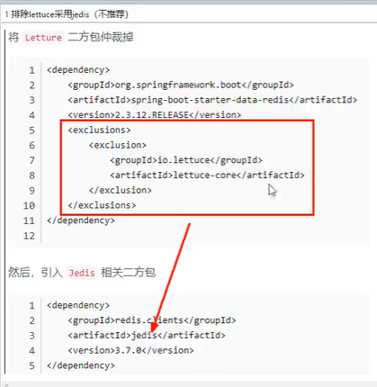

# SpringBoot集成Redis

本地Java连接Redis常见问题

- bind配置注释掉
- 保护模式设置为no
- Linux系统的防火墙设置
- redis服务器的IP地址和密码是否正确
- redis的服务的端口号和auth密码

## 集成Jedis

### 概述

Jedis Client是Redis官网推荐的一个面向Java客户端，库文件实现了对各类API进行封装调用

### 操作步骤

1、新建项目模块

2、在<code>pom.xml</code>引入依赖坐标

```xml
<!--jedis依赖-->
<dependency>
     <groupId>redis.clients</groupId>
     <artifactId>jedis</artifactId>
     <version>5.0.0-alpha2</version>
</dependency>
```

3、编写代码

```java
package com.huang.springboot_redis.demo;
import redis.clients.jedis.Jedis;
import java.util.*;

/**
 * @Author HYL
 * @Date 2023/6/20 9:57
 * @Version 1.0
 */
public class JedisDemo {
    private static final String REDIS_IP = "192.168.197.132";
    private static final int REDIS_PORT = 6379;

    public static void main(String[] args) {
        // 1、指定IP和端口获得连接
        Jedis jedis = new Jedis(REDIS_IP, REDIS_PORT);

        // 2、指定访问服务器的密码
        jedis.auth("123456");

        // 3、获得到jedis客户端，可以操作了
        String ping = jedis.ping();
        System.out.println(ping);

        // keys
        Set<String> keys = jedis.keys("*");
        System.out.println(keys);

        // string
        jedis.set("k3", "hello-jedis");
        System.out.println(jedis.get("k3"));
        System.out.println(jedis.ttl("k3"));
        jedis.expire("k3", 20L);

        // list
        jedis.lpush("list", "11", "12", "13");
        List<String> list = jedis.lrange("list", 0, -1);
        for (String element : list) {
            System.out.print(element + " ");
        }
        System.out.println();

        // set
        jedis.sadd("orders", "jd001");
        jedis.sadd("orders", "jd002");
        jedis.sadd("orders", "jd003");
        Set<String> orders = jedis.smembers("orders");

        for (Iterator<String> iterator = orders.iterator(); iterator.hasNext(); ) {
            String next = iterator.next();
            System.out.print(next + " ");
        }
        System.out.println();
        jedis.srem("orders", "jd002");
        System.out.println(jedis.smembers("orders").size());

        // hash
        jedis.hset("hash1", "username", "lisi");
        System.out.println(jedis.hget("hash1", "username"));

        Map<String, String> map = new HashMap<>();
        map.put("telephone", "124421521414");
        map.put("address", "safas");
        map.put("email", "qeaf@qq.com");
        jedis.hmset("hash2", map);

        // zset
        jedis.zadd("zset01", 60D, "v1");
        jedis.zadd("zset01", 70D, "v2");
        jedis.zadd("zset01", 80D, "v3");

        List<String> zset01 = jedis.zrange("zset01", 0, -1);
        zset01.forEach(System.out::println);
    }
}
```

## 集成Lettuce

### 概述

jedis和Lettuce都是Redis的客户端，它们都可以连接Redis服务器，但是在SpringBoot2.0之后默认都是使用的Lettuce这个客户端连接Redis服务器。因为当使用Jedis客户端连接Redis服务器的时候，每个线程都要拿自己创建的Jedis实例去连接Redis客户端，当有很多个线程的时候，不仅开销大需要反复的创建关闭一个Jedis连接，而且也是线程不安全的，一个线程通过Jedis实例更改Redis服务器中的数据之后会影响另一个线程。

但是如果使用Lettuce这个客户端连接Redis服务器的时候，就不会出现上面的情况,Lettuce底层使用的是Netty,当有多个线程都需要连接Redis服务器的时候，可以保证只创建一个Lettuce连接，使所有的线程共享这一个Lettuce连接，这样可以减少创建关闭一个Lettuce连接时候的开销;而且这种方式也是线程安全的，不会出现一个线程通过Lettuce更改Redis服务器中的数据之后而影响另—个线程的情况。

### 操作步骤

1、导入pom依赖

```xml
<dependency>
    <groupId>io.lettuce</groupId>
    <artifactId>lettuce-core</artifactId>
    <version>6.1.10.RELEASE</version>
</dependency>
```

2、编写代码

```java
package com.huang.springboot_redis.demo;

import io.lettuce.core.RedisClient;
import io.lettuce.core.RedisURI;
import io.lettuce.core.SortArgs;
import io.lettuce.core.api.StatefulRedisConnection;
import io.lettuce.core.api.sync.RedisCommands;

import java.util.HashMap;
import java.util.List;
import java.util.Map;
import java.util.Set;

/**
 * @Author HYL
 * @Date 2023/6/20 16:08
 * @Version 1.0
 */
public class LettuceDemo {

    private static final String REDIS_IP = "192.168.197.132";
    private static final int REDIS_PORT = 6379;

    public static void main(String[] args) {
        // 1、使用构建器链式编程来builder RedisURI
        RedisURI uri = RedisURI.Builder
                .redis(REDIS_IP)
                .withPort(REDIS_PORT)
                .withAuthentication("default", "123456")
                .build();

        // 2、创建连接客户端
        RedisClient redisClient = RedisClient.create(uri);
        StatefulRedisConnection connect = redisClient.connect();

        // 3、创建操作的command
        RedisCommands commands = connect.sync();

        // =======各种操作========
        // keys
        List keys = commands.keys("*");
        System.out.println(keys);
        // string
        commands.set("k1", "11111");
        String k1 = (String) commands.get("k1");
        System.out.println(k1);
        //list
        commands.lpush("myList2", "v1", "v2", "v3", "v3");
        List myList2 = commands.lrange("myList2", 0, -1);
        for (Object o : myList2) {
            System.out.println(o);
        }
        //set
        commands.sadd("mySet2", "v1", "v2", "v3", "v3");
        Set mySet2 = commands.smembers("mySet2");
        for (Object o : mySet2) {
            System.out.println(o);
        }
        //hash
        Map<String, String> map = new HashMap<>();
        map.put("k1", "12124521312");
        map.put("k2", "asfadf");
        map.put("k3", "gsasaf@qq.com");
        commands.hset("myHash2", map);
        Map<String, String> myHash2 = commands.hgetall("myHash2");
        for (String k : myHash2.keySet()) {
            System.out.println("hash k=" + k + ",v=" + myHash2.get(k));
        }
        //zset
        commands.zadd("myZset2", 100, "s1", 110, "s2", 90, "s3");
        List myZset2 = commands.zrange("myZset2", 0, -1);
        for (Object o : myZset2) {
            System.out.println(o);
        }
        // sort
        SortArgs sortArgs = new SortArgs();
        sortArgs.alpha();
        sortArgs.desc();

        List myList21 = commands.sort("myList2", sortArgs);
        for (Object o : myList21) {
            System.out.println(o);
        }
        // =======各种操作========

        // 4、各种关闭释放资源
        connect.close();
        redisClient.shutdown();

    }
}
```

## 集成RedisTemplate – 推荐使用

#### 连接单机

#### 1、导入依赖

```xml
<dependency>
    <groupId>org.springframework.boot</groupId>
    <artifactId>spring-boot-starter-data-redis</artifactId>
</dependency>
<dependency>
    <groupId>org.apache.commons</groupId>
    <artifactId>commons-pool2</artifactId>
</dependency>
<dependency>
    <groupId>io.springfox</groupId>
    <artifactId>springfox-swagger2</artifactId>
    <version>2.9.2</version>
</dependency>
<dependency>
    <groupId>io.springfox</groupId>
    <artifactId>springfox-swagger-ui</artifactId>
    <version>2.9.2</version>
</dependency>
```

#### 2、修改yml文件

```yaml
server.port=7777
spring.application.name=springboot_redis
# ========================logging=====================
logging.level.root=info
logging.level.com.atguigu.redis7=info
logging.pattern.console=%d{yyyy-MM-dd HH:mm:ss.SSS} [%thread] %-5level %logger- %msg%n 
logging.file.name=D:/mylogs2023/redis7_study.log
logging.pattern.file=%d{yyyy-MM-dd HH:mm:ss.SSS} [%thread] %-5level %logger- %msg%n
# ========================swagger=====================
spring.swagger2.enabled=true
#在springboot2.6.X结合swagger2.9.X会提示documentationPluginsBootstrapper空指针异常，
#原因是在springboot2.6.X中将SpringMVC默认路径匹配策略从AntPathMatcher更改为PathPatternParser，
# 导致出错，解决办法是matching-strategy切换回之前ant_path_matcher
spring.mvc.pathmatch.matching-strategy=ant_path_matcher
# ========================redis单机=====================
spring.redis.database=0
# 修改为自己真实IP
spring.redis.host=192.168.197.132
spring.redis.port=6379
spring.redis.password=123456
spring.redis.lettuce.pool.max-active=8
spring.redis.lettuce.pool.max-wait=-1ms
spring.redis.lettuce.pool.max-idle=8
spring.redis.lettuce.pool.min-idle=0
```

#### 3、配置类

[RedisConfig.java](http://RedisConfig.java)

```java
package com.huang.springboot_redis.config;

import org.springframework.context.annotation.Bean;
import org.springframework.context.annotation.Configuration;
import org.springframework.data.redis.connection.lettuce.LettuceConnectionFactory;
import org.springframework.data.redis.core.RedisTemplate;
import org.springframework.data.redis.serializer.GenericJackson2JsonRedisSerializer;
import org.springframework.data.redis.serializer.StringRedisSerializer;

/**
 * @Author HYL
 * @Date 2023/6/20 17:14
 * @Version 1.0
 */

@Configuration
public class RedisConfig {
    /**
     * redis序列化的工具配置类，下面这个请一定开启配置
     * 127.0.0.1:6379> keys *
     * 1) "ord:102"  序列化过
     * 2) "\xac\xed\x00\x05t\x00\aord:102"   野生，没有序列化过
     * this.redisTemplate.opsForValue(); //提供了操作string类型的所有方法
     * this.redisTemplate.opsForList(); // 提供了操作list类型的所有方法
     * this.redisTemplate.opsForSet(); //提供了操作set的所有方法
     * this.redisTemplate.opsForHash(); //提供了操作hash表的所有方法
     * this.redisTemplate.opsForZSet(); //提供了操作zset的所有方法
     */
    @Bean
    public RedisTemplate<String, Object> redisTemplate(LettuceConnectionFactory lettuceConnectionFactory) {
        RedisTemplate<String, Object> redisTemplate = new RedisTemplate<>();

        redisTemplate.setConnectionFactory(lettuceConnectionFactory);
        //设置key序列化方式string
        redisTemplate.setKeySerializer(new StringRedisSerializer());
        //设置value的序列化方式json，使用GenericJackson2JsonRedisSerializer替换默认序列化
        redisTemplate.setValueSerializer(new GenericJackson2JsonRedisSerializer());

        redisTemplate.setHashKeySerializer(new StringRedisSerializer());
        redisTemplate.setHashValueSerializer(new GenericJackson2JsonRedisSerializer());

        redisTemplate.afterPropertiesSet();

        return redisTemplate;
    }
}
```

[SwaggerConfig.java](http://SwaggerConfig.java)

```java
package com.huang.springboot_redis.config;

import org.springframework.beans.factory.annotation.Value;
import org.springframework.context.annotation.Bean;
import org.springframework.context.annotation.Configuration;
import springfox.documentation.builders.ApiInfoBuilder;
import springfox.documentation.builders.PathSelectors;
import springfox.documentation.builders.RequestHandlerSelectors;
import springfox.documentation.service.ApiInfo;
import springfox.documentation.spi.DocumentationType;
import springfox.documentation.spring.web.plugins.Docket;
import springfox.documentation.swagger2.annotations.EnableSwagger2;

import java.time.LocalDateTime;
import java.time.format.DateTimeFormatter;

/**
 * @Author HYL
 * @Date 2023/6/20 17:18
 * @Version 1.0
 */

@Configuration
@EnableSwagger2
public class SwaggerConfig {
    @Value("${spring.swagger2.enabled}")
    private Boolean enabled;

    @Bean
    public Docket createRestApi() {
        return new Docket(DocumentationType.SWAGGER_2)
                .apiInfo(apiInfo())
                .enable(enabled)
                .select()
                .apis(RequestHandlerSelectors.basePackage("com.huang.springboot_redis")) //你自己的package
                .paths(PathSelectors.any())
                .build();
    }

    public ApiInfo apiInfo() {
        return new ApiInfoBuilder()
                .title("springboot利用swagger2构建api接口文档 " + "\t" +
                        DateTimeFormatter.ofPattern("yyyy-MM-dd").format(LocalDateTime.now()))
                .description("springboot+redis整合")
                .version("1.0")
                .termsOfServiceUrl("https://haomin.blog.csdn.net/")
                .build();
    }
}
```

[OrderService.java](http://OrderService.java)

```java
package com.huang.springboot_redis.service;

import lombok.extern.slf4j.Slf4j;
import org.springframework.beans.factory.annotation.Autowired;
import org.springframework.data.redis.core.RedisTemplate;
import org.springframework.data.redis.core.StringRedisTemplate;
import org.springframework.stereotype.Service;

import javax.annotation.Resource;
import java.util.UUID;
import java.util.concurrent.ThreadLocalRandom;

/**
 * @Author HYL
 * @Date 2023/6/20 21:24
 * @Version 1.0
 */
@Service
@Slf4j
public class OrderService {

    public static final String ORDER_KEY = "ord:";

    @Resource
    private RedisTemplate redisTemplate;
//    private StringRedisTemplate redisTemplate;

    public void addOrder() {
        int keyId = ThreadLocalRandom.current().nextInt(1000) + 1;
        String serialNo = UUID.randomUUID().toString();

        String key = ORDER_KEY + keyId;
        String value = "京东订单" + serialNo;

        redisTemplate.opsForValue().set(key, value);

        log.info("key:{}", key);
        log.info("value:{}", value);
    }

    public String getOrderById(Integer keyId) {
        return (String) redisTemplate.opsForValue().get(ORDER_KEY + keyId);
    }
}
```

[OrderController.java](http://OrderController.java)

```java
package com.huang.springboot_redis.controller;

import com.huang.springboot_redis.service.OrderService;
import io.swagger.annotations.Api;
import io.swagger.annotations.ApiOperation;
import lombok.extern.slf4j.Slf4j;
import org.springframework.web.bind.annotation.*;

import javax.annotation.Resource;

/**
 * @Author HYL
 * @Date 2023/6/20 21:39
 * @Version 1.0
 */
@RestController
@Slf4j
@Api(tags = "订单接口")
public class OrderController {

    @Resource
    private OrderService orderService;

    @ApiOperation("新增订单")
    @PostMapping("/order/add")
    public void addOrder() {
        orderService.addOrder();
    }

    @ApiOperation("按照keyId查订单")
    @GetMapping("/order/{keyId}")
    public String getOrderById(@PathVariable("keyId") Integer keyId) {
        return orderService.getOrderById(keyId);
    }
}
```

#### 4、测试

访问 [http://localhost:7777/swagger-ui.html](http://localhost:7777/swagger-ui.html)

使用RedisTemplate会出现序列化乱码的问题，[所以配置了RedisConfig.java](http://%E6%89%80%E4%BB%A5%E9%85%8D%E7%BD%AE%E4%BA%86RedisConfig.java)这个配置类。这样就解决乱码了。为什么会乱码？是因为序列化默认使用的是jdk的序列化方法<code>JdkSerializationRedisSerializer</code>。使用<code>StringRedisSerializer</code>就不会乱码了。

#### 连接集群

在前面单机的基础上，进一步修改

#### 1、修该yml文件

```yaml
# ========================redis集群=====================
spring.redis.password=111111
# 获取失败 最大重定向次数
spring.redis.cluster.max-redirects=3
spring.redis.lettuce.pool.max-active=8
spring.redis.lettuce.pool.max-wait=-1ms
spring.redis.lettuce.pool.max-idle=8
spring.redis.lettuce.pool.min-idle=0
spring.redis.cluster.nodes=***.***.***.***:6381,***.***.***.***:6382 (主机:port)
```

#### 2、测试

访问 [http://localhost:7777/swagger-ui.html](http://localhost:7777/swagger-ui.html)

#### 3、一台master宕机，java报错

<ul>
<li></li>
</ul>

让master-6381宕机，shutdown

<ul>
<li></li>
</ul>

查看集群信息 ，看slave是否上位 Cluster nodes

<ul>
<li></li>
</ul>

我们客户端再次读写

<ul>
<li></li>
</ul>

原因是因为SpringBoot客户端没有动态感知到RedisCluster的最新集群信息

<ul>
<li></li>
</ul>

导致这个的原因是：

<ul>
<li>
Spring Boot 2.x，Redis默认的连接池是 Lettuce
</li>
<li>
当Redis集群节点发生变化后，Lettuce默认是不会刷新节点拓扑
</li>
<li></li>
</ul>

解决方法：

<ul>
<li></li>
</ul>

排除Lettuce采用jedis（不推荐）



<ul>
<li></li>
</ul>

重写连接工厂实例（极度不推荐）

<ul>
<li></li>
</ul>

刷新节点集群拓扑动态感应（推荐）

重新修改yml文件，增加定时刷新，开启动态感应

```yaml
# ========================redis集群=====================
spring.redis.password=111111
# 获取失败 最大重定向次数
spring.redis.cluster.max-redirects=3
spring.redis.lettuce.pool.max-active=8
spring.redis.lettuce.pool.max-wait=-1ms
spring.redis.lettuce.pool.max-idle=8
spring.redis.lettuce.pool.min-idle=0
 
# ========================新增=====================
#支持集群拓扑动态感应刷新,自适应拓扑刷新是否使用所有可用的更新，默认false关闭
spring.redis.lettuce.cluster.refresh.adaptive=true
#定时刷新
spring.redis.lettuce.cluster.refresh.period=2000
 
spring.redis.cluster.nodes=***.***.***.***:6381,***.***.***.***:6382 (主机:port)
```

---

在此redis基础已全部完成！！
