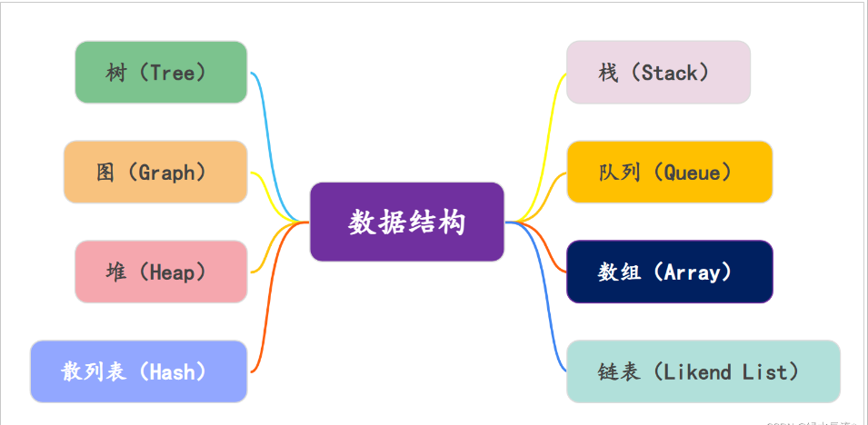
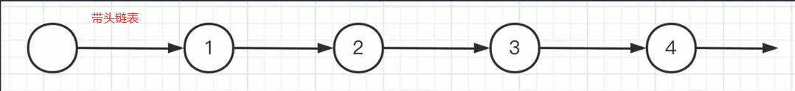
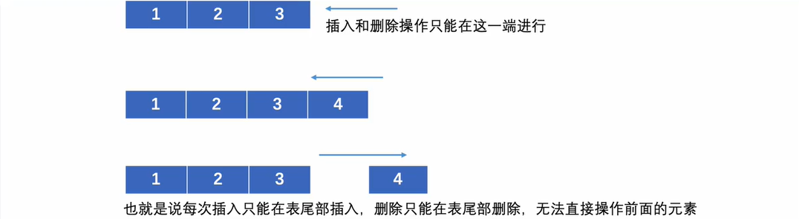
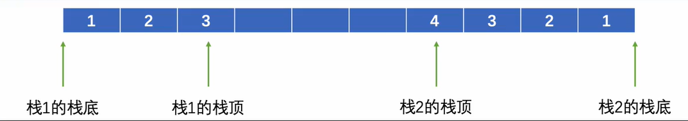
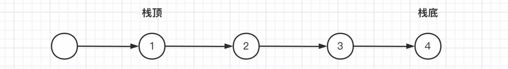
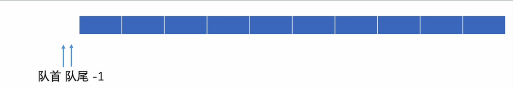
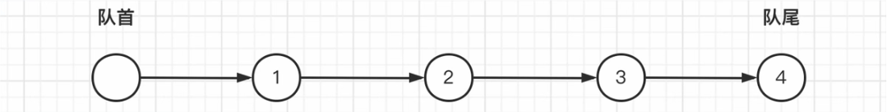

## 什么是数据结构与算法

### 数据结构

数据结构是计算机存储、组织数据的方式。数据结构是指相互之间存在一种或多种特定关系的[数据元素](https://baike.baidu.com/item/%E6%95%B0%E6%8D%AE%E5%85%83%E7%B4%A0/715313?fromModule=lemma_inlink)的集合。通常情况下，精心选择的数据结构可以带来更高的运行或者存储效率。数据结构往往同高效的检索算法和索引技术有关。

数据结构有哪些，看下图



### 算法

算法是利用计算机解决问题的处理步骤，简而言之，<b>算法就是解决问题的步骤</b>

不同的算法，执行效率有很大的差别。衡量一个算法的复杂程度需要用到以下两个指标：

- 时间复杂度T(n)：算法程序在执行时消耗的时间长度，一帮与输入数据的规模n有关。
- 空间复杂度S(n)：算法程序在执行时占用的存储单元长度，同样与数据的输入规模有关，大部分情况下，我们采用空间换时间。

以下是常见的各种复杂度

<table class="legacy-table">
<thead>
<tr>
<th align="center">函数</th>
<th align="center">类型</th>
<th align="center">描述</th>
</tr>
</thead>
<tbody><tr>
<td align="center">O(1)</td>
<td align="center">常数阶</td>
<td align="center">最快的算法描述</td>
</tr>
<tr>
<td align="center">O(log<del>2</del>n)</td>
<td align="center">对数阶</td>
<td align="center">仅次于常数阶，比如二分搜索算法</td>
</tr>
<tr>
<td align="center">O(n)</td>
<td align="center">线性阶</td>
<td align="center">线性表的插入、删除，包括动态规划能够达到线性阶</td>
</tr>
<tr>
<td align="center">O(n log<del>2</del>n)</td>
<td align="center">线性对数阶</td>
<td align="center">相当于在对数阶的基础上再套了一层线性阶循环</td>
</tr>
<tr>
<td align="center">$O(n^2)$</td>
<td align="center">平方阶</td>
<td align="center">需要进行两轮循环的，一般都为平方阶。比如：冒泡排序</td>
</tr>
<tr>
<td align="center">$O(n^3)$</td>
<td align="center">立方阶</td>
<td align="center">三层循环。比如：暴力枚举</td>
</tr>
<tr>
<td align="center">$O(2^n)$</td>
<td align="center">指数阶</td>
<td align="center">递归，比如：斐波那契数递归算</td>
</tr>
<tr>
<td align="center">$O(n!)$</td>
<td align="center">阶乘</td>
<td align="center">比指数阶还复杂，一般很少算法到达</td>
</tr>
</tbody></table>

### 案例：二分搜索

现有一个从小到大的排序数组，给你一个目标值<code>target</code>，现请你找到数组中的对应下标，如果没有，则返回-1

方法一：

暴力循环

```c
int search(int* nums,int numsSize,int target){
    for(int i = 0; i < numsSize; ++i){
        if(nums[i]==target) {
            return i;
        }
    }
    return -1;
}
```

方法二：

二分查找–循环（推荐）

```c
int search(int* nums,int numsSize,int target){
    int left = 0;
    int right = numsSize - 1;
    while(left > right){
        int mid = (left + right) / 2;
        if(nums[mid] == target){
            return mid;
        }
        if(nums[mid] < target){
            left = mid + 1;
        }else{
            right = mid - 1;
        }
    }
    return -1;
}
```

二分查找–递归（推荐）

```c
int binarySearch(int* nums, int target, int left, int right){
    if(left > right) return -1;
    int mid = (left + right) / 2;
    if(nums[mid] == target) return mid;
    if(nums[mid] < target) 
        return binarySearch(nums, target, mid + 1, right);
    else 
        return binarySearch(nums, target, left,  mid - 1);
}

int search(int* nums,int numsSize,int target){
    return binarySearch(nums, target, 0, numsSize - 1);
}
```

## 线性表

我们希望将这些数据顺序存放，并且支持在某个位置插入一条数据、删除一条数据、修改一些数据，这时候，数组就显得乏力了。因此需要使用更加高级的数据结构，就是线性表（Linear List）

线性表是由一个类型的数据元素构成的有序存放的线性结构。线性表中元素的个数为线性表的长度，表的起始位称为表头，结束位称为表尾。当表中没有一个数据时，称为空表。

线性表一包含以下功能：

- \*\*初始化线性表：\*\*将一个线性表初始化，得到一个空表。
- \*\*获取指定位置的元素：\*\*直接获取线性表指定位置 $i$ 上的元素
- \*\*获取元素位置：\*\*获取某个元素在线性表上的位置 $i$
- \*\*插入元素：\*\*在指定位置 $i$ 上插入一个元素
- \*\*删除元素：\*\*删除指定位置 $i$ 上的一个元素
- \*\*获取长度：\*\*返回线性表的长度

### 顺序表

前面我们说到，既然数组无法实现这样的高级表结构，那么我就基于数组，对其进行强化，也就是说，我们存放数据还是使用数组,但是我们可以为其编写一些额外的操作来强化为线性表，像这样底层依然采用顺序存储实现的线性表，我们称为顺序表。

这里可以定义一个新的结构体类型，将

```c
typedef int E;

struct List{
    E * array;    // 表示指向顺序表的底层数组
    int capacity; // 表示数组的容量
    int size;  // 表示表中元素的数量
}
```

<b>初始化线性表</b>

```c
typedef struct List * ArrayList;  // 起别名

void initList(ArrayList list){
    list->array = molloc(sizeof(int) * 10);// 给array分配内存空间
list->capacity = 10;  // 设置容量大小为10
    list->size = 0;  // 设置元素个数为0，因为没有插入值
}
```

还有一种情况需要考虑，如果申请内存空间失败，需要返回一个结果告诉使用者

```c
int initList(ArrayList list){
    list->array = molloc(sizeof(int) * 10);
    if(list->array == NULL) return 0;// 如果申请内存失败
list->capacity = 10;  
    list->size = 0;
    return 1;// 正常返回1
}
```

这样一个简单的顺序表就定义好了，我们可以通过<code>initList</code>函数来初始化

```c
int main(){
    struct List list;// 创建新的结构体变量
    if(initList(&list)){
        printf("初始化成功，可进行后续操作！")
        ...
    }else{
        printf("初始化失败！")
    }
}
```

<b>插入数据到线性表</b>

```c
int insertList(ArrayList list,E element,int index){
    // 判断插入的位置是否越界
    if(index < 1 || index > list->size + 1){
        return 0;
    }
    // 如果顺序表里的元素已经到达底层数组的最大值，此时需扩容
    if(list->size == list.capacity){
        // 我们先计算一下容器的大小，这里用的1.5倍
        int newCapacity = list->capacity + (list->capacity >> 1);
        // 这里使用新的函数realloc重新申请内存空间
        E * newArray = realloc(list->array, newCapacity * sizeof(E));
        // 如果申请失败则返回空
        if (newArray == NULL)
            return 0;
        list->array = newArray;
        list->capacity = newCapacity;
    }
    // 在指定位置插入数据
    for(int i = list->size; i > index - 1; --i){
        list->array[i] = list->array[index - 1];
    }
    // 首先刚初始化线性表时，插入数据
    list->array[index - 1] = element;
    list->size++;  // 表中元素加一
    return 1;
}
```

<b>删除数据</b>

```c
int deleteList(ArrayList list, int index)
{
    // 判断越界条件
    if (index < 1 || index > list->size){
        return 0;
    }
    // 删除数据
    for (int i = index - 1; i < list->size - 1; i++){
        list->array[i] = list->array[i + 1];
    }
    list->size--;
    return 1;
}
```

<b>获取元素个数</b>

```c
int sizeList(ArrayList list){
return list->size;
}
```

<b>获取指定位置数据</b>

```c
E get(ArrayList list,int index){
    // 如果越界则返回-1
    if(index < 1 || index > list.size){
        return -1;
    }
    return list->array[index-1];
}
```

<b>获取指定数据的索引</b>

```c
int getIndex(ArrayList list,E element){
    // 遍历，如果找到返回索引下标，如果没找到就返回-1
    for(int i = 0; i < list->size; ++i){
        if(list->array[i] == element){
            return i;
        } 
    }
    return -1;
}
```

### 链表

链表不同于顺序表，顺序表底层采用数组作为存储容器，需要分配一块连续且完整的内存空间进行使用，而链表则不需要，它通过一个指针来连接各个分散的结点，形成了一个链状的结构，每个结点存放一个元素，以及一个指向下一个结点的指针，通过这样一个一个相连，最后形成了链表。它不需要申请连续的空间，只需要按照顺序连接即可，虽然物理上可能不相邻，但是在逻辑上依然是每个元素相邻存放的，这样的结构叫做链表（单链表)。

链表分为带头结点的链表和不带头结点的链表。戴头结点的链表就是会有一个头结点指向后续的整个链表，但是头结点不存放数据。如下图



而不带头结点的链表就是第一个节点就是存放数据的结点，一般设计链表都会采用带头结点的结构，因为操作更加方便。如下图


下面我们写一个带头节点的链表并且初始化

```c
typedef int E;
typedef struct ListNode *Node;

struct ListNode {
    E element;  // 保存当前元素
    Node next;  // 指向下一个结点
};

// 初始化函数
void initList(Node node) {
    node->next = NULL;
}
```

接着我们来设计链表的插入和删除，前面顺序表是通过移动数据的位置来进行插入和删除，那么链表插入应该怎么样呢？

- 首先我们得让新插入结点的指针指向当前位置结点的地址，使当前结点变为新的结点的<b>后继结点</b>
- 然后上一个结点的指针指向新插入的结点的地址，使上一个结点变为新的结点的<b>前驱结点</b>

插入结点具体代码：

```c
// 插入结点
int insertList(Node head, E element, int index) {
    // 判断是否越界
    if (index < 1) return 0;
    // 到指定位置去
    while (--index) {
        head = head->next;
        // 判断是否越界
        if (head == NULL) return 0;
    }
    // 申请结点
    Node node = malloc(sizeof(struct ListNode));
    // 判断结点是否为空
    if (node == NULL) return 0;
    node->element = element;
    // 连接结点
    node->next = head->next;
    head->next = node;
    return 1;
}
```

删除结点：

```c
// 删除结点
int deleteList(Node head, int index) {
    if (index < 1) return 0;
    while (--index) {
        head = head->next;
        // 判断是否越界
        if (head == NULL) return 0;
    }
    if (head->next == NULL) return 0;
    // 先用临时变量存放待删除结点，之后释放
    Node temp = head->next;
    head->next = head->next->next;
    free(temp);
    return 1;
}
```

查找指定位置数据：

```c
// 获取指定位置的数据
E get(Node head, int index) {
    if (index < 1) return 0;
    do {
        head = head->next;
        if (head == NULL) return 0;
    } while (--index);
    return head->element;
}
```

查找对应元素的位置：

```c
int getIndex(Node head, E element) {
    // 因为头节点没数据，所以先移到第一个节点
    head = head->next;
    int i = 0;  // 计数器，求该数据在链表的位置
    while (head) {
        if (head->element == element) {
            return i;
        }
        head = head->next;
        i++;
    }
    return -1;
}
```

获取链表长度：

```c
int sizeList(Node head){
int i = 0;
    while(head->next){
        head = head->next;
        i++;
    }
    return i;
}
```

完整代码：

```c
//
// Created by User on 2023/6/22.
//
#include <stdio.h>
#include <stdlib.h>

typedef int E;
typedef struct ListNode *Node;

struct ListNode {
    E element;  // 保存当前元素
    Node next;  // 指向下一个结点
};

// 初始化函数
void initList(Node node) {
    node->next = NULL;
}

// 插入结点
int insertList(Node head, E element, int index) {
    // 判断是否越界
    if (index < 1) return 0;
    // 到指定位置去
    while (--index) {
        head = head->next;
        // 判断是否越界
        if (head == NULL) return 0;
    }
    // 申请结点
    Node node = malloc(sizeof(struct ListNode));
    // 判断结点是否为空
    if (node == NULL) return 0;
    node->element = element;
    // 连接结点
    node->next = head->next;
    head->next = node;
    return 1;
}

// 删除结点
int deleteList(Node head, int index) {
    if (index < 1) return 0;
    while (--index) {
        head = head->next;
        // 判断是否越界
        if (head == NULL) return 0;
    }
    if (head->next == NULL) return 0;
    // 先用临时变量存放待删除结点，之后释放
    Node temp = head->next;
    head->next = head->next->next;
    free(temp);
    return 1;
}

// 获取指定位置的数据
E get(Node head, int index) {
    if (index < 1) return 0;
    do {
        head = head->next;
        if (head == NULL) return 0;
    } while (--index);
    return head->element;
}


int getIndex(Node head, E element) {
    head = head->next;
    int i = 0;
    while (head) {
        if (head->element == element) {
            return i;
        }
        head = head->next;
        i++;
    }
    return -1;
}

int sizeList(Node head) {
    int i = 0;
    while (head->next) {
        head = head->next;
        i++;
    }
    return i;
}

// 打印
void printList(Node head) {
    while (head->next) {
        head = head->next;
        printf("%d ", head->element);
    }
    printf("\n");
}

int main() {
    struct ListNode head;
    initList(&head);
    printf("%d\n", sizeList(&head));
    for (int i = 1; i <= 3; ++i) {
        insertList(&head, i * 100, i);
    }
    printList(&head);
    deleteList(&head, 2);
    printList(&head);
    printf("%d\n", get(&head, 2));
    printf("%d\n", getIndex(&head, 300));
    printf("%d\n", sizeList(&head));
    return 0;
}
```

\*\*问题：\*\*什么情况使用顺序表，什么情况使用链表呢？

- 通过分析顺序表和链表的特性我们不难发现，链表在随机访问元素时，需要通过遍历来完成，而顺序表则利用数组的特性直接访问得到，所以，当我们读取数据多于插入或是删除数据的情况下时，使用顺序表会更好。
- 而顺序表在插入元素时就显得有些鸡肋了，因为需要移动后续元素，整个移动操作会浪费时间，而链表则不需要，只需要修改结点指向即可完成插入，所以在频繁出现插入或删除的情况下，使用链表会更好。

总结：当<b>读大于写</b>时，顺序表比链表好；当<b>写大于读</b>时，链表比顺序表好。

### 双向链表

前面我们介绍了单链表，通过这样的链式存储，我们不用再像顺序表那样一次性申请一段连续的空间，而是只需要单独为结点申请内存空间，同时在插入和删除的速度上也比顺序表轻松。不过有一个问题就是，如果我们想要操作某一个结点，比如删除或是插入，那么由于单链表的性质，我们只能先去找到它的前驱结点，才能进行。

为了解决这种查找前驱结点非常麻烦的问题，我们可以让结点不仅保存指向后续结点的指针，同时也保存指向前驱结点的指针;


下面我们尝试实现下双向链表，首先自定义好结构体：

```c
#include <stdio.h>
#include <stdlib.h>
typedef int E;
typedef struct ListNode *Node;

struct ListNode {
    E element;
    Node prev;
    Node next;
};
```

然后初始化方法，初始化时前驱和后继都要设置为NULL：

```c
// 初始化方法
void initList(Node head) {
    head->prev = head->next = NULL;
}

int main() {
    struct ListNode head;
    initList(&head);
    return 0;
}
```

插入操作：

```c
// 插入操作
int insertList(Node head, E element, int index) {
    // 首先判断是否越界
    if (index < 1) return 0;
    // 移到指定位置
    while (--index) {
        head = head->next;
        if (head == NULL) return 0;
    }
    Node node = malloc(sizeof(struct ListNode));
    if (node == NULL) return 0;

    node->element = element;

    if (head->next != NULL) {
        node->next = head->next;
        head->next->prev = node;
    } else {
        node->next = NULL;
    }

    head->next = node;
    node->prev = head;

    return 1;
}
```

删除操作：

```c
// 删除操作
int deleteList(Node head, int index) {
    if (index < 1) return 0;
    while (--index) {
        head = head->next;
        if (head == NULL) return 0;
    }
    if (head->next == NULL) return 0;

    Node temp = head->next;
    if (head->next->next) {
        head->next = temp->next;
        temp->next->prev = head;
    } else {
        head->next = NULL;
    }
    free(temp);

    return 1;
}
```

完整代码：

```c
//
// Created by User on 2023/6/23.
// 双向链表
//
#include <stdio.h>
#include <stdlib.h>

typedef int E;
typedef struct ListNode *Node;

struct ListNode {
    E element;
    Node prev;
    Node next;
};

// 初始化方法
void initList(Node head) {
    head->prev = head->next = NULL;
}

// 插入操作
int insertList(Node head, E element, int index) {
    // 首先判断是否越界
    if (index < 1) return 0;
    // 移到指定位置
    while (--index) {
        head = head->next;
        if (head == NULL) return 0;
    }
    Node node = malloc(sizeof(struct ListNode));
    if (node == NULL) return 0;

    node->element = element;

    if (head->next != NULL) {
        node->next = head->next;
        head->next->prev = node;
    } else {
        node->next = NULL;
    }

    head->next = node;
    node->prev = head;

    return 1;
}

// 删除操作
int deleteList(Node head, int index) {
    if (index < 1) return 0;
    while (--index) {
        head = head->next;
        if (head == NULL) return 0;
    }
    if (head->next == NULL) return 0;

    Node temp = head->next;
    if (head->next->next) {
        head->next = temp->next;
        temp->next->prev = head;
    } else {
        head->next = NULL;
    }
     free(temp);

    return 1;
}

int main() {
    struct ListNode head;
    initList(&head);

    for (int i = 1; i <= 5; ++i) {
        insertList(&head, i * 10, i);
    }

    Node node = &head;

    deleteList(node,3);

    do {
        node = node->next;
        printf("%d -> ", node->element);
    } while (node->next != NULL);

    return 0;
}
```

### 循环链表

接着我们再来简单认识一下另一种类型的链表，循环链表，这种链表实际上和前面我们讲的链表是一样的，但是它的最后一个结点是与头结点相连的，双向链表和单向链表都可以做成这样的环形结构，我们这里以单链表为例:


这种类型的链表实际上与普通链表的唯一区别就在于最后是否连接到头结点，因此循环链表支持从任意一个结点出发都可以到达任何的结点，而普通的链表则只能从头结点出发才能到达任意结点，同样也是为了更灵活而设计的。

## 特殊线性表

### 栈

栈（也叫堆栈，stack）是一种特殊的线性表，只能在表尾进行插入和删除操作。如下图：



因此，它具有<b>先进后出</b>的特点。


底部称为<b>栈底</b>，顶部称为<b>栈顶</b>，所有操作只能在<b>栈顶</b>进行操作。之后栈顶操作完之后才能操作下面的，它是一种先进后出的数据结构（FILO，First In，Last Out）

- <code>pop</code>：出栈操作，在栈顶取出一个元素
- <code>push</code>：入栈操作，在栈顶压入一个元素

代码实现，首先定义结构体：

```c
typedef int E;
typedef struct Stack *ArrayStack;

struct Stack {
    E *array;
    int capacity;
    int top;  // 这里使用top来表示但前栈顶的位置
};
```

初始化操作：

```c
int initStack(ArrayStack stack) {
    stack->array = malloc(sizeof(E) * 10);
    if (stack->array == NULL) return 0;
    stack->capacity = 10;
    stack->top = -1;  // 初始化栈的时候，栈顶元素默认是-1，因为此时栈里还没有一个元素
    return 1;
}
```

入栈操作（插入）：

```c
// 入栈
int pushStack(ArrayStack stack, E element) {
    // 扩容
    if (stack->top + 1 == stack->capacity) {
        int newCapacity = stack->capacity + (stack->capacity >> 1);
        E *newArray = realloc(stack->array, newCapacity * sizeof(E));
        if (newArray == NULL)return 0;
        stack->array = newArray;
        stack->capacity = newCapacity;
    }
    stack->top++;
    stack->array[stack->top] = element;
    return 1;
}
```

判断栈是否为空：

```c
int isEmpty(ArrayStack stack) {
    return stack->top == -1;
}
```

出栈操作（删除）：

```c
// 出栈
E popStack(ArrayStack stack) {
    E num = stack->array[stack->top];
    stack->top--;
    return num;
}
```

完整代码：

```c
//
// Created by User on 2023/6/23.
//
#include <stdio.h>
#include <stdlib.h>

typedef int E;
typedef struct Stack *ArrayStack;

struct Stack {
    E *array;
    int capacity;
    int top;  // 这里使用top来表示但前栈顶的位置
};

// 初始化
int initStack(ArrayStack stack) {
    stack->array = malloc(sizeof(E) * 10);
    if (stack->array == NULL) return 0;
    stack->capacity = 10;
    stack->top = -1;  // 初始化栈的时候，栈顶元素默认是-1，因为此时栈里还没有一个元素
    return 1;
}

// 判断栈是否为空
int isEmpty(ArrayStack stack) {
    return stack->top == -1;
}

// 入栈
int pushStack(ArrayStack stack, E element) {
    // 扩容
    if (stack->top + 1 == stack->capacity) {
        int newCapacity = stack->capacity + (stack->capacity >> 1);
        E *newArray = realloc(stack->array, newCapacity * sizeof(E));
        if (newArray == NULL)return 0;
        stack->array = newArray;
        stack->capacity = newCapacity;
    }
    stack->top++;
    stack->array[stack->top] = element;
    return 1;
}

// 出栈
E popStack(ArrayStack stack) {
    E num = stack->array[stack->top];
    stack->top--;
    return num;
}


// 打印
void printStack(ArrayStack stack) {
    for (int i = 0; i <= stack->top; ++i) {
        printf("%d ", stack->array[i]);
    }
    printf("\n");
}

int main() {
    struct Stack stack;
    initStack(&stack);
    for (int i = 0; i < 11; ++i) {
        pushStack(&stack, i * 10);
    }
    printStack(&stack);
    while (!isEmpty(&stack)) {
        printf("%d ", popStack(&stack));
    }
    return 0;
}
```

有时候，栈的利用率比较低，这时候我们可以将一个固定长度的数组共享给两个栈使用：



数组的两头分别作为两个栈的栈底，当两个栈的栈顶指计相遇时（栈顶指针下标之差绝对值为1时)，表示栈已满。通过这种方式，我们就可以将数组占用的空间更充分地使用，这样的栈我们称为<b>共享栈</b>

前面我们使用了顺序表实现栈，下面我们演示通过链表来实现栈。



代码实现，先定义结构体并初始化栈

```c
typedef int E;
typedef struct LNode *Node;

struct LNode {
    E element;
    Node next;
};

void initStack(Node head) {
    head->next = NULL;
}
```

入栈（push）

```c
// 入栈
int pushStack(Node head, E element) {
    Node node = malloc(sizeof(struct LNode));
    if (node == NULL) return 0;
    node->element = element;
    node->next = head->next;
    head->next = node;
    return 1;
}
```

出栈（pop）

```c
// 出栈
E popStack(Node head) {
    Node temp = head->next;
    E e = temp->element;
    head->next = temp->next;
    free(temp);
    return e;
}

// 判空
int isEmpty(Node head) {
    if (head->next == NULL) return 1;
    else return 0;
}
```

遍历带头链栈

```c
// 遍历
void printStack(Node head) {
    head = head->next;
    while (head) {
        printf("%d ", head->element);
        head = head->next;
    }
    printf("| \n");
}
```

完整代码如下：

```c
//
// Created by HYL on 2023/6/25.
//

#include <stdio.h>
#include <stdlib.h>


typedef int E;
typedef struct LNode *Node;

struct LNode {
    E element;
    Node next;
};

void initStack(Node head) {
    head->next = NULL;
}

// 入栈
int pushStack(Node head, E element) {
    Node node = malloc(sizeof(struct LNode));
    if (node == NULL) return 0;
    node->element = element;
    node->next = head->next;
    head->next = node;
    return 1;
}

// 出栈
E popStack(Node head) {
    Node temp = head->next;
    E e = temp->element;
    head->next = temp->next;
    free(temp);
    return e;
}

// 判空
int isEmpty(Node head) {
    if (head->next == NULL) return 1;
    else return 0;
}

// 遍历
void printStack(Node head) {
    head = head->next;
    while (head) {
        printf("%d ", head->element);
        head = head->next;
    }
    printf("| \n");
}

int main() {
    struct LNode head;
    initStack(&head);
    for (int i = 0; i < 3; ++i) {
        pushStack(&head, i * 100);
    }
    printStack(&head);

    while (!isEmpty(&head)) {
        printf("%d ", popStack(&head));
    }
    return 0;
}
```

### 队列

队列像栈一样，也是一种特殊的线性表，不过它的特点是<b>先进先出</b>，就跟排队一样，经典的<b>生产者-消费者</b>问题中的缓冲区就是用的队列。

同样，队列也有两种实现方式。我们先看顺序表是如何实现的，一开始队列里没有元素，队首队尾一般初始值都是\*\*-1\*\*



\*\*入队：\*\*如果有新元素加入了，队尾向后移动一格（+1），然后在队尾所指的位置插入一个元素。

\*\*出队：\*\*如果要出队的话，那就是需要将队首向后移动一格，然后排除队首所指向的元素。

但是如果就采用普通的顺序表来实现的话，那不太现实，因为这指针会不断的往后移动，不断地申请内存空间，造成了很大的浪费。所以通常我们要采用<b>循环队列</b>的形式来实现重复使用的队列数组，不过这样就没办法扩容了。

顺序表队列代码实现：

自定义结构体，并初始化队列

```c
typedef int E;
typedef struct Queue *ArrayQueue;

struct Queue {
    int *array;
    int capacity;
    int front, rear;
};

int initQueue(ArrayQueue queue) {
    // 申请10个int类型大小的内存
    queue->array = malloc(sizeof(E) * 10);
    if (queue->array) return 0;
    queue->capacity = 10;
    queue->front = queue->rear = 0;
    return 1;
}
```

入队操作

```c
// 入队
int offerQueue(ArrayQueue queue, E element) {
    // 创建临时变量用来存储队尾指针的值
    int temp = (queue->rear + 1) % queue->capacity;
    // 判断该队列是否满,满了返回0
    if (temp == queue->front) return 0;
    // 移动队尾指针
    queue->rear = temp;
    // 在该位置给他赋值
    queue->array[queue->rear] = element;
    return 1;
}
```

出队操作

```c
// 出队
E pollQueue(ArrayQueue queue) {
    queue->front = (queue->front + 1) % queue->capacity;
    return queue->array[queue->front];
}

// 判断是否为空
int isEmpty(ArrayQueue queue) {
    return queue->rear == queue->front;
}
```

完整代码如下：

```c
//
// Created by HYL on 2023/6/30.
// 顺序表队列
//

#include <stdlib.h>
#include <stdio.h>

typedef int E;
typedef struct Queue *ArrayQueue;

struct Queue {
    int *array;
    int capacity;
    int front, rear;
};

int initQueue(ArrayQueue queue) {
    // 申请10个int类型大小的内存
    queue->array = malloc(sizeof(E) * 10);
    if (queue->array == NULL) return 0;
    queue->capacity = 10;
    queue->front = queue->rear = 0;
    return 1;
}

// 入队
int offerQueue(ArrayQueue queue, E element) {
    // 创建临时变量用来存储队尾指针的值
    int temp = (queue->rear + 1) % queue->capacity;
    // 判断该队列是否满,满了返回0
    if (temp == queue->front) return 0;
    // 移动队尾指针
    queue->rear = temp;
    // 在该位置给他赋值
    queue->array[queue->rear] = element;
    return 1;
}

// 出队
E pollQueue(ArrayQueue queue) {
    queue->front = (queue->front + 1) % queue->capacity;
    return queue->array[queue->front];
}

// 判断是否为空
int isEmpty(ArrayQueue queue) {
    return queue->rear == queue->front;
}


// 打印队列
void printQueue(ArrayQueue queue) {
    int i = queue->front; // 遍历队列需要从队首开始
    do {
        i = (i + 1) % queue->capacity;
        printf("%d ", queue->array[i]);
    } while (i != queue->rear);  // 当队首等于队尾时，结束
    printf("\n");
}

int main() {
    struct Queue queue;
    initQueue(&queue);

    for (int i = 0; i < 5; ++i) {
        offerQueue(&queue, i * 100);
    }
    printQueue(&queue);

    while (!isEmpty(&queue)) {
        printf("%d ", pollQueue(&queue));
    }

    return 0;
}
```

下面使用链表来创建队列。使用链表来创建队列的话就不用担心扩容的问题了，更加灵活。

在初始化时，我们需要两个指针来存队首和队尾，因为是单链表，所以队首需要存放指向头结点的指针，用来找到后面的数据，而队尾则直接指向尾结点即可。



\*\*入队：\*\*当有新的元素入队时，只需要在队尾拼接，然后队尾向后移动一位即可。

\*\*出队：\*\*当出队时，只需要移除队首指向下一个元素即可。

链表队列代码实现

首先定义结构体（因为有两个指向结点的队首队尾指针，所以得定义一个执行存放数据结点的结构体。相当于以队首为入口去查找存放数据的结点），然后初始化：

```c
typedef int E;
typedef struct LNode *Node;
typedef struct Queue *LinkedQueue;

// 结点
struct LNode {
    E element;
    Node next;
};

// 队首，队尾
struct Queue {
    // 指向结点的指针
    Node front, rear;
};

int initQueue(LinkedQueue queue) {
    Node node = malloc(sizeof(struct LNode));
    if (node == NULL) return 0;
    queue->rear = queue->front = node;
    return 1;
}
```

入队操作：

```c
int offerQueue(LinkedQueue queue, E element) {
    // 链表队列入队时要创建一个新的节点
    Node node = malloc(sizeof(struct LNode));
    if (node == NULL) return 0;
    // 将数据存入新创的结点的数据域
    node->element = element;
    // 让队尾指针指向新创的结点，使结点连接起来
    queue->rear->next = node;
    // 使队尾指针向后移动一位
    queue->rear = node;
    node->next = NULL;
    return 1;
}
```

出队操作：

```c
E pollQueue(LinkedQueue queue) {
    // 拿到待出队的下一个结点
    Node temp = queue->front->next;
    E e = temp->element;
    // 让其头结点指向它下一个的下一个
    queue->front->next = temp->next;
    // 如果队首指向的结点等于队尾了，则说明没有元素了，就要将队尾移到头结点
    if (queue->rear == temp) queue->rear = queue->front;
    free(temp);
    return e;
}
```

完整代码如下：

```c
//
// Created by HYL on 2023/6/30.
//
#include <stdio.h>
#include <stdlib.h>

typedef int E;
typedef struct LNode *Node;
typedef struct Queue *LinkedQueue;

// 结点
struct LNode {
    E element;
    Node next;
};

// 队首，队尾
struct Queue {
    // 指向结点的指针
    Node front, rear;
};

int initQueue(LinkedQueue queue) {
    Node node = malloc(sizeof(struct LNode));
    if (node == NULL) return 0;
    queue->rear = queue->front = node;
    return 1;
}

int offerQueue(LinkedQueue queue, E element) {
    // 链表队列入队时要创建一个新的节点
    Node node = malloc(sizeof(struct LNode));
    if (node == NULL) return 0;
    // 将数据存入新创的结点的数据域
    node->element = element;
    // 让队尾指针指向新创的结点，使结点连接起来
    queue->rear->next = node;
    // 使队尾指针向后移动一位
    queue->rear = node;
    node->next = NULL;
    return 1;
}

E pollQueue(LinkedQueue queue) {
    // 拿到待出队的下一个结点
    Node temp = queue->front->next;
    E e = temp->element;
    // 让其头结点指向它下一个的下一个
    queue->front->next = temp->next;
    // 如果队首指向的结点等于队尾了，则说明没有元素了，就要将队尾移到头结点
    if (queue->rear == temp) queue->rear = queue->front;
    free(temp);
    return e;
}

int isEmpty(LinkedQueue queue) {
    return queue->rear == queue->front;
}

void printQueue(LinkedQueue queue) {
    Node node = queue->front->next;
    while (node) {
        printf("%d ", node->element);
        node = node->next;
    }
    printf("\n");
}

int main() {
    struct Queue queue;
    initQueue(&queue);

    for (int i = 0; i < 5; ++i) {
        offerQueue(&queue, i * 100);
    }
    printQueue(&queue);

    while (!isEmpty(&queue)) {
        printf("%d ", pollQueue(&queue));
    }
    return 0;
}
```
