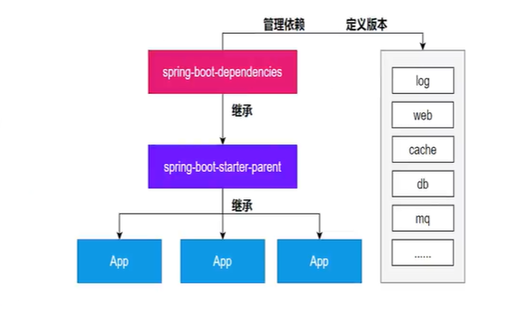
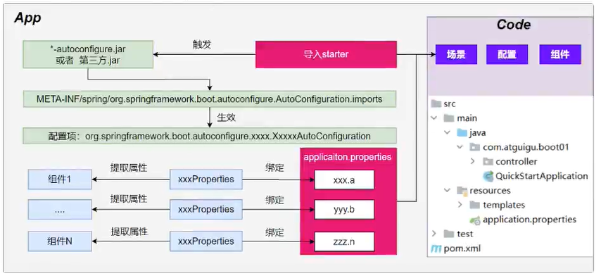
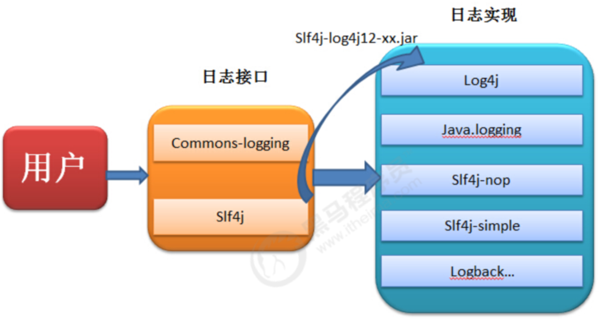

## SpringBoot3快速入门

### 1、简介

#### 1.1 环境要求

<table class="legacy-table">
<thead>
<tr>
<th align="center">工具</th>
<th align="center">版本</th>
</tr>
</thead>
<tbody><tr>
<td align="center">Springboot</td>
<td align="center">3.x+</td>
</tr>
<tr>
<td align="center">IDEA</td>
<td align="center">2021.2.1+</td>
</tr>
<tr>
<td align="center">JDK</td>
<td align="center">17+</td>
</tr>
<tr>
<td align="center">Maven</td>
<td align="center">3.5+</td>
</tr>
<tr>
<td align="center">Tomcat</td>
<td align="center">10.0+</td>
</tr>
<tr>
<td align="center">Servlet</td>
<td align="center">5.0+</td>
</tr>
<tr>
<td align="center">GraalVM Community</td>
<td align="center">22.3+</td>
</tr>
<tr>
<td align="center">Native Build Tools</td>
<td align="center">0.0.19+</td>
</tr>
</tbody></table>

#### 1.2 Springboot是什么

Springboot帮我们简单、快速地创建一个独立的生产级别的Spring应用。大多数Springboot应用只需要编写少量配置即可快速整合Spring平台以及第三方技术。

<b>特性：</b>

- 能够<b>快速创建</b>独立Spring应用
- 直接<b>嵌入</b>Tomcat，Jetty和Undertow（无需部署war包）
- 提供可选的<b>starter</b>，简化应用整合
- 按需<b>自动配置</b>Spring以及第三方库
- 提供<b>生产级特性</b>：如 监控指标、健康检查、外部化部署等
- 无代码生成，<b>无xml</b>

总结：简化开发、简化配置、简化整合、简化部署、简化监控、简化运维

### 2、快速体验

#### 2.1 开发流程

- 创建maven项目，并继承springboot父maven

```xml
<!--所有springboot项目木都必须继承spring-boot-starter-parent-->
<parent>
    <groupId>org.springframework.boot</groupId>
    <artifactId>spring-boot-starter-parent</artifactId>
    <version>3.1.0</version>
</parent>
```

- 导入场景（场景启动器）

```xml
<dependencies>
    <!--web开发场景启动器-->
    <dependency>
        <groupId>org.springframework.boot</groupId>
        <artifactId>spring-boot-starter-web</artifactId>
    </dependency>
</dependencies>
```

- 主程序

```java
@SpringBootApplication  // 
public class MainApplication {
    
    public static void main(String[] args) {
        SpringApplication.run(MainApplication.class, args);
    }
}
```

- 编写业务类

```java
@RestController
public class HelloController {

    @GetMapping("/hello")
    public String hello() {
        return "Hello,Spring Boot";
    }
}
```

- 测试

默认访问：[localhost:8080](http://localhost:8080)

- 打包（引入打包插件）

```xml
<build>
    <plugins>
        <plugin>
            <groupId>org.springframework.boot</groupId>
            <artifactId>spring-boot-maven-plugin</artifactId>
        </plugin>
    </plugins>
</build>
```

使用<code>mvn clean</code>先清除target文件，在使用<code>mvn package</code>把项目打成jar包

<code>java -jar xxxxx.jar</code>启动项目

还可以使用Spring Initializer来快速创建

### 3、应用分析

#### 3.1 依赖管理机制



#### 3.2自动配置机制

#### 1、初步理解

<ul>
<li></li>
</ul>

自动配置的Tomcat、SpringMVC等

<ul>
<li></li>
</ul>

导入场景，容器中就会自动配置这个场景的核心组件。

<ul>
<li></li>
</ul>

以前：DispatcherServlet、ViewResolver、CharacterEncodingFilter …

<ul>
<li></li>
</ul>

现在：自动配置好这些组件

<ul>
<li></li>
</ul>

验证：容器中有什么组件，就具有什么功能

```java
public static void main(String[] args) {
    // java10：局部变量类型的自动推断
    var ioc = SpringApplication.run(MainApplication.class, args);

    // 1、获取容器中所有组件的名字
    String[] names = ioc.getBeanDefinitionNames();
    // spring boot把以前配置的核心组件现在都配置好了
    for (String name : names) {
        System.out.println(name);
    }
}
```

<ul>
<li></li>
</ul>

默认的包扫描规则

<ul>
<li></li>
</ul>

<code>@SpringBootApplication</code>标注的类就是主程序类

<ul>
<li></li>
</ul>

SpringBoot只会扫描主程序所在的包及其下面的子包，自动的component-scan功能

<ul>
<li></li>
</ul>

自定义扫描路经

<ul>
<li>
<code>@SpringBootApplication(scanBasePackages = "xxx.xxx")</code>
</li>
<li>
<code>@ComponentScan(xxx.xxx)</code>：直接指定扫描的路径
</li>
<li></li>
</ul>

配置默认值

<ul>
<li>
配置文件的所有配置项是和某个类的对象值进行一一绑定的
</li>
<li>
绑定了配置文件中每一项的值的类：<b>配置属性类</b>
</li>
<li>
比如：
</li>
<li>
<code>ServerProperties</code>绑定了所有Tomcat服务器有关的配置
</li>
<li>
<code>MultipartProperties</code>绑定了所有文件上传的相关的配置
</li>
<li>
其他参照\[官网文档\]([Common Application Properties (spring.io)](https://docs.spring.io/spring-boot/docs/current/reference/html/application-properties.html#appendix.application-properties))
</li>
<li></li>
</ul>

按需加载自动配置

- 导入场景<code>spring-boot-starter-web</code>
- 场景启动器除了会导入相关功能依赖，还导入了一个<code>spring-boot-starter</code>，是所有的<code>starter</code>的<code>starter</code>，基础核心<b>starter</b>
- <code>spring-boot-starter</code>还导入了一个包，<code>spring-boot-autoconfigure</code>。包里面都是各种场景的<code>AutoConfiguration</code><b>自动配置类</b>
- 虽然全场景的自动配置都在<code>spring-boot-autoconfigure</code>这个包，但是不全是开启的

#### 2、完整流程



- 一：导入<code>starter</code>：比如<code>starter-web</code>就是导入了web开发场景
- 1、每个<code>starter</code>都引入了<code>spring-boot-autoconfigure</code>包
- 2、<code>spring-boot-autoconfigure</code>里面囊括了所有场景的所有配置
- 3、只要这个包下的所有类都能生效，相当于springBoot官方写好的所有整合功能生效了
- 4、SpringBoot默认扫描不到<code>spring-boot-autoconfigure</code>下写好的所有配置类
- 二：主程序：<code>@SpringBootApplication</code>
- 1、<code>@SpringBootApplication</code>由三个注解组成<code>@SpringBootConfiguration</code>、<code>@EnableAutoConfiguration</code>、<code>@ComponentScan</code>
- 2、SpringBoot默认只扫描自己主程序所在的包及其下面的子包，扫描不到<code>spring-boot-autoconfigure</code>包中官方写好的配置类
- 3、<code>@EnableAutoConfiguration</code>：SpringBoot开启自动配置的核心
- 1、是由<code>@Import({AutoConfigurationImportSelector.class})</code>提供功能：批量给容器中导入组件
- 2、SpringBoot启动会默认加载146个配置类（版本3.1.0）
- 3、这146个来自于<code>METAINF/spring/org.springframework.boot.autoconfigure.AutoConfiguration.imports</code>
- 4、按需生效：并不是这<code>146</code>个自动装配类都能生效，每一个自动装配类都有条件注解<code>@ConditionalOnXxx</code>,只有条件成立，才能生效
- 三：写业务，全程无需关心各种整合（底层都整合好了，且生效了）

#### 3、如何学好SpringBoot

框架的框架，底层基于Spring。

<ul>
<li></li>
</ul>

理解<b>自动装配原理</b>

a、<b>导入starter</b> –> 生效xxxAutoConfiguration –> <b>组件</b> –> xxxPreperties –> <b>配置文件</b>

<ul>
<li></li>
</ul>

理解<b>其他框架底层</b>

<ul>
<li></li>
</ul>

可以随时<b>定制化任何组件</b>

a、改配置文件

b、自定义组件

核心：

- 这个场景自动配置导入了哪些组件，我们能不能Autowired进来使用
- 能不能通过修改配置改变组件的一些默认参数
- 需不需要完全定义这个组件
- <b>场景定制化</b>

### 4、核心技能

#### 4.1. 常用注解

SpringBoot摒弃xml配置方式，改为全注解驱动

#### 1、组件注解

<code>@Configuration</code>：替代以前的xml配置文件，配置类本身也是容器中的组件<br /><code>@SpringBootConfiguration</code>：与@Configuration无区别，就是名字不一样<br /><code>@Bean</code>：替代以前的Bean标签，组件在容器中的名字默认是方法名，如果修改了注解的值，则名字是注解的值<br /><code>@Scope</code>：替代以前Bean标签里的scpoe属性，设置组件是否为单实例或多实例（默认都是单实例的）<br /><code>@Import</code>：导入第三方的的组件到 ioc 容器中，组件名默认是全类名<br />@Controller、@Service、@Repository、@Component、@ComponentScan

使用步骤：

- 编写一个配置类使用@Configuration修饰
- 在配置类中，自定义方法给容器中注册组件，配合@Bean
- 或使用@Import导入第三方的组件

#### 2、条件注解

如果注解指定的条件成立，则触发指定行为

@ConditionalOnXxx

@ConditionalOnClass：如果类路径中存在这个类，则触发指定行为

@ConditionalOnMissClass：如果类路径中不存在这个类，则触发指定行为

@ConditionalOnBean：如果容器中存在这个Bean，则触发指定行为

@ConditionalOnMissBean：如果容器中不存在这个Bean，则触发指定行为

场景：

- 如果存在<code>FastsqlException</code>这个类，给容器中放一个<code>cat</code>组件，名为cat01，否则就在容器中放一个<code>Dog</code>组件，名为dog01
- 如果系统中有<code>dog01</code>这个组件，就在容器中放一个User组件，名为zhangsan，否则，就名叫lisi<br />实现：

```java
@SpringBootConfiguration
public class AppConfig2 {

    @ConditionalOnClass(name = "com.alibaba.druid.FastsqlException")
    @Bean
    public Cat cat01() {
        return new Cat();
    }

    @ConditionalOnMissingClass(value = "com.alibaba.druid.FastsqlException")
    @Bean
    public Dog dog01() {
        return new Dog();
    }

    @ConditionalOnBean(name = "dog01")
    @Bean
    public User zhangsan() {
        return new User();
    }

    @ConditionalOnMissingBean(name = "dog01")
    @Bean
    public User lisi() {
        return new User();
    }
}
```

#### 3、属性绑定

@ConfigurationProperties<br />@EnableConfigurationProperties ：开启某个类与配置文件的绑定

在容器中任意组件（Bean）的<b>属性值</b>和<b>配置文件</b>的配置项的值进行绑定

1、给容器中注册组件（@Component、@Bean）

2、使用@ConfigurationProperties 声明组件和配置文件的哪些配置项进行绑定

#### 4.2. YAML配置文件

加载顺序：yml > yaml > properties

痛点：SpringBoot集中化管理配置，<code>application.properties</code>

问题：配置多以后很难阅读和修改，层次结构辨识度不高

<b>YAML</b> 目前的官方全称为 “<b>YAML Ain’t Markup Language</b>（YAML 不是标记语言）”，但有意思的是，其实 YAML 最初的含义是 “<b>Yet Another Markup Language</b>（还是一种标记语言）”

设计目标：为了<b>方便阅读</b>

层次分明，更适合做配置文件

使用.yaml和.yml作为文件后缀

#### 1、基本语法

- 大小写敏感
- 使用缩进表示层级关系，k:v，使用空格分割k，v
- 缩进时不允许使用Tab，只允许<b>使用空格</b>
- 缩进的空格数目不重要，只要相同层级的元素左侧对齐即可
- <b># 表示注释</b>，从这个字符一直到行尾，都会被解析器忽略

支持的写法

- 对象：<b>键值对</b>的集合，如：映射（map）/哈希（hash）/字典（dictionary）
- 数组：一组按次序排列的值，如：序列（sequence）/列表（list）
- 纯量：单个的、不可分割的值，如：字符串、数字、bool、日期

#### 2、示例

实体类

```java
@Component
@ConfigurationProperties(prefix = "person")  // 和配置文件中所有以person前缀进行绑定
@Data  // 自动生成JavaBean属性的getter/setter
public class Person {
    private String name;
    private Integer age;
    private Date birthday;
    private Boolean like;
    private Child child;
    private List<Dog> dogs;
    private Map<String, Cat> cats;
}

public class Child {
    private String name;
    private Integer age;
    private Date birthday;
    private List<String> text;  // 集合类型的
}

public class Dog {
    private String name;
}

public class Cat {
    private String name;
}
```

properties文件和yaml文件都是配置文件

properties文件

```javascript
person.name=zhangsan
person.age=18
person.birthday=2001/10/10 10:10:10
person.like=true
person.child.name=lisi
person.child.age=12
person.child.birthday=2008/10/10 10:10:10
person.child.text[0]=abc
person.child.text[1]=def
person.dogs[0].name=xiaob
person.dogs[1].name=xiaoh
person.cats.c1.name=xiaol
person.cats.c2.name=xiaog
```

yaml文件

```yaml
person:
  name: zhangs
  age: 18
  birthday: 2001/10/10 10:10:10
  like: false
  child:
    name: lisi
    age: 20
    birthday: 2008/10/10 10:10:10
    text: [ "abc","def" ]
  dogs:
    - name: xh
    - name: xb
  cats:
    c1:
      name: xx
    c2: {name: xy}  # 对象也可这么表示
```

#### 3、使用细节

- 驼峰命名的推荐使用 - 连接。比如：birthDay == birth-day
- 文本：
- <b>单引号</b>不会转义【认为 \\n 为普通字符】
- <b>双引号</b>会转义【 \\n 为<b>换行符</b>】
- 大文本：
- <code>|</code>开头，大文本写在下层，保留文本格式，换行符正确显示
- <code>></code>开头，大文本写在下层，折叠换行符，以空格代替
- 多文档合并
- 使用<code>---</code>可以把多个yaml文档合并在一个文档中，每个文档依然内容独立

#### 4.3. 日志配置

规范：项目开发不要编写<code>System.out.println() </code>，应该用<b>日志</b>记录信息



#### 1、简介

- Spring使用<code>commons-logging</code>作为内部日志，但底层日志实现是开放的。可对接其他日志框架。
- 支持<code>java.util.logging</code>、<code>log4j</code>、<code>logback</code>。SpringBoot提供了默认的控制台输出配置，也可以配置输出文件。
- <code>logback</code>是默认使用的
- SpringBoot使用的是<code>slf4j</code>+<code>logback</code>组合

SpringBoot怎么把日志默认配置好的

- 每个<code>starter</code>场景，都会导入一个核心场景<code>spring-boot-starter</code>
- 核心场景引入了日志的所有功能<code>spring-boot-starter-longging</code>
- 默认使用了<code>slf4j</code>+<code>logback</code>组合作为默认底层日志
- 日志系统一启动就要用，<code>xxxAutoConfiguration</code>是系统启动好后，再用到的自动配置组件
- 日志是利用监听器机制配置好的，<code>ApplicationListener</code>
- 日志所有的配置都可以通过配置文件修改实现

#### 2、日志格式

```txt
2023-06-22T23:28:38.274+08:00  INFO 17680 --- [           main] com.huang.Boot303LoggingApplication      : No active profile set, falling back to 1 default profile: "default"
2023-06-22T23:28:39.275+08:00  INFO 17680 --- [           main] o.s.b.w.embedded.tomcat.TomcatWebServer  : Tomcat initialized with port(s): 8080 (http)
```

默认输出格式：

- 时间日期：毫秒级精度
- 日志级别：<code>ERROR</code>、<code>WARN</code>、<code>INFO</code>、<code>DEBUG</code>、<code>TRACE</code>
- 进程ID
- <code>---</code>：消息分隔符
- 线程名：使用\[\]包括
- Logger名：通常为产生日志的类名
- 消息：日志记录的内容

注意：logback没有<code>FATAL</code>级别，对应的是<code>ERROR</code>

#### 3、记录日志

<ul>
<li></li>
</ul>

方案一：可以在类中定义变量来记录

```java
private final Logger log = LoggerFactory.getLogger(getClass());
```

<ul>
<li></li>
</ul>

方案二：使用lombak注解<code>@Slf4j</code>

#### 4、日志级别

- 由低到高：<code>ALL</code>、<code>TRACE</code>、<code>DEBUG</code>、<code>INFO</code>、<code>WARN</code>、<code>ERROR</code>、<code>FATAL</code>、<code>OFF</code>；
- <b>只会打印指定级别及以上级别的日志</b>
- ALL：打印所有日志
- TRACE：追踪框架详细流程日志，一般不使用
- DEBUG：开发调试细节日志
- INFO：关键信息日志
- WARN：警告但不是错误的信息日志
- ERROR：业务错误日志
- FATAL：致命错误日志，比如JVM系统奔溃
- OFF：关闭所有日志记录
- 不指定级别的所有类，都是用root指定的级别作为默认级别
- SpringBoot日志默认级别是INFO

在<code>application.yaml</code>中配置<code>logging.level.=</code>指定日志级别

#### 5、日志分组

比较有用的技巧。

将相关的<b>logger</b>分组在一起，统一配置，SpringBoot也支持。比如：Tomcat相关的日志统一设置

```javascript
logging.grougl.tomcat=org.apache.catalina,org.apache.coyote,org.apache.tomcat
logging.level.tomcat=trace
```

SpringBoot 预定义两个组

<table class="legacy-table">
<thead>
<tr>
<th align="center">Name</th>
<th align="left">Loggers</th>
</tr>
</thead>
<tbody><tr>
<td align="center">web</td>
<td align="left"><code>org.springframework.core.codec,org.springframework.http,</code><br /><code>org.springframework.web,</code><br /><code>org.springframework.boot.actuate.endpoint.web</code>,<br /><code>org.springframework.boot.web.servlet.ServletContextinitializerBeans</code></td>
</tr>
<tr>
<td align="center">sql</td>
<td align="left"><code>org.springframework.jdbc.core</code>, <br /><code>org.hibernate.SQL</code>,<br /><code> org.jooq.tools.LoggerListener</code></td>
</tr>
</tbody></table>

#### 6、文件输出

SpringBoot默认把日志打印到控制台，如果想将日志文件保存到磁盘，可以在<code>application.yaml</code>中添加<code>logging.file.name</code>或则<code>logging.file.path</code>配置项

<table class="legacy-table">
<thead>
<tr>
<th align="center">logging.file.name</th>
<th align="center">logging.file.path</th>
<th align="center">示例</th>
<th align="center">效果</th>
</tr>
</thead>
<tbody><tr>
<td align="center">未指定</td>
<td align="center">未指定</td>
<td align="center"></td>
<td align="center">仅控制台输出</td>
</tr>
<tr>
<td align="center"><strong>指定</strong></td>
<td align="center">未指定</td>
<td align="center">my.log</td>
<td align="center">在此项目下出现<code>my.log</code>文件，也可<code>加路径</code>将其指定到其他磁盘上</td>
</tr>
<tr>
<td align="center">未指定</td>
<td align="center"><strong>指定</strong></td>
<td align="center">D:&#x2F;</td>
<td align="center">写入指定目录，文件名为<code>spring.log</code></td>
</tr>
<tr>
<td align="center"><strong>指定</strong></td>
<td align="center"><strong>指定</strong></td>
<td align="center"></td>
<td align="center">以<code>logging.file.name</code>为准</td>
</tr>
</tbody></table>

#### 7、文件归档与滚动切割

归档：每一天的日志单独存到一个文档中。

切割：每个文件10MB，如果超过则切割成另一个文件。

- 每天的日志应该独立分割出来存档，如果使用<code>logback</code>（SpringBoot）默认整合，可以通过<code>applicaiton.preperties/yaml</code>文件指定日志滚动规则
- 如果是其他日志系统，需自行配置配置文件（添加<code>log4j2.xml</code>或<code>log4j2-spring.xml</code>）
- 支持的滚动规则设置如下：

<table class="legacy-table">
<thead>
<tr>
<th align="left">配置项</th>
<th align="left">描述</th>
</tr>
</thead>
<tbody><tr>
<td align="left"><code>logging.logback.rollingpolicy.file-name-pattern</code></td>
<td align="left">日志存档的文件名称格式（默认值：<code>$&#123;LOG_FILE&#125;.%d[yyyy-MM-dd].%i.gz</code>）</td>
</tr>
<tr>
<td align="left"><code>logging.logback.rollingpolicy.max-file-size</code></td>
<td align="left">存档前，每个日志文件的最大大小（默认值：10MB）</td>
</tr>
<tr>
<td align="left"><code>logging.logback.rollingpolicy.clean-history-on-start</code></td>
<td align="left">应用启动是是否清楚以前存档（默认值：<code>false</code>）</td>
</tr>
<tr>
<td align="left"><code>logging.logback.rollingpolicy.total-size-cap</code></td>
<td align="left">日志文件被删除之前，可以容纳的最大大小（默认值：0B）.设置1GB则磁盘存储超过1BG日志后就会删除日志文件</td>
</tr>
<tr>
<td align="left"><code>logging.logback.rollingpolicy.max-history</code></td>
<td align="left">日志文件保存的最大的天数（默认值：7天）</td>
</tr>
</tbody></table>

#### 8、自定义配置

通常我们配置<code>applicaiton.preperties</code>就够了。当然也可以自定义，比如：

<table class="legacy-table">
<thead>
<tr>
<th>日志系统</th>
<th>自定义</th>
</tr>
</thead>
<tbody><tr>
<td>Logback</td>
<td><code>logback-spring.xml</code>、<br /><code>logback-spring.groovy</code>、<br /><code>logback.xml</code><br /><code>logback.groovy</code></td>
</tr>
<tr>
<td>Log4j2</td>
<td><code>log4j2-spring.xml</code> 或者 <code>log4j2.xml</code></td>
</tr>
<tr>
<td>JDK(Java Util Logging)</td>
<td><code>logging-properties</code></td>
</tr>
</tbody></table>

如果可能，建议使用<code>-spring</code>变量（例如：<code>logback-spring.xml</code> 而不是<code>logback.xml</code>）。如果使用标准配置文件，spring无法完全控制日志初始化。

#### 9、切换日志组合

要先使用第三方日志框架：

第一步要先排除自己默认的日志框架

第二步导入第三方框架的依赖坐标

第三步配置日志框架的配置文件

```xml
<dependency>
    <groupId>org.springframework.boot</groupId>
    <artifactId>spring-boot-starter</artifactId>
    <exclusions>
        <exclusion>
            <groupId>org.springframework.boot</groupId>
            <artifactId>spring-boot-starter-logging</artifactId>
        </exclusion>
    </exclusions>
</dependency>
<dependency>
    <groupId>org.springframework.boot</groupId>
    <artifactId>spring-boot-starter-log4j2</artifactId>
</dependency>
```

log4j2支持yaml和json格式的配置文件

<table class="legacy-table">
<thead>
<tr>
<th>格式</th>
<th>依赖</th>
<th>文件名</th>
</tr>
</thead>
<tbody><tr>
<td>YAML</td>
<td>com.fastterxml.jackson.core:jackson-databind +<br />com.fasterxml.jackson.dataformat.jackson-dataformat-yaml</td>
<td>log4j2.yaml + log4j2.yml</td>
</tr>
<tr>
<td>JSON</td>
<td>com.fasterxml.jackson.core:jackson-databind</td>
<td>log4j2.json + log4j2.jsn</td>
</tr>
</tbody></table>
