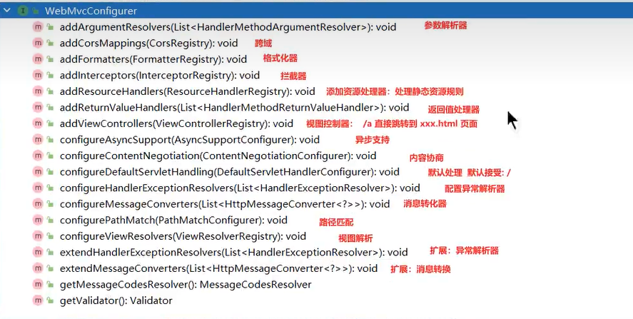
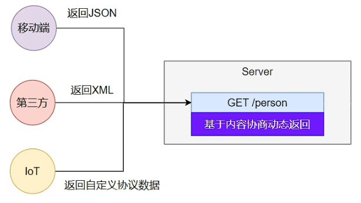
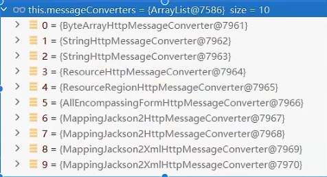
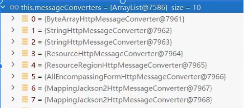
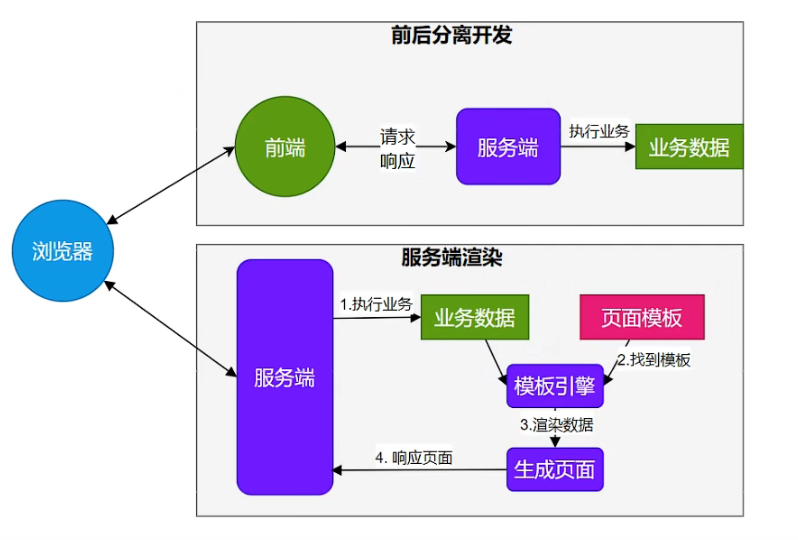
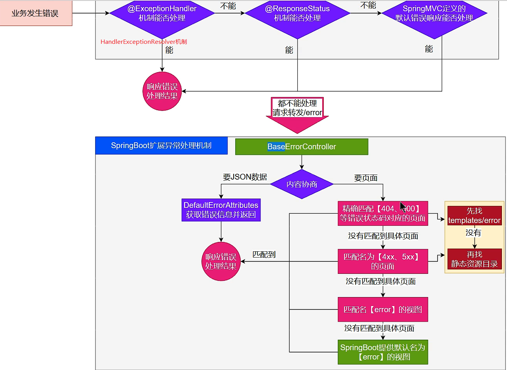

## SpringBoot3-Web开发

SpringBoot的web开发能力，由SpringMVC提供

### 0、WebMvcAutoConfiguration原理

#### 1、生效条件

```java
@AutoConfiguration(
    after = {DispatcherServletAutoConfiguration.class, TaskExecutionAutoConfiguration.class, ValidationAutoConfiguration.class}
)  // 在这些配置生效后 
@ConditionalOnWebApplication(
    type = Type.SERVLET
)  // 如果是web应用就生效，类型是servlet；另外还有reaction类型
@ConditionalOnClass({Servlet.class, DispatcherServlet.class, WebMvcConfigurer.class})
@ConditionalOnMissingBean({WebMvcConfigurationSupport.class})  // 没有这个Bean，才生效。默认就是没有
@AutoConfigureOrder(-2147483638)  // 优先级
@ImportRuntimeHints({WebResourcesRuntimeHints.class})
public class WebMvcAutoConfiguration {
```

#### 2、效果

<ul>
<li></li>
</ul>

放了两个Filter：

a. <code>HiddenHttpMethodFilter</code>：页面表单提交Rest请求

b. <code>FormContentFilter</code>：表单内容Filter，GET（数据放URL后面）、POST（数据放请求体）请求可以携带数据，PUT、DELETE的请求体数据会被忽略

<ul>
<li></li>
</ul>

给容器中放了<code>WebMvcConfigurer</code>组件，给SpringMvc添加各种定制功能

a、因为开启了属性绑定<code>@EnableConfigurationProperties</code>，所有所有的功能最终会和配置文件进行绑定

b、WebMvcProperties：在配置文件中以<code>spring.mvc</code>开头

c、WebProperties：在配置文件中以<code>spring.web</code>开头

```java
@Configuration(
    proxyBeanMethods = false
)
@Import({EnableWebMvcConfiguration.class})  // 额外导入了其他配置
@EnableConfigurationProperties({WebMvcProperties.class, WebProperties.class})
@Order(0)
public static class WebMvcAutoConfigurationAdapter implements WebMvcConfigurer, ServletContextAware {
    ...
}
```

#### 3、WebMvcConfigurer接口

提供了配置SpringMVC底层的所有组件入口



#### 4、静态资源规则源码

```java
@Override
public void addResourceHandlers(ResourceHandlerRegistry registry) {
    if (!this.resourceProperties.isAddMappings()) {
        logger.debug("Default resource handling disabled");
        return;
    }
    // 1、
    addResourceHandler(registry, this.mvcProperties.getWebjarsPathPattern(),
                       "classpath:/META-INF/resources/webjars/");
    // 2、
    addResourceHandler(registry, this.mvcProperties.getStaticPathPattern(), (registration) -> {
        registration.addResourceLocations(this.resourceProperties.getStaticLocations());
        if (this.servletContext != null) {
            ServletContextResource resource = new ServletContextResource(this.servletContext, SERVLET_LOCATION);
            registration.addResourceLocations(resource);
        }
    });
}
```

<ul>
<li></li>
</ul>

规则一：访问<code>/webjars/**</code>路径就去<code>classpath:/META-INF/resources/webjars/</code>路径下找资源

<ul>
<li>
maven导入依赖
</li>
<li></li>
<li></li>
</ul>

规则二：访问<code>/**</code>路径就去<code>静态资源默认的四个位置找资源</code>

<ul>
<li>
<code>classpath:/META-INF/resources/</code>
</li>
<li>
<code>classpath:/resources/</code>
</li>
<li>
<code>classpath:/static/</code>
</li>
<li>
<code>classpath:/public/</code>
</li>
<li></li>
</ul>

规则三：静态资源默认都有缓存规则的设置

<ul>
<li></li>
</ul>

所有缓存的设置，直接通过配置文件：<code>spring.web</code>

<ul>
<li></li>
</ul>

cachePeriod：缓存周期；多久不用找服务器要新的。默认没有，以s为单位

<ul>
<li></li>
</ul>

cacheControl：HTTP缓存控制。具体可以上mdn官网查看 [HTTP 缓存 - HTTP \| MDN (mozilla.org)](https://developer.mozilla.org/zh-CN/docs/Web/HTTP/Caching)

<ul>
<li></li>
</ul>

useLastModified：是否使用最后一次修改

如果浏览器访问了静态资源<code>index.js</code>，如果服务这个资源没有发生变化，下次访问的时候就可以直接让浏览器用自己缓存中的东西，而不是给服务器发请求。

```java
registration.setCachePeriod(getSeconds(this.resourceProperties.getCache().getPeriod()));
registration.setCacheControl(this.resourceProperties.getCache().getCachecontrol().toHttpCacheControl());
registration.setUseLastModified(this.resourceProperties.getCache().isUseLastModified());
```

#### 5、EnableWebMvcConfiguration源码

```java
//springBoot给容器中放weblvcconfigurationsupport组件。
//我们如果自己放了WebNcConfigurationsupport 组件，Boot的WebmvcAutoconfiguration都会失效。
@Configuration(proxyBeanMethods = false)
@EnableConfigurationProperties(WebProperties.class)
public static class EnableWebMvcConfiguration extends DelegatingWebMvcConfiguration implements ResourceLoaderAware {
    ...
}
```

<ul>
<li></li>
</ul>

<code>HandlerMapping</code>：根据请求路径<code>/a</code>找到handler能处理请求

a、<code>WelcomePageHandlerMapping</code>：

i、访问<code>/**</code>路径下的所有请求 ，都在之前四个静态资源路径下找，欢迎页也是

ii、找<code>index.html</code>：只要静态资源位置有一个<code>index.html</code>页面，项目启动默认访问

#### 6、为什么容器中放一个WebMvcConfigurer就能生效

- <code>WebMvcAutoConfiguration</code>是一个自动配置类，它里面有一个<code>EnableWebMvcConfiguration</code>
- <code>EnableWebMvcConfiguration</code>继承于<code>DelegatingWebMvcConfiguration</code>，这两个都生效
- <code>DelegatingWebMvcConfiguration</code>利用 DI 把容器中所有<code>WebMvcConfigurer</code>注入进来
- 别人调用<code> DelegatingWebMvcConfiguration</code>的方法配置底层规则，而它调用所有<code>WebMvcConfigure</code>的配置底层方法。

### 1、Web场景

#### 1、自动配置

<ul>
<li></li>
</ul>

整合整合web场景

```xml
<dependency>
    <groupId>org.springframework.boot</groupId>
    <artifactId>spring-boot-starter-web</artifactId>
</dependency>
```

<ul>
<li></li>
</ul>

引入<code>autoconfigure</code>功能

<ul>
<li></li>
</ul>

<code>@EnableAutoConfiguration</code>注解使用<code>@Import({AutoConfigurationImportSelector.class})</code>批量带入组件

<ul>
<li></li>
</ul>

加载<code>META-INF/spring/org.springframework.boot.autoconfigure.AutoConfiguration.imports</code>文件中配置的所有组件

<ul>
<li></li>
</ul>

所有自动配置类如下

```txt
org.springframework.boot.autoconfigure.web.client.RestTemplateAutoConfiguration
org.springframework.boot.autoconfigure.web.embedded.EmbeddedWebServerFactoryCustomizerAutoConfiguration
============= 以下是响应式web场景 ==============================
org.springframework.boot.autoconfigure.web.reactive.HttpHandlerAutoConfiguration
org.springframework.boot.autoconfigure.web.reactive.ReactiveMultipartAutoConfiguration
org.springframework.boot.autoconfigure.web.reactive.ReactiveWebServerFactoryAutoConfiguration
org.springframework.boot.autoconfigure.web.reactive.WebFluxAutoConfiguration
org.springframework.boot.autoconfigure.web.reactive.WebSessionIdResolverAutoConfiguration
org.springframework.boot.autoconfigure.web.reactive.error.ErrorWebFluxAutoConfiguration
org.springframework.boot.autoconfigure.web.reactive.function.client.ClientHttpConnectorAutoConfiguration
org.springframework.boot.autoconfigure.web.reactive.function.client.WebClientAutoConfiguration
============= 以上是响应式web场景 ==============================
org.springframework.boot.autoconfigure.web.servlet.DispatcherServletAutoConfiguration
org.springframework.boot.autoconfigure.web.servlet.ServletWebServerFactoryAutoConfiguration
org.springframework.boot.autoconfigure.web.servlet.error.ErrorMvcAutoConfiguration
org.springframework.boot.autoconfigure.web.servlet.HttpEncodingAutoConfiguration
org.springframework.boot.autoconfigure.web.servlet.MultipartAutoConfiguration
org.springframework.boot.autoconfigure.web.servlet.WebMvcAutoConfiguration
org.springframework.boot.autoconfigure.websocket.reactive.WebSocketReactiveAutoConfiguration
org.springframework.boot.autoconfigure.websocket.servlet.WebSocketServletAutoConfiguration
org.springframework.boot.autoconfigure.websocket.servlet.WebSocketMessagingAutoConfiguration
org.springframework.boot.autoconfigure.webservices.WebServicesAutoConfiguration
org.springframework.boot.autoconfigure.webservices.client.WebServiceTemplateAutoConfiguration
```

- 绑定了配置文件的一堆配置项
- 1、SpringMVC的所有配置 <code>spring.mvc</code>
- 2、Web场景的通用配置 <code>spring.web</code>
- 3、文件上传配置 <code>spring.servlet.multipart</code>
- 4、服务器的配置 <code>server</code>

#### 2、默认效果

默认配置：

- 包含了<code>ContentNegotiatingViewResolver</code>和<code>BeanNameViewResolver</code>组件，方便视图解析
- \*\*默认的静态资源处理机制：\*\*静态资源放在<code> static</code> 文件夹下即可直接访问
- 自动注册了<code>Converter</code>,<code>GenericConverter</code>,<code>Formatter</code>组件，适配常见的数据类型转换和格式化需求。
- 支持<code>HttpMessageConverters</code>，可以方便返回<code>json</code>等数据类型
- 注册<code>MessageCodesResolver</code>，方便国际化及错误消息处理
- 支持 静态<code>index.html</code>
- 自动使用<code>ConfigurableWebBindingInitializer</code>，实现<b>消息处理、数据绑定、类型转化、数据校验</b>等功能

重要：

- 如果想保持 boot mvc 的默认配置，并且自定义更多的 mvc配置，如: \*\*interceptors, \*\*<br /><b>formatters,view controllers</b>等。可以使用<code>@Configuration</code>注解添加一个 <code>WebMvcConfigurer</code>类型的配置类,并不要标注<code>@EnableWebMvc</code>
- 如果想保持 boot mvc的默认配置，但要自定义核心组件实例，比如:<code>RequestMappingHandlerMapping</code>,<code>RequestMappingHandlerAdapte</code>r,或<br /><code>ExceptionHandlerExceptionResolver</code>，给容器中放一个 <code>WebMvcRegistrations</code> 组件即可
- 如果想全面接管Spring MVC，<code>@Configuration</code>标注一个配置类，并加上<code>@EnableWebMvc</code>注解，实现 <code>WebMvcConfigurer</code>接口

### 2、静态资源

<ol>
<li></li>
</ol>

#### 1、默认规则

#### 1、静态资源映射

静态资源映射规则在<code>WebMvcAutoConfiguration</code>中进行定义：

- <code>/webjars/**</code>的所有路径资源都在<code>classpath:/META-INF/resources/webjars/</code>
- <code>/**</code>的所有路径资源都在<code>classpath:/META-INF/resources/</code>、<code>classpath:/resources/</code>、<code>classpath:/static/</code>、<code>classpath:/public/</code>

#### 2、静态资源缓存

所有缓存的设置，直接通过配置文件：<code>spring.web</code>

- Period：缓存周期；默认0s
- cacheControl：HTTP缓存控制；默认无
- useLastModified：是否使用lastModified头。默认 false

#### 3、欢迎页

欢迎页规则在<code>WebMvcAutoConfiguration</code>中进行了定义：

- 在静态资源目录下找  index.html
- 没有就在 <code>templates</code>下找 index 模板页

#### 4、Favicon

在静态资源目录下找<code>favicon.ico</code>，如果找到就显示到浏览器图标上。有的可能不会显示（更浏览器有关）

#### 5、缓存实验

```javascript
#1、spring.web
#   1、配置国际化的区域信息
#   2、静态资源策略（开启，链，缓存）
#开启静态资源映射规则
spring.web.resources.add-mappings=true
#设置缓存
spring.web.resources.cache.period=3600
#缓存详细合并项控制，覆盖period配置
spring.web.resources.cache.cachecontrol.max-age=7200
#使用资源 last-modified 时，来对比服务器和浏览器的资源是否相同没有变化。相同返回304
spring.web.resources.cache.use-last-modified=true
```

#### 2、自定义静态资源规则

#### 1、配置方式

<code>spring.mvc</code>：静态资源访问的前缀路径

<code>spring.web</code>：

- 设置静态资源的目录
- 设置静态资源的缓存策略

```javascript
#2、spring.mvc
##  1、指定自定义webjars路径前缀
spring.mvc.webjars-path-pattern=/wj/**
##  2、指定静态资源访问路径前缀
spring.mvc.static-path-pattern=/static/**
##  3、自定义静态资源文件夹位置
spring.web.resources.static-locations=classpath:/a/,classpath:/b/
```

#### 2、代码方式

- 容器中只要有一个WebConfigurer组件。配置的底层行为都会生效
- @EnableWebMvc  // 禁用boot的默认配置

方式一：

```java
@Configuration // 告诉spring这是一个配置类
public class MyConfig implements WebMvcConfigurer {

    @Override
    public void addResourceHandlers(ResourceHandlerRegistry registry) {
        // 保留以前的配置
        WebMvcConfigurer.super.addResourceHandlers(registry);

        // 自己额外添加
        registry.addResourceHandler("/static/**")
            .addResourceLocations("classpath:/a/", "classpath:/b/")
            .setCacheControl(CacheControl.maxAge(7200, TimeUnit.SECONDS));
    }
}
```

方式二：

```java
//@Configuration // 告诉spring这是一个配置类
public class MyConfig /*implements WebMvcConfigurer*/ {

    @Bean
    public WebMvcConfigurer webMvcConfigurer() {
        return new WebMvcConfigurer() {
            @Override
            public void addResourceHandlers(ResourceHandlerRegistry registry) {
                WebMvcConfigurer.super.addResourceHandlers(registry);
                // 自己额外添加
                registry.addResourceHandler("/static/**")
                    .addResourceLocations("classpath:/a/", "classpath:/b/")
                    .setCacheControl(CacheControl.maxAge(7200, TimeUnit.SECONDS));
            }
        };
    }


    //    @Override
    //    public void addResourceHandlers(ResourceHandlerRegistry registry) {
    //        // 保留以前的配置
    //        WebMvcConfigurer.super.addResourceHandlers(registry);
    //
    //        // 自己额外添加
    //        registry.addResourceHandler("/static/**")
    //                .addResourceLocations("classpath:/a/", "classpath:/b/")
    //                .setCacheControl(CacheControl.maxAge(7200, TimeUnit.SECONDS));
    //    }
}
```

### 3、路径匹配

Spring5.3 之后加入了更多的请求路径匹配的实现策略：

以前只支持AntPathMatcher策略，现在提供了PathPatternParser策略。并且可以让我们指定到底使用哪种策略。

#### 1、Ant风格路径用法

Ant风格的路径模式语法具有以下规则：

- <code>*</code> ：表示任意数量的字符
- <code>?</code> ：表示任意一个字符
- <code>**</code>：表示任意数量的目录
- <code>{}</code>：表示一个命名的模式占位符
- <code>[]</code>：表示字符集合，例如<code>[a-z]</code>表示小写字母

例如：

- <code>.html</code>匹配任意名称,扩展名为<code>.html</code>的文件
- <code>/folder1/*/*.java</code>匹配在<code>folder1</code>目录下的任意两级目录下的<code>.java</code>文件
- <code>/folder1/*/*.jsp</code>匹配在<code>folder2</code>目录下任意目录深度的<code>.jsp</code>文件
- <code>/{type}/{id}.html</code>匹配任意文件名为<code>{id}.html</code>,在任意命名的<code>{type}</code>目录下的文件

注意：Ant风格的路径模式语法中的特殊字符需要转义，如：

- 要匹配文件路径中的星号，则需要转义为<code>\\*</code>
- 要匹配文件路径中的句号，则需要转义为<code>\\?</code>

#### 2、模式切换

```java
/**
     * 默认使用新版路径匹配器 PathPatternParser 进行路劲匹配
     * 不嫩匹配 ** 在中间的情况，剩下的和 antPathMatcher语法兼容
     *
     * @param request
     * @param path
     * @return
     */
@GetMapping("/a*/b?/{p1:[a-f]+}/**")
public String hello(HttpServletRequest request, @PathVariable("p1") String path) {
    log.info("路径变量p1：{}", path);
    // 获取请求路径
    String requestURI = request.getRequestURI();
    return requestURI;
}
```

总结：

- 使用默认的路径匹配规则，是由<code>PathPatternParser</code>提供的
- 如果路径中间需要 \*\* ，替换成ant风格路径

```javascript
# 改变路径匹配策略
# ant_path_matcher 老版特性
# path_pattern_parser 新版特性
spring.mvc.pathmatch.matching-strategy=path_pattern_parser
```

### 4、内容协商

一套系统适配多段数据返回



#### 1、多端内容适配

#### 1、默认规则

<ul>
<li></li>
</ul>

SpringBoot 多端内容适配

1.1 基于<b>请求头</b>内容协商（默认开启）

1.1.1．客户端向服务端发送请求，携带HTTP标准的Accept请求头。<br />1.1.1.1.   <b>Accept:</b> application/json . text/xm1 . text/ yaml

1.1.1.2．服务端<b>根据客户端请求头期望的数掘类型</b>进行<b>动态返回</b><br />1.2.基于<b>请求参数</b>内容协商:（需要开启）<br />1.2.1．发送请求<b>GET /projects/spring-boot?format=json</b>

1.2.2．业配到\*\*@GetMapping(“/projects/spring-boot”)\*\*<br />1.2.3．根据参数协商，优先返回json类型数据【需要开启参数匹配设置】<br />1.2.4、发送诘求<b>GET /projects/spring-boot?format-xml</b>,优先返回xml类型数据

#### 2、效果演示

同一个接口，可以返回json和xml不同格式的数据

spring boot底层返回的默认就是json格式

- 也支持xml，不过需要先导依赖

```xml
<dependency>
    <groupId>com.fasterxml.jackson.dataformat</groupId>
    <artifactId>jackson-dataformat-xml</artifactId>
</dependency>
```

- 然后标注注解<code>@JacksonXmlRootElement</code>

```java
@Data
@JacksonXmlRootElement
public class Person {
    private Long id;
    private String userName;
    private String email;
    private Integer age;
}
```

- 开启基于请求参数的内容协商

```javascript
# 表示开启基于请求参数的内容协商功能，默认参数为format
spring.mvc.contentnegotiation.favor-parameter=true
# 设置请求参数的参数为type
spring.mvc.contentnegotiation.parameter-name=type
```

#### 2、自定义内容返回

#### 1、增加yaml返回支持

第一步：导入依赖

```xml
<dependency>
    <groupId>com.fasterxml.jackson.dataformat</groupId>
    <artifactId>jackson-dataformat-yaml</artifactId>
</dependency>
```

第二步：把对象写出成YAML

```java
public static void main(String[] args) throws JsonProcessingException {
    Person person = new Person();
    person.setId(1L);
    person.setUserName("张三");
    person.setEmail("aaa.@qq.com");
    person.setAge(18);

    ObjectMapper mapper = new ObjectMapper(new YAMLFactory());

    String s = mapper.writeValueAsString(person);
    System.out.println(s);
}
```

第三步：编写配置

```javascript
spring.mvc.contentnegotiation.media-types.yaml=text/yaml
```

第四步：编写自己的类型装换规则（MessageConverter）

MyYamlHttpMessageConverter类：

```java
public class MyYamlHttpMessageConverter extends AbstractHttpMessageConverter<Object> {

    private ObjectMapper objectMapper = null;

    public MyYamlHttpMessageConverter() {
        //        // 媒体类型
        //        MediaType mediaType = new MediaType("text", "yaml");
        // 告诉springboot这个messageConverter支持哪种媒体类型
        super(new MediaType("text", "yaml"));
        YAMLFactory factory = new YAMLFactory()
            .disable(YAMLGenerator.Feature.WRITE_DOC_START_MARKER);
        this.objectMapper = new ObjectMapper(factory);
    }

    @Override
    protected boolean supports(Class<?> clazz) {
        // 可以在这添加判断，只要是对象类型都支持。这里就没写了
        return true;
    }

    @Override // @RequestBody
    protected Object readInternal(Class<?> clazz, HttpInputMessage inputMessage) throws IOException, HttpMessageNotReadableException {
        return null;
    }

    @Override // @ResponseBody
    protected void writeInternal(Object methodReturnValue, HttpOutputMessage outputMessage) throws IOException, HttpMessageNotWritableException {
        // try。。。with写法，自动关流
        try (OutputStream os = outputMessage.getBody()) {
            this.objectMapper.writeValue(os, methodReturnValue);
        }
    }
}
```

第五步：增加<code>HttpMessageConverter</code>组件，把自定义的配置写入底层。专门负责把对象写出为yaml格式

config类：

```java
@Bean
public WebMvcConfigurer webMvcConfigurer() {
    return new WebMvcConfigurer() {
        @Override  // 配置一个把对象转为yaml的messageConverter
        public void configureMessageConverters(List<HttpMessageConverter<?>> converters) {
            converters.add(new MyYamlHttpMessageConverter( ));
        }
    };
}
```

#### 2、思考：如何增加其他

- 配置媒体类型支持
- 编写对应的<code>HttpMessageConverter</code>

#### 3、内容协商原理-HttpMessageConverter

- <code>HttpMessageConverter</code>怎么工作？
- 定制<code>HttpMessageConverter</code>来实现多端内容协商
- 编写<code>WebMvcConfigurer</code>提供的<code>configureMessageConverters</code>底层，修改底层的<code>MessageConverter</code>

#### 1、@ResponseBody由HttpMessageConverter处理

标注了<code>@ResponseBody</code>的返回值 将会由支持它的 <code>HttpMessageConverter</code>写给浏览器

<ul>
<li></li>
</ul>

如果controller方法的返回值标注了<code>@ResponseBody</code>注解

- 请求进来先来到<code>DispatcherServlet</code>的<code>doDispatch()</code>进行处理
- 找到一个<code>HandlerAdapter</code>适配器，利用适配器执行目标方法
- 因为标了<code>RequestMapping</code>注解，所有是由<code>RequestMappingHandlerAdapter</code>来执行，最终会调用<code>invokeHandlerMethod</code>这个方法
- 目标方法执行之前，准备了两个东西：
- <code>HandlerMethodArgumentResolver</code>：参数解析器，确定目标方法每个参数
- <code>HandlerMethodReturnValueHandler</code>：返回值处理器，返回的数据怎么处理
- <code>RequestMappingHandlerAdapter</code>里面的<code>invokeAndHandler()</code>真正的执行目标方法
- 目标方法执行完成，会返回<b>返回值对象</b>
- 当得到返回值对象后，先找到一个合适的返回值处理器<code>HandlerMethodReturnValueHandler</code>
- 最终找到<code>RequestResponseBodyMethodProcessor</code>能处理 标注了<code>@ResponseBody</code>注解的方法
- <code>RequestResponseBodyMethodProcessor</code>调用<code>writeWithMessageConverters</code>，利用<code>MessageConverter</code>把返回值写出去

上面解释：<code>@ResponseBody</code>由<code>HttpMessageConverter</code>处理

<ul>
<li></li>
</ul>

<code>HttpMessageConverter</code>会进行内容协商

<ul>
<li>
遍历所有的<code>MessageConverter</code>看谁支持这种内容类型的数据
</li>
<li>
<code>MessageConverter</code>有以下
</li>
<li></li>
</ul>



- 最终因为要JSON所以<code>MappingJackson2HttpMessageConverter</code>支持写出JSON
- jackson用<code>ObjectMapper</code>把对象写出去

#### 2、WebMvcAutoConfiguration提供了几种默认HttpMessageConverters

<ul>
<li></li>
</ul>

<code>EnableWebMvcConfigurration</code>通过<code>addDefaultHttpMessageConverters</code>添加了默认的<code>MessageConverter</code>；如下：

- <code>ByteArrayHttpMessageConverter()</code>：支持字节数据读写
- <code>StringHttpMessageConverter()</code>：支持字符串读写
- <code>ResourceHttpMessageConverter()</code>：支持资源读写
- <code>ResourceRegionHttpMessageConverter()</code>：支持分区资源写出
- <code>AllEncompassingFormHttpMessageConverter()</code>：支持表单xml/json读写
- <code>MappingJackson2XmlHttpMessageConverter</code>：支持请求响应体Json读写

如果不导包，默认只要8个：



系统提供默认的<code>MessageConverter</code>功能有限，仅用于json或者普通返回数据，额外增加新的内容协商功能，必须增加新的<code>HttpMessageConverter </code>

#### 4、WebMvcConfigurationSupport

提供很多默认设置。

判断系统中是否有相应的类；如果有，就加入<code>HttpMessageConverter</code>

```java
jackson2Present = ClassUtils.isPresent("com.fasterxml.jackson.databind.ObjectMapper", classLoader) &&
    ClassUtils.isPresent("com.fasterxml.jackson.core.JsonGenerator", classLoader);
jackson2XmlPresent = ClassUtils.isPresent("com.fasterxml.jackson.dataformat.xml.XmlMapper", classLoader);
jackson2SmilePresent = ClassUtils.isPresent("com.fasterxml.jackson.dataformat.smile.SmileFactory", classLoader);
```

### 5、模板引擎

由于SpringBoot使用了<b>嵌入式Servlet容器</b>，所以<b>JSP</b>默认不能使用

如果需要服务端页面渲染，优先考虑使用模板引擎



<b>模板引擎</b>页面默认放在<code>src/main/resource/templates</code>

SpringBoot包括以下模板引擎的自动配置

- FressMarker
- Groovy
- Thymeleaf
- Mustache

[<b>Thymeleaf官网</b>](https://www.thymeleaf.org/)

#### 1、Thymeleaf整合

导坐标：

```xml
<dependency>
    <groupId>org.springframework.boot</groupId>
    <artifactId>spring-boot-starter-thymeleaf</artifactId>
</dependency>
```

Thymeleaf自动配置原理：

- 开启了<code>org.springframework.boot.autoconfigure.thymeleaf.ThymeleafAutoConfiguration</code>自动配置
- 属性绑定在<code>ThymeleafProperties</code>中，对应配置文件以<code>spring.thymeleaf</code>开头
- 所有模板页面默认在<code>classpath:/templates</code>文件下

#### 2、基础语法

#### 1、核心用法

\*\*<code>th:xxx</code>：\*\*动态渲染指定的 html 标签属性值、或则 th 指令（遍历、判断等）

- <code>th:text</code>：用于获取标签体内的数据并渲染到页面。数据是什么样子就原原本本的展示到页面，<b>会进行转义</b>
- <code>th:utext</code>：用于获取标签体内的数据并渲染到页面。如果是<b>html</b>样式在标签体内，会按html语法渲染到界面，<b>不会进行转义</b>
- <code>th:任意html属性</code>：标签指定属性渲染
- <code>th:attr</code>：标签任意属性渲染
- <code>th:if  th:each ...</code>：其他指令

<b>表达式</b>：用来动态取值

- <code>${}</code>：变量取值；使用model共享给界面的值都直接用\$\{\}
- <code>@{}</code>：url地址取值
- <code>#{}</code>：国际化信息
- <code>~{}</code>：片段引用
- <code>*{}</code>：变量选择：需要配合 th:object 绑定对象

<b>系统工具&内置对象</b>：见 [官方文档](https://www.thymeleaf.org/doc/tutorials/3.1/usingthymeleaf.html#appendix-b-expression-utility-objects)

#### 3、遍历

语法：<code>th:each="元素名，迭代状态：${集合}"</code>

```html
<tr th:each="prod : ${prods}">
    <td th:text="${prod.name}">Onions</td>
    <td th:text="${prod.price}">2.41</td>
    <td th:text="${prod.inStock} ? #{true} : #{false}">yes</td>
</tr>

<tr th:each="prod,iterStat : ${prods}" th:class="${iterStat.odd} ? 'odd'">
    <td th:text="${prod.name}">Onions</td>
    <td th:text="${prod.price}">2.41</td>
    <td th:text="${prod.inStock} ? #{true} : #{false}">yes</td>
</tr>
```

<b>iterSat</b>有以下属性：

- index ：当前遍历元素的索引，从0开始
- count ：当前遍历元素的索引，从1开始
- size ：需要遍历元素的总数量
- current ：当前正在遍历的元素对象
- even / odd ：是否偶数 / 奇数，返回值为 <code>true</code> OR <code>false</code>
- first ：是否第一个元素
- last ：是否最后一个元素

#### 4、判断

- <code>th:if</code>
- <code>th:switch</code> … <code>th:case</code>

#### 5、模板布局

- 定义模板：<code>th:fragment</code>
- 引用模板：<code>~{模板名 :: 片段名}</code>
- 插入模板：<code>th:insert</code>、<code>th:replace</code>

#### 6、热启动

<b>devtools</b>

```xml
<dependency>
    <groupId>org.springframework.boot</groupId>
    <artifactId>spring-boot-devtools</artifactId>
</dependency>
```

修改界面后：<code>ctrl+F9</code>刷新效果

Java代码的修改，如果<code>devtools</code>热启动，可能有bug

### 6、国际化

国际化的自动配置类是<code>MessageSourceAutoConfiguration</code>

实现步骤：

- 在资源文件夹下新建 <code>message.properties</code>配置文件
- <code>message.properties</code>：默认语言
- <code>message-en-US.properties</code>：英文
- <code>message-zh-CN.properties</code>：中文
- 在页面中使用表达式 <code>#{}</code>获取国际化配置信息
- 在程序中可以自动注入 <code>MessageSource</code>组件，过去国际化的配置项值

### 7、错误处理



### 8、嵌入式容器

<b>Servlet容器：</b> 管理、运行Servlet组件（Servlet、Filter、Listenere ）的环境，一般指服务器

#### 1、自动配置原理

SpringBoot默认嵌入Tomcat作为Servlet容器

<ul>
<li></li>
</ul>

<code>ServletWebServerFactoryAutoConfiguration</code>自动配置了嵌入式容器

<ul>
<li></li>
</ul>

所有的属性都绑定在了<code>ServerProperties</code>属性类中

<ul>
<li></li>
</ul>

<code>ServletWebServerFactoryAutoConfiguration</code>导入了嵌入式三大服务器 tomcat、jetty、undertow

```java
@AutoConfiguration
@AutoConfigureOrder(Ordered.HIGHEST_PRECEDENCE)
@ConditionalOnClass(ServletRequest.class)
@ConditionalOnWebApplication(type = Type.SERVLET)
@EnableConfigurationProperties(ServerProperties.class)
@Import({ ServletWebServerFactoryAutoConfiguration.BeanPostProcessorsRegistrar.class,
ServletWebServerFactoryConfiguration.EmbeddedTomcat.class,
ServletWebServerFactoryConfiguration.EmbeddedJetty.class,
ServletWebServerFactoryConfiguration.EmbeddedUndertow.class })
public class ServletWebServerFactoryAutoConfiguration {
```

- 导入这三个服务器都有条件注解<code>@ConditionalOnClass({ Servlet.class, Tomcat.class, UpgradeProtocol.class })</code>、<code>@ConditionalOnMissingBean(value = ServletWebServerFactory.class, search = SearchStrategy.CURRENT)</code>
- 默认是tomcat，给容器中放入了<code>TomcatServletWebServerFactory</code>
- 都在容器中<code>XXXServletWebServerFactory</code>放了一个<b>Web服务器工厂</b>
- web服务器工厂都有一个功能，<code>getWebServer</code>获取web服务器

### 9、全面接管SpringMVC

spring boot默认配置好了springmvc的所有常用特性

如果我们需要全面接管springmvc的所有配置并禁用默认配置，只需要我们编写一个<code>WebMvcConfigurer</code>配置类，并标注<code>@EnableWebMvc</code>

- <code>@EnableWebMvc</code>：禁用默认配置
- <code>WebMvcConfigurer</code>组件：定义mvc底层行为

#### 1、WebMvcAutoConfiguration配置了哪些行为

- <code>WebMvcAutoConfiguration</code> web场景的自动配置类
- 支持RESTful的filter：<code>HiddenHttpMethodFilter</code>
- 支持非POST，请求体携带数据：<code>FormContentFilter</code>
- 导入<code>EnableWebMvcConfiguration</code>
- <code>WebMvcAutoConfigurationAdapter</code>配置生效，它实现了<code>WebMvcConfigurer</code>
- mvc所有的底层行为接口都在<code>WebMvcConfigurer</code>这个接口里

#### 2、@EnableWebMvc禁用默认行为怎么实现

- <code>@EnableWebMvc</code>往容器中导入了<code>DelegatingWebMvcConfiguration</code>组件，此组件又继承了<code>WebMvcConfigurationSupport</code>，相当于它就是<code>WebMvcConfigurationSupport</code>
- <code>WebMvcAutoConfiguration</code>要生效有条核心注解<code>@ConditionalOnMissingBean(WebMvcConfigurationSupport.class)</code>，只有ioc容器中没有此组件时才会生效mvc底层的所有默认行为
