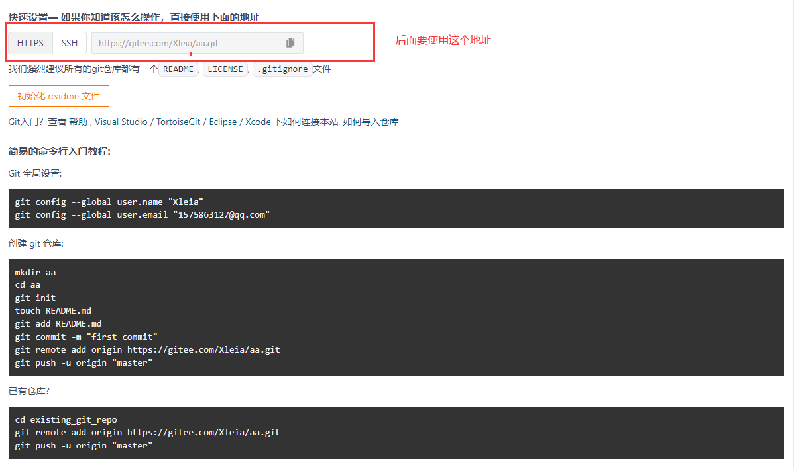
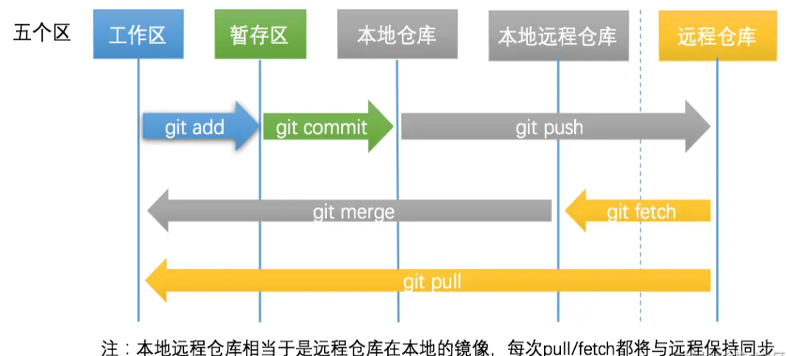

## git将本地仓库数据上传到远程仓库基本步骤

### 步骤一：注册仓库

先在gitee或者github上创建一个远程仓库并保存那个仓库地址



### 步骤二：初始化本地仓库

```shell
git init
```

### 步骤三：建立本地与仓库上新建项目连接

```shell
git remote add origin 仓库的地址(比如：git@xxxxxxxx.git)
```

### 步骤四：同步仓库的项目到本地

```shell
git pull origin master
```

### 步骤五：添加本地文件到缓存区

```shell
git add .
```

### 步骤六：为提交文件添加说明

```shell
git commit -m "first push"
```

### 步骤七：将本地文件提交到仓库

```shell
git push origin master
```

## git常用命令大全（自用）

### 创建仓库命令

<table class="legacy-table">
<thead>
<tr>
<th>命令</th>
<th>说明</th>
</tr>
</thead>
<tbody><tr>
<td><code>git init</code></td>
<td>初始化仓库，在当前文件夹会出现一个.git文件</td>
</tr>
<tr>
<td><code>git clone [url]</code></td>
<td>克隆一份远程仓库</td>
</tr>
</tbody></table>

### 配置命令

<table class="legacy-table">
<thead>
<tr>
<th>命令</th>
<th>说明</th>
</tr>
</thead>
<tbody><tr>
<td><code>git config --list</code></td>
<td>显示当前的Git所有配置</td>
</tr>
<tr>
<td><code>git config --global user.name &quot;xxx&quot;</code><br /><code>git config --global user.email &quot;xxx@xxx&quot;</code></td>
<td>设置个人用户信息（用户名和邮箱）</td>
</tr>
</tbody></table>

### 增加 & 删除文件命令

<table class="legacy-table">
<thead>
<tr>
<th>命令</th>
<th>说明</th>
</tr>
</thead>
<tbody><tr>
<td><code>git add [file1] [file2] ...</code></td>
<td>添加指定文件到缓存区</td>
</tr>
<tr>
<td><code>git add [dir]</code></td>
<td>添加指定目录到缓存区</td>
</tr>
<tr>
<td><code>git add .</code></td>
<td>添加当前目录的所有文件到缓存区</td>
</tr>
<tr>
<td><code>git add -p</code></td>
<td>添加每个变化前，都会要求确认</td>
</tr>
<tr>
<td><code>git rm [file1] [file2] ...</code></td>
<td>删除指定文件，并将此次删除的文件放入缓存区</td>
</tr>
<tr>
<td><code>git rm --cached [file]</code></td>
<td>停止追踪指定文件，但该文件会保留在工作区</td>
</tr>
<tr>
<td><code>git mv [file-original] [file-renamed]</code></td>
<td>改名文件，并将这个改名放入缓存区</td>
</tr>
</tbody></table>

### 提交命令

<table class="legacy-table">
<thead>
<tr>
<th>命令</th>
<th>说明</th>
</tr>
</thead>
<tbody><tr>
<td><code>git commit -m &quot;xxxxx&quot;</code></td>
<td>提交缓存区到仓库区</td>
</tr>
<tr>
<td><code>git commit [file1] [file2] ... -m &quot;xxxxx&quot;</code></td>
<td>提交缓存区的指定文件到仓库区</td>
</tr>
<tr>
<td><code>git commit -a</code></td>
<td>提交工作区自<strong>上次commit</strong>之后的变化，直接到仓库区</td>
</tr>
<tr>
<td><code>git commit -v</code></td>
<td>提交时显示所有的信息</td>
</tr>
<tr>
<td><code>git commit --amend -m &quot;xxxx&quot;</code></td>
<td>使用一个新的commit，替代上一次提交<br />如果代码没有任何变化，则用来改写上一次commit的提交信息</td>
</tr>
<tr>
<td><code>git commit --amend [file1] [file2] ...</code></td>
<td>重做上一次commit，并包括指定文件的新变化</td>
</tr>
</tbody></table>

### 分支命令

<table class="legacy-table">
<thead>
<tr>
<th>命令</th>
<th>说明</th>
</tr>
</thead>
<tbody><tr>
<td><code>git branch</code></td>
<td>列出所有本地分支</td>
</tr>
<tr>
<td><code>git branch -r</code></td>
<td>列出所有远程分支</td>
</tr>
<tr>
<td><code>git branch -a</code></td>
<td>列出所有本地和远程分支</td>
</tr>
<tr>
<td><code>git branch [branch-name]</code></td>
<td>新建一个分支</td>
</tr>
<tr>
<td><code>git checkout -b [branch-name]</code></td>
<td>新建一个分支，并切换到该分支</td>
</tr>
<tr>
<td><code>git checkout [branch-name]</code></td>
<td>切换到指定分支</td>
</tr>
<tr>
<td><code>git checkout -</code></td>
<td>切换到上一个分支</td>
</tr>
</tbody></table>

### 查看信息命令

<table class="legacy-table">
<thead>
<tr>
<th>命令</th>
<th>说明</th>
</tr>
</thead>
<tbody><tr>
<td><code>git status</code></td>
<td>显示有变更的文件</td>
</tr>
<tr>
<td><code>git log</code></td>
<td>显示当前分支的版本历史</td>
</tr>
<tr>
<td><code>git log --stat</code></td>
<td>显示commit历史，以及每次commit发生变更的文件</td>
</tr>
</tbody></table>

### 远程同步命令

<table class="legacy-table">
<thead>
<tr>
<th>命令</th>
<th>说明</th>
</tr>
</thead>
<tbody><tr>
<td><code>git fetch [remote]</code></td>
<td>下载远程仓库的所有变动</td>
</tr>
<tr>
<td><code>git remote -v</code></td>
<td>显示所有远程仓库</td>
</tr>
<tr>
<td><code>git remote add [origin] [url]</code></td>
<td>建立本地于远程仓库的连接并命名</td>
</tr>
<tr>
<td><code>git pull [remote] [branch]</code></td>
<td>下载远程仓库的代码，并于本地分支合并</td>
</tr>
<tr>
<td><code>git push [remote] [branch]</code></td>
<td>上传本地指定分支到远程仓库</td>
</tr>
<tr>
<td><code>git push [remote] --force</code></td>
<td>强制推送当前分支到远程仓库，即使有冲突</td>
</tr>
<tr>
<td><code>git push [remote] --all</code></td>
<td>推送所有分支到远程仓库</td>
</tr>
</tbody></table>

### 撤销命令

<table class="legacy-table">
<thead>
<tr>
<th>命令</th>
<th>说明</th>
</tr>
</thead>
<tbody><tr>
<td><code>git checkout [file]</code></td>
<td>恢复暂存区的指定文件到工作区</td>
</tr>
<tr>
<td><code>git checkout [commit] [file]</code></td>
<td>恢复某个commit的指定文件到暂存区和工作区</td>
</tr>
<tr>
<td><code>git checkout .</code></td>
<td>恢复暂存区的所有文件到工作区</td>
</tr>
<tr>
<td><code>git reset [file]</code></td>
<td>重置暂存区的指定文件，与上一次commit保持一致，但工作区不变</td>
</tr>
<tr>
<td><code>git reset --hard</code></td>
<td>重置暂存区与工作区，与上一次commit保持一致</td>
</tr>
<tr>
<td><code>git reset [commit]</code></td>
<td>重置当前分支的指针为指定commit，同时重置暂存区，但工作区不变</td>
</tr>
<tr>
<td><code>git reset --hard [commit]</code></td>
<td>重置当前分支的HEAD为指定commit，同时重置暂存区和工作区与指定commit一致</td>
</tr>
<tr>
<td><code>git reset --keep [commit]</code></td>
<td>重置当前HEAD为指定commit，但保持暂存区和工作区不变</td>
</tr>
<tr>
<td><code>git revert [commit]</code></td>
<td>新建一个commit，用来撤销指定commit<br/>后者的所有变化都将被前者抵消，并且应用到当前分支</td>
</tr>
<tr>
<td><code>git stash</code></td>
<td>暂时将未提交的变化移除，稍后再移入</td>
</tr>
<tr>
<td><code>git stash pop</code></td>
<td>暂时将未提交的变化移除，稍后再移入</td>
</tr>
</tbody></table>

## git提交代码流程


