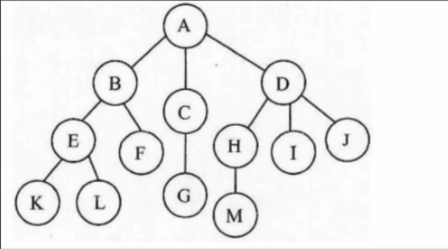
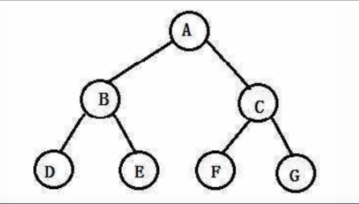
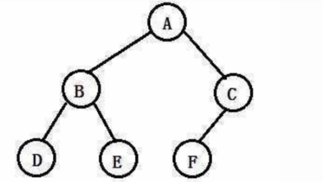

# 树形结构篇

树形结构就像下面这个图一样：

可以看到，每一个结点下都有子结点，并不断延申。像树一样，所以就成为<b>树（Tree）</b>，有一个特点就是，<b>每个结点都不与其他结点相交</b>

- 我们称最上方的结点为<b>根结点（root）</b>
- 每一个结点的子结点的数目（分支的数目），我们称为结点的<b>度（Degree）</b>，而各个结点度的最大值称为树的度
- 每个结点延伸下去的下一个结点都可以称为一颗<b>子树（SubTree）</b>
- 每个<b>结点的层次（Level）按照从上往下的顺序，书的根结点为1，每向下一层+1。整棵树中所有结点最大层次就是这个树的深度（Depth）</b>。比如上面那个树的深度就是4。

各结点之间的称呼：

- 当前结点直接向下连接的结点，称为<b>子结点</b>；相反，就是<b>父结点</b>
- 如果某个节点没有任何子结点（结点度为0时）那么就称这个结点为<b>叶子结点</b>
- 如果两个结点的父结点是同一个，那么称这两个结点为<b>兄弟结点</b>
- 从根结点开始一直到某个结点大的整个路径上的结点，都是这个结点的<b>祖先结点</b>（比如：L的祖先结点就是E、B、A）

---

## 二叉树

\*\*二叉树（Birnary Tree）\*\*是一种特殊的树，它的度最大只能为2，所以称为二叉树。

当然某些二叉树也有特殊的称呼。比如，在一棵二叉树中，所有分支结点都存在左子树和右子树，且叶子结点都在同一层：

这样的二叉树，就称为<b>满二叉树</b>，没有出现任何度为1的结点。还有一种特殊情况：

可以看到最后一层有空缺，但是所有叶子结点是按照从左往右的顺序排列的，这样的树我们称为<b>完全二叉树</b>。故，一颗满二叉树一定是一颗完全二叉树，但是一颗完全二叉树不一定是满二叉树。

## 二叉树的性质

由于二叉树的结构特殊，总结了了五个性质：

<ul>
<li></li>
</ul>

\*\*性质一：\*\*对于一颗二叉树，第$i$层的最大结点数量为$2^{i-1}$个，比如二叉树的第一层只有一个根结点，也就是$2^0=1$

<ul>
<li></li>
</ul>

\*\*性质二：\*\*对于一颗深度为 k 的二叉树，可以具有最大的结点数量为：

$$
n=2^0+2^1+2^2+…+2^{k-1}
$$

发现，实际上每一层的结点数量，组成等比数列求和公式，可以简化为：

$$
Sn=2^k-1
$$

所以一颗深度为 k 的二叉树结点数量为 $n = 2^k-1$

<ul>
<li></li>
</ul>

\*\*性质三：\*\*假设一颗二叉树中度为 0、1、2 的结点数量分别为 n0、n1、n2，由于一颗二叉树中只有这三种类型的结点，那么可以直接得到结点总数：

$$
n=n_0+n_1+n_2
$$

$$
n=n_1+2n_2+1
$$

对于任何一颗二叉树，如果其叶子结点个数为n0，度为2的结点个数为n2，那么

$$
n_0=n_2+1
$$

<ul>
<li></li>
</ul>

\*\*性质四：\*\*一颗具有 n 个结点的完全二叉树深度为 $k=\lfloor log_2n \rfloor+1$

<ul>
<li></li>
</ul>

\*\*性质五：\*\*一颗有n个结点的完全二叉树，由性质四得到深度为 $k= \lfloor log_2n\rfloor+1$现在对于任意一个结点i，结点的顺序为从上往下，从左往右:

- 对于一个拥有左右孩子的结点来说，其左孩子为 2i，右孩子为 2i + 1。
- 如果 \`i = 1，那么此结点为二叉树的根结点，如果i>1，那么其父结点就是\[i/2\]，比如第3个结点的父结点为第1个节点，也就是根结点。
- 如果2i > n，则结点i没有左孩子，比如下面图中的二叉树，n为5，假设此时i = 3，那么2i = 6 > n =5 说明第三个结点没有左子树。
- 如果2i +1 > n，则结点i没有右孩子。
