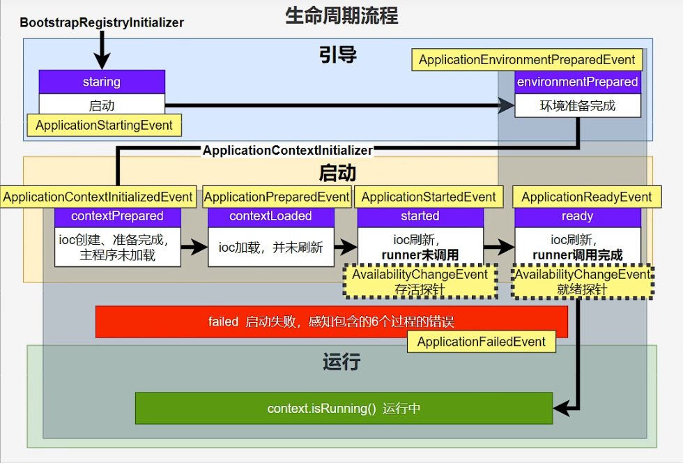
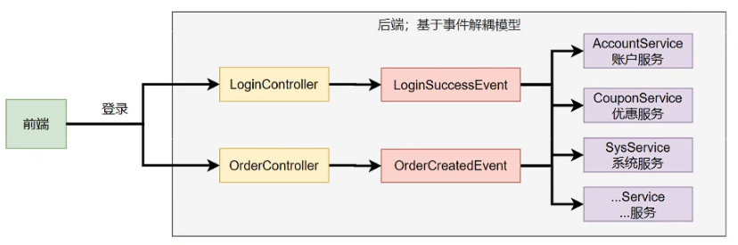
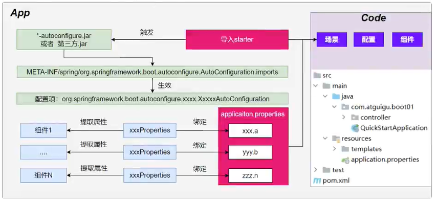
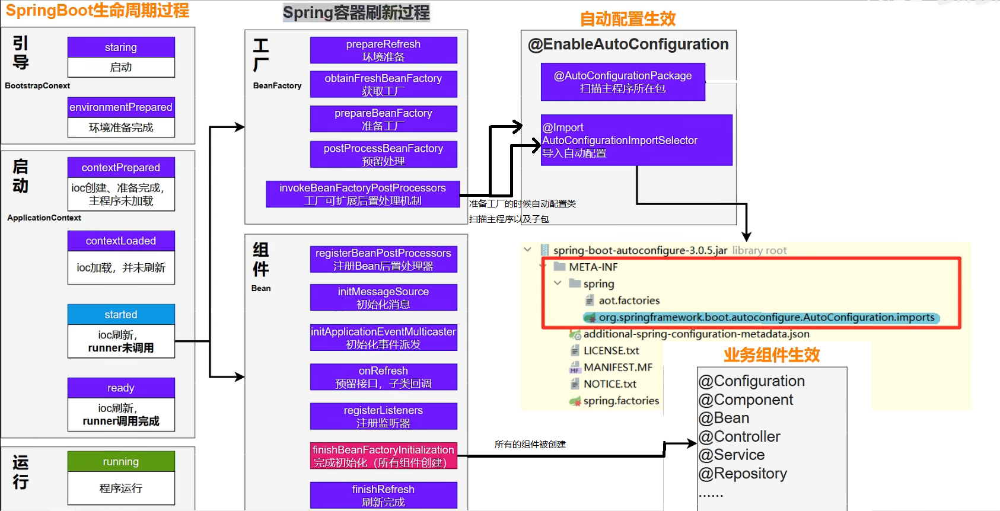

# SpringBoot3-核心原理

## 1、事件和监听器

### 1.1  生命周期监听

场景：监听应用的生命周期

#### 1.1.1 监听器

通过自定义<code>SpringApplicationRunListener</code>来监听事件

<b>步骤：</b>

<ul>
<li></li>
</ul>

编写<code>SpringApplicationRunListener</code>实现类

<ul>
<li></li>
</ul>

在资源文件夹下创建<code>META-INF/spring.factories</code>并配置<code>org.springframework.boot.SpringApplicationRunListener=自定义的Listener</code>，例如：

```javascript
org.springframework.boot.SpringApplicationRunListener=com.huang.listener.MyAppListener
```

#### 1.1.2 生命周期全流程

\*\*黄色文本框：\*\*事件

\*\*蓝色、红色文本框：\*\*监听



### 1.2 事件触发时机

#### 1.2.1 各种回调监听器

- <b>BootstrapRegistryInitializer</b>：感知特定阶段：感知引导初始化
- <code>META-INF/spring.factories</code>
- <b>ApplicationContextInitializer</b>：   感知特定阶段：感知ioc容器初始化
- <code>META-INF/spring.factories</code>
- <b>ApplicationListener</b>：                   感知全阶段：基于事件机制，感知事件。一旦到了哪个阶段可以做别的事
- <code>@Bean</code>或 <code>@EventListener</code>
- <code>SpringApplication.addListeners(...)</code>或<code>SpringApplicationBuilder.listeners(...)</code>
- <code>NETA-INF/spring.factories</code>
- <b>SpringApplicationRunListener</b>：  感知全阶段生命周期＋各种阶段都能自定义操作;功能更完善。
- <code>NETA-INF/spring.factories</code>
- <b>ApplicationRunner</b>：                    感知特定阶段：感知应用就绪Ready，如果卡死应用就不会就绪
- <code>@Bean</code>
- <b>CommandLineRunner</b>：               感知特定阶段：感知应用就绪Ready
- <code>@Bean</code>

总结：

- 如果要在项目启动前写操作：重写<code>BootstrapRegistryInitializer</code>和<code>ApplicationContextInitializer</code>
- 如果要在项目启动后写操作：重写<code>ApplicationRunner</code>和<code>CommandLineRunner</code>
- 如果要干涉生命周期做事：<code>SpringApplicationRunListenel</code>
- 如果想要用事件机制：<code>ApplicationListener</code>

#### 1.2.2 SpringBoot 事件驱动开发

应用启动过程生命周期事件感知(9大事件)、应用运行中事件感知（无数种)。

- 事件发布:：<code>ApplicationEventPublisherluware</code>或<code>注入：ApplicationEventMulticaster</code>
- 事件监听：<code>组件 ＋ @EventListener</code>



步骤：

<ul>
<li></li>
</ul>

创建需要发布事件的信息：自定义一个<code>事件类</code>继承<code>ApplicationEvent</code>并重写构造器方法（因为<code>ApplicationEvent</code>是一个抽象类所以必须重写）

```java
public class LoginSuccessEvent extends ApplicationEvent {

    /**
     * @param source 代表谁登录成功
     */
    public LoginSuccessEvent(Object source) {
        super(source);
    }
}
```

<ul>
<li></li>
</ul>

发布事件：自定义一个<code>事件发布类</code>实现<code>ApplicationEventPublisherluware</code>接口用来自动注入并可以调用底层的<code>publishEvent()</code>发布事件

```java
@Service
public class EventPublisher implements ApplicationEventPublisherAware {

    /**
     * 底层发送事件的组件，SpringBoot会通过ApplicationEventPublisherAware接口自动注入
     * 事件是通过广播出去的，所有监听这个事件的监听器都能收到
     */
    ApplicationEventPublisher applicationEventPublisher;

    /**
     * 所有事件都可以发（自定义的）
     *
     * @param event
     */
    public void sendEvent(ApplicationEvent event) {
        // 事件广播
        applicationEventPublisher.publishEvent(event);
    }

    @Override
    public void setApplicationEventPublisher(ApplicationEventPublisher applicationEventPublisher) {
        // 调用底层API发送事件
        this.applicationEventPublisher = applicationEventPublisher;
    }
}
```

<ul>
<li></li>
</ul>

监听事件：根据需求自定义<code>监听服务</code>，然后监听所需的事件。例子如下：

```java
@Service
public class AccountService implements ApplicationListener<LoginSuccessEvent> {

    public void addAccountScore(String username) {
        System.out.println(username + "加了一分");
    }

        // 方式一：
        @Override
        public void onApplicationEvent(LoginSuccessEvent event) {
            System.out.println("AccountService 收到事件");
            UserEntity source = (UserEntity) event.getSource();
            addAccountScore(source.getUsername());
        }

}
=========================================================================================
@Service
public class CouponService {

    public void sendCoupon(String username) {
        System.out.println(username + "得到了一张优惠券");
    }

    // 方式二：
    @EventListener
    public void onEvent(LoginSuccessEvent loginSuccessEvent) {
        UserEntity source = (UserEntity) loginSuccessEvent.getSource();
        sendCoupon(source.getUsername());
    }

}
```

<ul>
<li></li>
</ul>

创建事件并发布事件

<code>LoginController.java</code>类

```java
public class LoginController {
    @Autowired
    EventPublisher eventPublisher;
    // TODO 发布事件
    // 1、创建事件信息
    LoginSuccessEvent event = new LoginSuccessEvent(new UserEntity(username, password));
    // 2、发送事件
    eventPublisher.sendEvent(event);
}
```

## 2、自动配置原理

### 2.1 入门理解

\*\*三大核心：\*\*场景、配置、组件

#### 2.1.1 自动配置流程



- 导入<code>starter</code>
- 依赖导入<code>autoconfigurer</code>
- 寻找类路径下的<code>META-INF/spring/org.springframework.boot.autoconfigure.AutoConfiguration.imports</code>文件
- 启动、加载所有<code>自动配置类（xxxAutoConfiguration）</code>
- 给容器中配置功能组件
- 组件参数绑定到属性类中（<code>xxxPropertoes</code>）
- 属性类和配置文件前缀绑定
- <code>ConditionalOnXXXX</code>条件注解判断是否生效

#### 2.1.2 SPI机制

- Java中的SPI(Service Provider Interface)是一种软件设计模式，用于在应用程序中动态地发现和加载组件。SP的思想是，定义一个接口或抽象类，然后通过在classpath中定义实现该接口的类来实现对组件的动态发现和加载.
- SPI的主要目的是解决在应用程序中使用可插拔组件的问题。例如。一个应用程序可能需要使用不同的日志框架或数据库连接池，但是这些组件的选择可能取决于运行时的条件。通过使用SPI，应用程序可以在运行时发现并加载适当的组件，而无需在代码中硬编码这些组件的实现类。
- 在Java中，SPI的实现方式是通过在(META-INF/services目录下创建一个以服务接口全限定名为名字的文件。文件十包含实现该服务接口的类的全限定名。当应用程序启动时，Java的SPI机制会自动扫描classpath中的这些文件，并根据文件中指定的类名来加载实现类,
- 通过使用SPI，应用程序可以实现更灵活、可扩展的架构，同时也可以避免硬编码依赖关系和增加代码的可维护性。

<b>SPI机制的工作原理如下：</b>

- 开发者定义一个接口（服务接口），并在代码中引用该接口。
- 提供者（服务提供者）实现这个接口，并通过在类路径的META-INF/services目录下创建一个以接口名为命名的文件，文件内容为实现类的全限定名。
- 框架在运行时通过解析这些配置文件，动态加载并实例化所有的实现类，形成一个可用的服务列表。
- 开发者可以通过Java标准库中的<code>ServiceLoader</code>类来访问这个服务列表，从中选择对应的实现类进行使用。

使用SPI机制的好处是，它解耦了开发者和提供者的代码，使得开发者无需关心具体的实现细节，只需通过接口进行编程，并能够动态切换不同的实现类。同时，SPI机制也提供了一种扩展框架的方式，使得新增功能的实现变得更加简单和灵活。

<b>代码实现：</b>

服务接口定义：

```java
public interface Service {
    void execute();
}
```

服务提供者实现：

```java
public class ServiceImpl1 implements Service {
    @Override
    public void execute() {
        System.out.println("执行Service1的方法");
    }
}
public class ServiceImpl2 implements Service {
    @Override
    public void execute() {
        System.out.println("执行Service2的方法");
    }
}
```

服务提供者配置文件定义：在<code>META-INF/services/</code>路径下，创建<code>服务接口配置文件</code>（<b>注意：文件名为服务接口的全类名。例如：com.example.service.xxxx</b>），文件内容为实现接口的全类名

```txt
com.huang.service.impl.ServiceImpl1
com.huang.service.impl.ServiceImpl2
```

<code>ServiceLoader.load()</code>加载和调用服务：

```java
public class Main {
    public static void main(String[] args) {
        // 使用ServiceLoader加载Service接口的实现类
        ServiceLoader<Service> serviceLoader = ServiceLoader.load(Service.class);

        // 遍历并调用每个实现类的方法
        for (Service service:serviceLoader){
            service.execute();
        }
    }
}
```

#### 2.1.3 功能开关

以<code>@EableXxx</code>命名的：手动开启某些功能

- 开启xxx功能
- 都是利用<code>@Import</code>把功能组件导入进来

### 2.2 进阶理解

#### 2.2.1 @SpringBootApplication

<b>@SpringBootConfiguration</b>：

就是@Configuration，容器中的组件，配置类。spring ioc启动就会加载并创建这个类对象

<b>@EnableAutoConfiguration</b>：<b>开启自动配置</b>

- <b>@AutoConfigurationPackage</b>：<b>扫描主程序包的注解，加载自己的组件</b>

利用<code>@Import(AutoConfigurationPackages.Registrar.class)</code>给容器导入组件，把主程序所在的<b>包</b>的所有组件导入

- \*\*@Import(AutoConfigurationImportSelector.class)：\*\*加载所有的自动配置类（扫描SPI文件），加载starter导入的组件

<b>@ComponentScan</b>：<b>组件扫描注解，排除一些注解（因为前面注解已经扫描过了，此注解负责排除一些已经注入的组件）</b>



## 3、自定义stater

#### 基本抽取：

- 创建<code>starter</code>项目，把公共代码放入此项目，并把公共代码需要的所有依赖导入
- 自定义编写<code>xxxAutoConfiguration</code>，并导入此场景需要的所有组件
- 为什么这些组件不会默认扫描呢？因为<code>starter</code>所在包和引入它的项目的主程序入口所在的包不是父子关系
- 别的项目引用此<code>starter</code>时，通过<code>@Inport()</code>直接导入<code>xxxAutoConfiguration</code>就ok了

#### 使用Enable注解抽取

编写@Enable注解

```java
@Retention(RetentionPolicy.RUNTIME)
@Target({ElementType.TYPE})
@Documented
@Import(RobotAutoConfiguration.class)
public @interface EnableRobot {
}
```

此后引入<code>starter</code>只需要使用<code>@EnableRobot</code>注解就行了

#### 使用SPI抽取

在资源文件夹下建立<code>META-INF/spring/org.springframework.boot.autoconfigure.AutoConfiguration.imports</code>，并写入自动配置类的全类名

```txt
com.huang.robot.RobotAutoConfiguration
```

项目启动后就实现自动配置了
