# SpringBoot3-场景整合

在Linux系统上安装docker容器

```shell
sudo yum install -y yum-utils
sudo yum-config-manager \
> --add-repo \
> https://download.docker.com/linux/centos/docker-ce.repo
sudo yum install docker-ce docker-ce-cli containerd.io docker-buildx-plugin docker-compose-plugin

sudo systemctl enable docker --now

# 调试工作
docker ps
# 批量安装所有软件
docker compose
```

创建<code>/prod</code>文件夹（有则不需要），准备以下文件

docker-compose.yml

```yaml
version: '3.8'
services:
  redis:
    image: redis:latest
    ports:
      - '6379:6379'
    volumes:
      - redis-data:/data

  prometheus:
    image: prom/prometheus:latest
    ports:
      - '9090:9090'
    volumes:
      - ./prometheus.yml:/etc/prometheus/prometheus.yml
      - prometheus-data:/prometheus
    command:
      - '--config.file=/etc/prometheus/prometheus.yml'

  kafka:
    image: wurstmeister/kafka
    ports:
      - '9092:9092'
    environment:
      - KAFKA_ADVERTISED_HOST_NAME=kafka
      - KAFKA_ZOOKEEPER_CONNECT=zookeeper:2181
    volumes:
      - kafka-data:/kafka

  kafka-ui:
    image: provectuslabs/kafka-ui
    ports:
      - '8080:8080'
    environment:
      - KAFKA_CLUSTERS_0_NAME=local
      - KAFKA_CLUSTERS_0_BOOTSTRAP_SERVERS=kafka:9092
      - KAFKA_CLUSTERS_0_ZOOKEEPER_CONNECT=zookeeper:2181

  grafana:
    image: grafana/grafana:latest
    ports:
      - '3000:3000'
    depends_on:
      - prometheus

  zookeeper:
    image: wurstmeister/zookeeper
    ports:
      - '2181:2181'
    environment:
      - ZOOKEEPER_SERVER_ID=1
      - ZOOKEEPER_CLIENT_PORT=2181
      - ZOOKEEPER_TICK_TIME=2000
    volumes:
      - zookeeper-data:/data

  mysql:
    image: mysql:latest
    ports:
      - '3306:3306'
    environment:
      - MYSQL_ROOT_PASSWORD=yourpassword
      - MYSQL_DATABASE=yourdatabase
    volumes:
      - mysql-data:/var/lib/mysql

volumes:
  redis-data:
  prometheus-data:
  kafka-data:
  zookeeper-data:
  mysql-data:
```

prometheus.yml

```yaml
global:
  scrape_interval: 15s
  evaluation_interval: 15s

scrape_configs:
 - job_name: 'prometheus'
   static_configs:
     - targets: ['localhost:9090']

 - job_name: 'redis'
   static_configs:
     - targets: ['redis:6379']

 - job_name: 'kafka '
   static_configs:
     - targets: ['kafka:9092']
```

启动环境

```shell
docker compose -f docker-compose.yml up -d
```

## 1、NoSQL

### 1.1 Redis整合

#### 1.1.1 场景整合

导入redis依赖

```xml
<dependency>
    <groupId>org.springframework.boot</groupId>
    <artifactId>spring-boot-starter-data-redis</artifactId>
</dependency>
```

配置数据源

```javascript
spring.data.redis.host=111.230.48.114(此host为需要连接的redis的服务器的IP)
spring.data.redis.port=6379
```

测试

```java
@RestController
public class RedisTestController {

    @Autowired
    StringRedisTemplate stringRedisTemplate;

    @GetMapping("/count")
    public String count() {
        Long hello = stringRedisTemplate.opsForValue().increment("hello");
        return "访问了【" + hello + "】";
    }
}
```

#### 1.1.2 自动配置原理

SpringBoot启动是会加载<code>META-INF/spring/org.springframework.boot.autoconfigure.AutoConfiguration.imports</code>文件中的<code>RedisAutoConfiguration</code>类。

- <code>RedisAutoConfiguration</code>类配置了以下组件
- <code>LettuceConnectionConfiguration</code>给容器中注入连接工厂<code>LettuceConnectionFactory</code>和操作redis的客户端<code>DefaultClientResources</code>
- <code>RedisTemplate</code>：可以给redis中存放任意对象，会使用jdk默认序列化方式
- <code>StringRedisTemplate</code>：给redis中存放字符串，如果要存放对象，需自行进行序列化。

所有的属性绑定在<code>RedisProperties</code>类中

#### 1.1.3 自定义序列化

redis采用的序列化机制默认是jdk的序列化<code>JdkSerializationRedisSerializer()</code>。

我们可以自定义序列化规则

```java
@Bean
public RedisTemplate<Object, Object> redisTemplate(RedisConnectionFactory redisConnectionFactory) {
    RedisTemplate<Object, Object> template = new RedisTemplate<>();
    template.setConnectionFactory(redisConnectionFactory);
    // 把对象转为json字符串的序列化工具
    template.setDefaultSerializer(new GenericJackson2JsonRedisSerializer());
    return template;
}
```

#### Redis事务处理

由于 spring 并没有专门的 redis 提供事务管理器，但是可以借助 jdbc 提供的。

操作步骤：

```xml
<dependency>
    <groupId>org.springframework.boot</groupId>
    <artifactId>spring-boot-starter-data-jdbc</artifactId>
</dependency>

<dependency>
    <groupId>com.mysql</groupId>
    <artifactId>mysql-connector-j</artifactId><!--Driver驱动-->
</dependency>
```

```java
@Service
public class RedisService {

    @Resource
    StringRedisTemplate template;

    @PostConstruct
    public void init() {
        template.setEnableTransactionSupport(true);  // 需要开启事务
    }

    @Transactional  // 需要开启此注解
    public void test() {
        template.multi();
        template.opsForValue().set("d", "xxxxx");
        template.exec();
    }
}
```

#### Redis做缓存

二级缓存，不过它是Mapper级别的缓存，能够作用与所有会话。

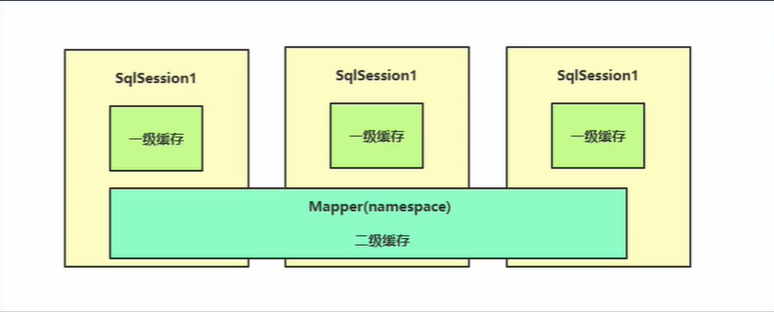

#### Mybatis二级缓存

Mybatis也能够做二级缓存，不过有一个问题，就是由于Mybatis默认的二级缓存只能是单机的，如果存在多态服务器访问同一个数据库，实际上二级缓存只会在各个服务器上生效。但是我们想在多台服务器上都能使用同一个二级缓存，这样就不会造成过多的资源浪费。

我们可以将Redis作为Mybatis的二级缓存，这样就能够实现多台服务器使用同一个二级缓存了，它们只需要连接同一台Redis服务器即可，所有的缓存数据全部存储在Redis服务器上。需要手动实现Mybatis提供的Cache接口，如下：

```java
public class MybatisRedisCache implements Cache {

    private final String id;
    private static RedisTemplate<Object, Object> template;

    //构造方法必须带一个String类型的参数接收id
    public MybatisRedisCache(String id) {
        this.id = id;
    }

    //初始化时通过配置类将RedisTemplate给过来
    public static void setTemplate(RedisTemplate<Object, Object> template) {
        MybatisRedisCache.template = template;
    }

    @Override
    public String getId() {
        return id;
    }

    @Override
    public void putObject(Object key, Object value) {
        //这里直接向Redis数据库中丢数据，第一个参数为key，第二个为value
        template.opsForValue().set(key, value, 60, TimeUnit.SECONDS);
    }

    @Override
    public Object getObject(Object key) {
        //根据key直接从redis数据库中获取值
        return template.opsForValue().get(key);
    }

    @Override
    public Object removeObject(Object key) {
        //根据key删除value
        return template.delete(key);
    }

    @Override
    public void clear() {
        //由于template中没有封装清除操作，之呢个通过connection来执行
        template.execute((RedisCallback<Void>) connection -> {
            connection.serverCommands();
            return null;
        });
    }

    @Override
    public int getSize() {
        //这里也是用connection对象来获取当前key的数量
        return template.execute(RedisServerCommands::dbSize).intValue();
    }
}
```

缓存类编写完成后，接着编写配置类

```java
@Configuration
public class MybatisConfiguration {

    @Resource
    private RedisTemplate<Object, Object> redisTemplate;

    @PostConstruct
    public void init() {
        MybatisRedisCache.setTemplate(redisTemplate);
    }
}
```

然后再Mapper上启用此缓存

```java
@CacheNamespace(implementation = MybatisRedisCache.class)
@Mapper
public interface CacheMapper {
    @Select("select username from db1.user where password=222222")
    String getSid();
}
```

最后测试

```java
@SpringBootTest
class Boot309RedisApplicationTests {
    @Test
    void cacheTest(){
        cacheMapper.getSid();
    }
}
```

查看Redis数据库可以看到有一条Mybatis生成的缓存数据了

#### Token持久化存储

将token信息保存到Redis缓存当中，只需要实现  接口

```java
public class RedisTokenRepository implements PersistentTokenRepository {

    //Key名前缀，用于区分
    private final static String REMEMBER_ME_KEY = "spring:security:rememberMe";
    @Resource
    RedisTemplate<Object, Object> template;

    @Override
    public void createNewToken(PersistentRememberMeToken token) {
        //这里要放置两个，一个存seriesId->Token，一个存username->seriesId，因为删除时是通过username删除
        template.opsForValue().set(REMEMBER_ME_KEY + "username:" + token.getUsername(), token.getSeries());
        template.expire(REMEMBER_ME_KEY + "username:" + token.getUsername(), 1, TimeUnit.DAYS);
        this.setToken(token);
    }

    //先获取，然后修改创建一个新的，再放入
    @Override
    public void updateToken(String series, String tokenValue, Date lastUsed) {
        PersistentRememberMeToken token = this.getToken(series);
        if (token != null) {
            this.setToken(new PersistentRememberMeToken(token.getUsername(), series, tokenValue, lastUsed));
        }
    }

    @Override
    public PersistentRememberMeToken getTokenForSeries(String seriesId) {
        return this.getToken(seriesId);
    }

    @Override
    public void removeUserTokens(String username) {
        String series = (String) template.opsForValue().get(REMEMBER_ME_KEY + "username:" + username);
        template.delete(REMEMBER_ME_KEY + series);
        template.delete(REMEMBER_ME_KEY + "username:" + username);
    }

    //由于PersistentRememberMeToken没有实现序列化接口，就只能使用Hash来存储，所以单独编写set和get操作
    private PersistentRememberMeToken getToken(String series) {
        Map<Object, Object> map = template.opsForHash().entries(REMEMBER_ME_KEY + series);
        if (map.isEmpty()) return null;
        return new PersistentRememberMeToken(
            (String) map.get("username"),
            (String) map.get("series"),
            (String) map.get("tokenValue"),
            new Date(Long.parseLong((String) map.get("date")))
        );
    }

    private void setToken(PersistentRememberMeToken token) {
        Map<String, String> map = new HashMap<>();
        map.put("username", token.getUsername());
        map.put("series", token.getSeries());
        map.put("tokenValue", token.getTokenValue());
        map.put("date", String.valueOf(token.getDate().getTime()));
        template.opsForHash().putAll(REMEMBER_ME_KEY + token.getSeries(), map);
        template.expire(REMEMBER_ME_KEY + token.getSeries(), 1, TimeUnit.DAYS);
    }
}
```

#### 三大缓存问题

#### 缓存穿透

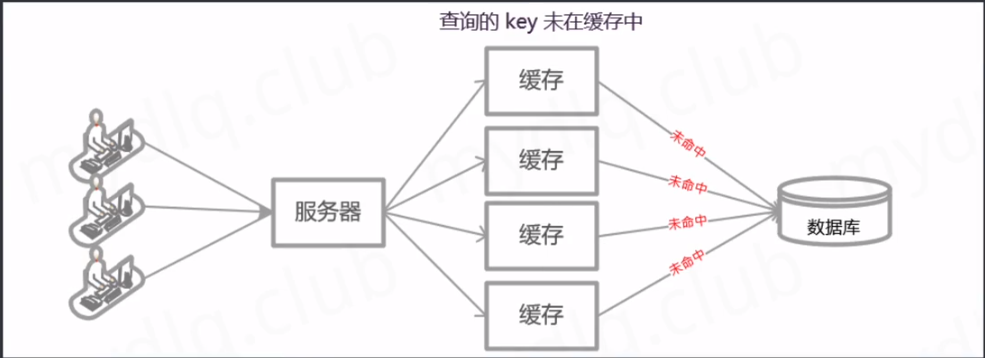

当我们去查询一个一定不存在的数据，比如Mybatis在缓存是未命中的情况下需要从数据库查询，查不到数据则不写入缓存，这将导致这个不存在的数据每次请求都要到数据库去查询，造成缓存穿透。

这显然是很浪费资源的，我们希望的是，如果这个数据不存在，为什么缓存这一层不直接返回空呢，这时就不必再去查数据库了，但是也有一个问题，缓存不去查数据库怎么知道数据库里面到底有没有这个数据呢?

我们可以使用布隆过滤器来判断，什么是布隆过滤器？

使用布隆过滤器，能够告诉你某样东西<b>一定不存在</b>或是<b>某样东西可能存在</b>。

布隆过滤器本质是一个存放二进制位的bit数组，如果我们要添加一个值到布隆过滤器中，我们需要使用N个不同的哈希函数来生成N个哈希值，并对每个生成的哈希值指向的bit位置1，如上图所示，一共添加了三个值abc。

接着我们给一个d，那么这时就可以进行判断，如果说d计算的N个哈希值的位置上都是1，那么就说明d可能存在;这时候又来了个e,计算后我们发现有一个位置上的值是0，这时就可以直接断定e一定不存在。

#### 缓存击穿

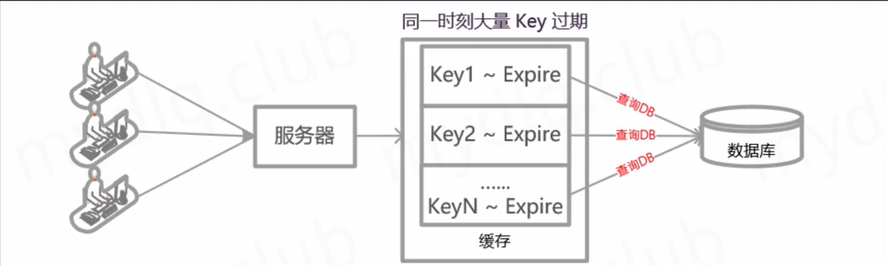

某个Key属于热点数据，访问非常频繁，同一时间很多人都在访问，在这个Key失效的瞬间，大量的请求到来，这时发现缓存中没有数据，就全都直接请求数据库，相当于击穿了缓存屏障，直接攻击整个系统核心。

这种情况下，最好的解决办法就是不让Key那么快过期，如果一个Key处于高频访问，那么可以适当地延长过期时间。获取设置Key的过期时间不一样。

#### 缓存雪崩

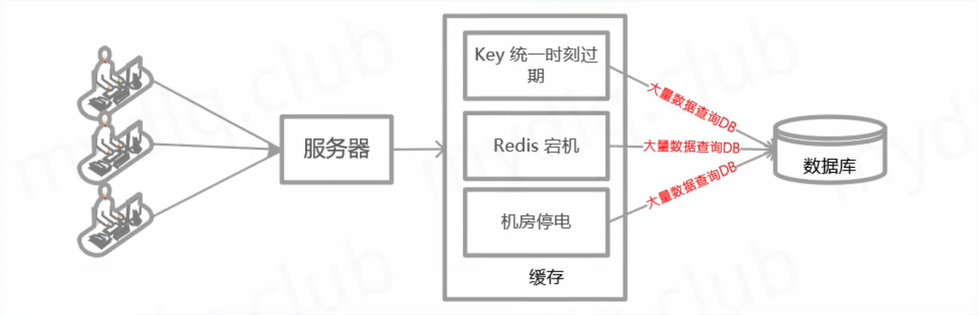

当你的Redis服务器宕机了或是大量的Key在同一时间过期，这时相当于缓存直接挂了，那么如果这时又有很多的请求来访问不同的数据，同一时间内缓存服务器就得向数据库大量发起请求来重新建立缓存，很容易把数据库也搞挂。

解决这种问题最好的办法就是设置高可用，也就是搭建Redis集群，当然也可以采取一些服务熔断降级机制。

#### redis客户端

RedisTemplate、StringRedisTemplate：都是操作redis的工具类

- 要从redis的连接工厂获取连接才能操作redis
- Redis客户端：
- Jedis
- Lettuce（默认）

切换redis客户端，首先导入新客户端的坐标，并排除默认的客户端坐标

```xml
<dependency>
    <groupId>org.springframework.boot</groupId>
    <artifactId>spring-boot-starter-data-redis</artifactId>
    <exclusions>
        <exclusion>
            <groupId>io.lettuce</groupId>
            <artifactId>lettuce-core</artifactId>
        </exclusion>
    </exclusions>
</dependency>
<dependency>
    <groupId>redis.clients</groupId>
    <artifactId>jedis</artifactId>
</dependency>
```

在配置文件中切换客户端

```javascript
spring.data.redis.client-type=jedis
```

## 2、接口文档

### 2.1 OpenAPI 和 Swagger

swagger可以快速生成实时接口文档，方便前后端开发，遵循OpenAPI规范

### 2.2 Swagger 整合

导入坐标

```xml
<dependency>
    <groupId>org.springdoc</groupId>
    <artifactId>springdoc-openapi-starter-webmvc-ui</artifactId>
    <version>2.1.0</version>
</dependency>
<!-----或者----->
<dependency>
    <groupId>io.springfox</groupId>
    <artifactId>springfox-boot-starter</artifactId>
    <version>3.0.0</version>
</dependency>
```

### 2.3、使用

#### 常用注解

<table class="legacy-table">
<thead>
<tr>
<th>注解</th>
<th>标注位置</th>
<th>作用</th>
</tr>
</thead>
<tbody><tr>
<td>@Tag</td>
<td>controller类</td>
<td>标识controller作用</td>
</tr>
<tr>
<td>@Parameter</td>
<td>参数</td>
<td>标识参数作用</td>
</tr>
<tr>
<td>@Parameters</td>
<td>参数</td>
<td>标识参数作用（多个）</td>
</tr>
<tr>
<td>@Schema</td>
<td>model层的JavaBean</td>
<td>描述模型作用及每个属性</td>
</tr>
<tr>
<td>@operation</td>
<td>方法</td>
<td>描述方法作用</td>
</tr>
<tr>
<td>@ApiResponse</td>
<td>方法</td>
<td>描述响应状态码</td>
</tr>
</tbody></table>

#### Docket配置

如果有多个docket，可以进行分组

```java
@Configuration
public class SwaggerUIConfig {

    @Bean
    public GroupedOpenApi publicApi(){
        return GroupedOpenApi
            .builder()
            .group("spring-public")
            .pathsToMatch("/public/**")
            .build();
    }

    @Bean
    public GroupedOpenApi adminApi(){
        return GroupedOpenApi
            .builder()
            .group("spring-admin")
            .pathsToMatch("/admin/**")
            .addOpenApiMethodFilter(method -> method.isAnnotationPresent(Admin.class))
            .build();
    }
}
```

如果只有一个也可以在配置文件中配置

```javascript
springdoc.packages-to-scan=xxx
springdoc.paths-to-match=/xx/**
```

#### OpenAPI配置

```java
@Bean
public OpenAPI docsOpenAPI() {
    return new OpenAPI()
        .info(new Info()
              .title("springShop API")
              .description("Spring shop sample application")
              .version("v0.0.1")
              .license(new License().name("Apache 2.0").url("http://sprinqdoc.org")))
        .externalDocs(new ExternalDocumentation()
                      .description("SpringShop Wiki Documentation")
                      .url("https://springshop.wiki.github.org/docs"));
}
```

## 3、远程调用

<b>RPC（Remote Procedure Call）：远程过程调用</b>

### 3.1 WebClient

非阻塞、响应式HTTP客户端

#### 3.1.1 创建和配置

创建<code>WebClient</code>：

- <code>WebClient.create()</code>
- <code>WebClient.create(String baseUrl)</code>

使用<code>WebClient.builder()</code>配置参数项：

- <code>uriBuilderFactory</code>：定义baseurl
- <code>dafaultUrlVariables</code>：设置默认uri变量
- <code>dafaultUrlHeader</code>：设置默认请求头
- <code>dafaultUrlCookie</code>：设置默认请求cookie
- <code>defaultRequest:Consumer</code>：自定义每个请求
- <code>filter</code>：过滤client发送的每个请求
- <code>exchangeStrtegies</code>：HTTP消息reader/writer自定义
- <code>clientConnector</code>：HTTP client库设置

#### 3.1.2 获取响应

以获取aliyun的天气查询api为例

```java
@Service
public class WeatherService {

    public Mono<String> weather(String city) {

        // 远程调用aliyun的API

        Mono<String> mono = getByWebClient(city);
        
        return mono;
    }
    
     private static Mono<String> getByWebClient(String city) {
        //1、创建webClient
        WebClient webClient = WebClient.create();

        Map<String, String> params = new HashMap<>();
        params.put("city", city);
        //2、定义发请求行为
        return webClient.get()
                .uri("https://ali-weather.showapi.com/area-to-weather-date?area={city}", params)
                .accept(MediaType.APPLICATION_JSON)// 定义响应的内容类型
                .header("Authorization", "APPCODE 955e02545445408b86a7c64c5592fb90")
                .retrieve()
                .bodyToMono(String.class);
    }
}
```

### 3.2 HTTP Interface

Spring允许通过自定义接口方式，给任意位置发送http请求，实现远程调用，只需导入<code>webflux</code>场景即可

#### 3.2.1 导入依赖

```xml
<dependency>
    <groupId>org.springframework.boot</groupId>
    <artifactId>spring-boot-starter-webflux</artifactId>
</dependency>
```

#### 3.2.2 定义接口

```java
public interface WeatherInterface {

    @GetExchange(url = "/area-to-weather-date", accept = "application/json")
    Mono<String> getWeather(@RequestParam("area") String city,
                    @RequestHeader("Authorization") String header);

}
```

#### 3.2.3 创建代理&测试

```java
@Service
public class WeatherService {

    public Mono<String> weather(String city) {

        // 远程调用aliyun的API

        Mono<String> mono = getByHttpInterface(city);

        return mono;
    }
    
    private static Mono<String> getByHttpInterface(String city) {
        // 1、创建客户端
        WebClient client = WebClient.builder()
                .baseUrl("https://ali-weather.showapi.com")
                .build();

        // 2、创建工厂
        HttpServiceProxyFactory factory = HttpServiceProxyFactory
                .builder(WebClientAdapter.forClient(client)).build();
        // 3、获取代理对象
        WeatherInterface weatherAPI = factory.createClient(WeatherInterface.class);


        return weatherAPI.getWeather(city, "APPCODE 955e02545445408b86a7c64c5592fb90");
    }
}
```

测试：

```java
@RestController
public class WeatherController {

    @Autowired
    WeatherService weatherService;

    @GetMapping("/weather")
    public Mono<String> weather(@RequestParam("city") String city){
        // 查询天气
        return weatherService.weather(city);
    }
}
```

---

如果为了复用性，可以把创建工厂的方法直接注入到ioc容器中，到时候要调用就<b>直接引工厂，然后创建代理对象就行</b>。代码如下：

[APIConfiguration.java](http://APIConfiguration.java)

```java
@Configuration
public class APIConfiguration {

    @Bean
    HttpServiceProxyFactory httpServiceProxyFactory() {
        // 1、创建客户端
        WebClient client = WebClient.builder()
          // 设置默认头
            .defaultHeader("Authorization","APPCODE 955e02545445408b86a7c64c5592fb90")
            .build();
        // 2、创建工厂
        return HttpServiceProxyFactory
            .builder(WebClientAdapter.forClient(client)).build();
    }


    @Bean
    WeatherInterface weatherInterface(HttpServiceProxyFactory httpServiceProxyFactory) {
        // 3、获取代理对象
        return httpServiceProxyFactory.createClient(WeatherInterface.class);
    }

}
```

WeatherInterface.class

```java
public interface WeatherInterface {

    @GetExchange(url = "https://ali-weather.showapi.com/area-to-weather-date", accept = "application/json")
    Mono<String> getWeather(@RequestParam("area") String city);

}
```

测试：[WeatherController.java](http://WeatherController.java)

```java
@RestController
public class WeatherController {

    @Autowired
    WeatherInterface weatherInterface;

    @GetMapping("/weather")
    public Mono<String> weather(@RequestParam("city") String city){
        // 查询天气
        return weatherInterface.weather(city);
    }
}
```

## 4、消息服务

### 4.1 消息队列场景

#### 异步

场景一：

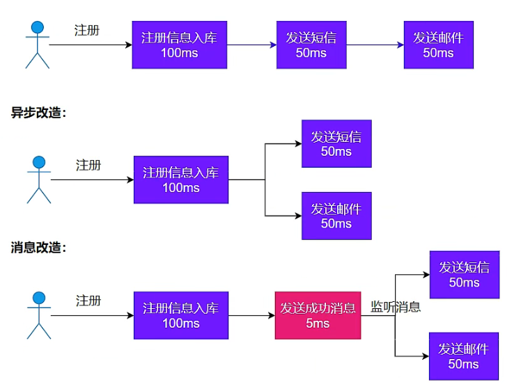

#### 解耦

场景二：

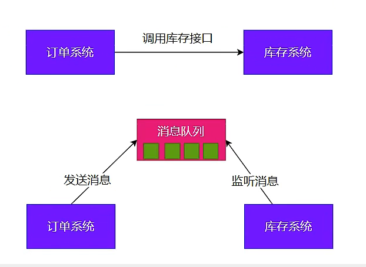

#### 削峰

场景三：

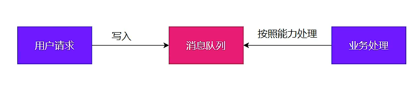

#### 缓冲

场景四：

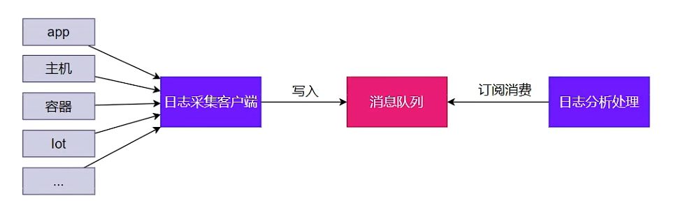

### 4.2 消息中间件–Kafka

#### 1、消息模式

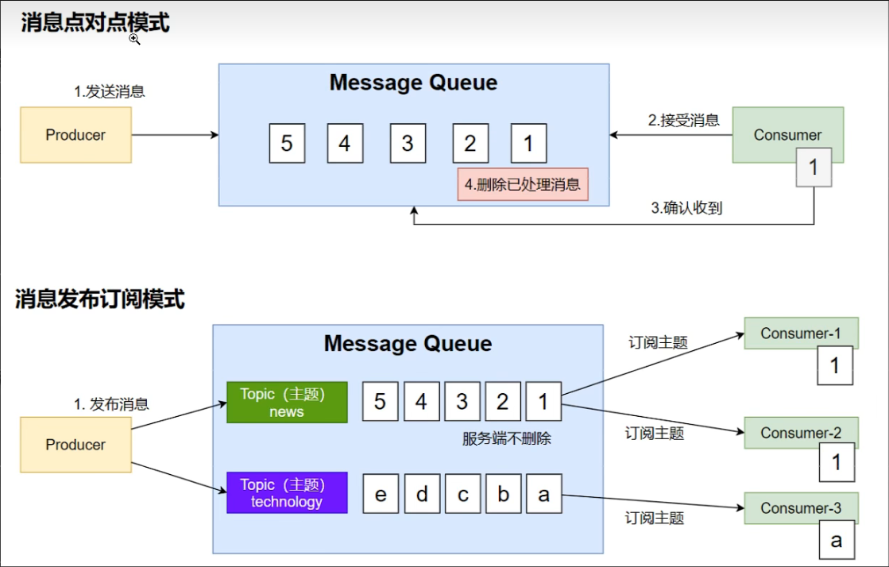

#### 2、Kafka工作原理

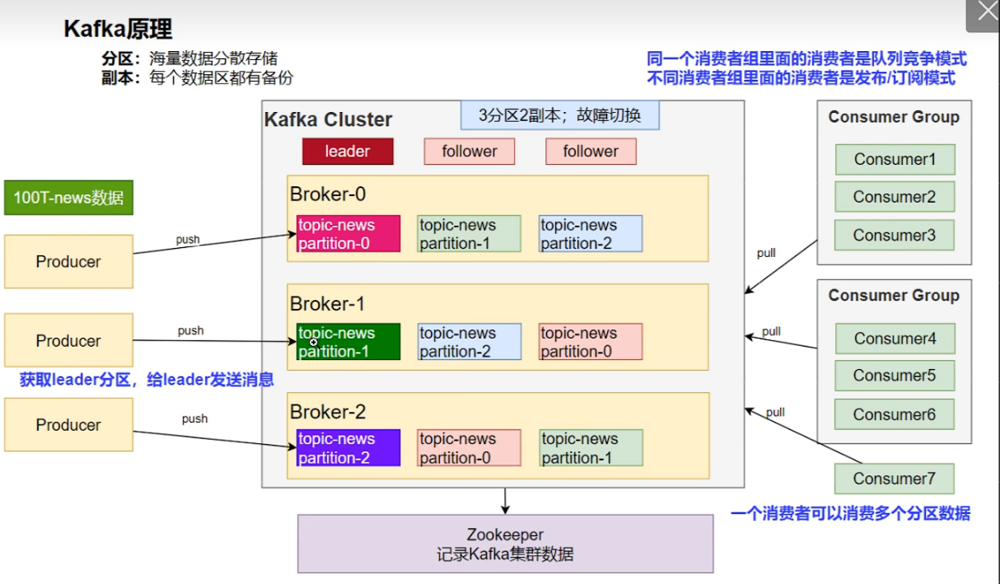

### 4.3 SpringBoot整合kafka

#### 发布消息

导入坐标：

```xml
<!--整合Kafka-->
<dependency>
    <groupId>org.springframework.kafka</groupId>
    <artifactId>spring-kafka</artifactId>
</dependency>
```

配置信息：

```javascript
spring.kafka.bootstrap-servers=host:9092
```

修改<code>C:\Windows\System32\drivers\etc\hosts</code>文件，配置<code>host(IP地址) kafka(自己配置的名字)</code>

生产者发生消息测试：

```java
@Autowired
KafkaTemplate kafkaTemplate;

@Test
void contextLoads() {

    StopWatch stopWatch = new StopWatch();

    CompletableFuture[] futures = new CompletableFuture[10000];

    stopWatch.start();
    for (int i = 0; i < 10000; i++) {
        CompletableFuture future = kafkaTemplate.send("newshaha", "haha", "哈哈哈");
        futures[i] = future;
    }
    CompletableFuture.allOf(futures)
        .join();
    stopWatch.stop();

    long millis = stopWatch.getTotalTimeMillis();
    System.out.println("10000消息发送时间：" + millis + "ms");
}
```

上面演示发送的 k-v 都是String类型的，但是如果发送的不是String类型的，比如以下的就会<b>报错</b>

```java
CompletableFuture future = kafkaTemplate.send("newshaha", "person", new Person("xxx","xxx","xxx"));
```

因为kafka默认使用的是String的序列化器。我们可以在配置文件中指定其他的系列化规则

```javascript
# 默认是这个StringSerializer
spring.kafka.producer.key-serializer=org.apache.kafka.common.serialization.StringSerializer
spring.kafka.producer.value-serializer=org.springframework.kafka.support.serializer.JsonSerializer
```

#### 监听消息

<b>首先</b>确保自定义的监听器是spring boot的组件，<b>然后</b>通过注解<code>@KafkaListener</code>来监听消息

```java
@Component
public class MyKafkaTopicListener {

    // 默认监听是从消息队列最后一个消息开始拿。新消息才能拿到
    @KafkaListener(topics = "newshaha", groupId = "haha")
    public void haha(ConsumerRecord record) {
        //1、获取消息的各种详细信息
        String topic = record.topic();
        Object key = record.key();
        Object value = record.value();
        System.out.println(topic + "收到消息。。。key：" + key + "，value：" + value);
    }


    // 拿完整消息
    @KafkaListener(groupId = "hehe", topicPartitions = {
        @TopicPartition(topic = "newshaha", partitionOffsets = {
            @PartitionOffset(partition = "0", initialOffset = "0")
        })
    })
    public void hehe(ConsumerRecord record) {
        //1、获取消息的各种详细信息
        String topic = record.topic();
        Object key = record.key();
        Object value = record.value();
        System.out.println(topic + "收到消息。。。key：" + key + "，value：" + value);
    }

}
```

#### 接收消息

通过<code>@EnableKafka + @KafkaListener</code>来接收消息

## 5、Web安全

- Apache Shiro
- Spring Security

### 5.1 Spring Security

#### 1、安全认证

#### 认证：Authentication

登录系统、用户系统

#### 授权：Authorization

权限管理、用户授权

#### 攻击防护

<b>XSS（Cross-Site Scripting）</b>：跨站脚本攻击<br /><b>CSRF（Cross-Site Request Forgery）</b>：跨站请求伪造<br /><b>CORS（Cross-Origin Resource Sharing）</b>：跨域资源共享<br /><b>SQL注入</b><br />。。。

#### 权限模型

<b>RBAC（Role-Based Access Control）</b>：基于角色的访问控制

- 用户（t\_user）
- 角色（t\_role）
- 权限（t\_permission）

<b>ACL（Access Control List）</b>：Access Control List

- 用户（t\_user）
- 权限（t\_permission）

#### 2、SpringSecurity原理

#### 过滤器链架构

SpringSecurity利用FilterChainProxy封装一系列拦截器链，实现安全拦截

Servlet三大组件：Servlet、Filter、Listener

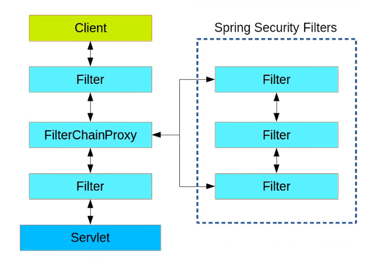

#### FilterChainProxy

使用<code>FilterChainProxy</code>对不同路径下的请求定义不同的过滤规则。例如：

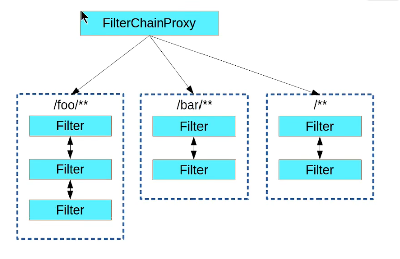

#### SecurityFilterChain

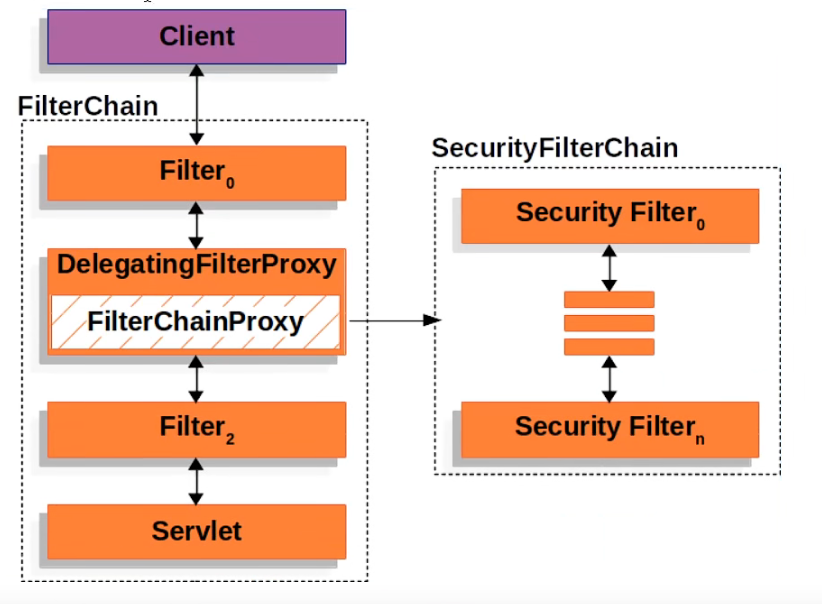

#### 3、使用

自定义<code>SecurityConfiguration.java</code>

```java
/**
 * 1、自定义请求授权规则：http.authorizeHttpRequests()
 * 2、自定义登录规则：http.formLogin()
 * 3、自定义用户信息查询规则：UserDetailsService
 * 4、开启方法级别的精确权限控制：@EnableMethodSecurity
 */

@EnableMethodSecurity
@Configuration
public class SecurityConfiguration {

    @Bean
    SecurityFilterChain securityFilterChain(HttpSecurity http) throws Exception {
        // 请求授权
        http.authorizeHttpRequests(registry -> {
            registry.requestMatchers("/").permitAll() //首页所有人都可访问
                .anyRequest().authenticated(); // 剩下的任意请求都需要认证
        });
        // 开启默认表单登录功能表单登录功能
        http.formLogin(formLogin -> {
            formLogin.loginPage("/login").permitAll(); // 自定义登录页位置，并且所有人都能访问
        });
        return http.build();
    }

    // 查询用户详细，此处使用的是在内存中添加，也可改为查询数据库的
    @Bean
    UserDetailsService userDetailsService(PasswordEncoder passwordEncoder) {
        UserDetails zhangsan = User.withUsername("zhangsan")  // 自定义用户账号，不使用security默认
            .password(passwordEncoder.encode("123456"))  // 自定义用户密码，必须加密，否则报错
            .roles("admin")  // 设置用户角色
            .authorities("file_reda", "file_write","world_exec") // 设置用户权限
            .build();
        UserDetails lisi = User.withUsername("lisi")
            .password(passwordEncoder.encode("123456"))
            .roles("hr")
            .authorities("file_reda")
            .build();

        // 默认内存保存所有用户信息
        return new InMemoryUserDetailsManager(zhangsan, lisi);
    }

    // 放一个密码加密器
    @Bean
    PasswordEncoder passwordEncoder() {
        return new BCryptPasswordEncoder();
    }
}
```

[LoginController.java](http://LoginController.java)

```java
@Controller
public class LoginController {

    @GetMapping("/login")
    public String loginPage() {
        return "login";
    }
}
```

[HelloController.java](http://HelloController.java)

```java
@RestController
public class HelloController {

    @GetMapping("/hello")
    public String hello(){
        return "Hello Security";
    }

    @PreAuthorize("hasAuthority('world_exec')")
    @GetMapping("/world")
    public String world(){
        return "World Security";
    }
}
```

index.html

```html
<!DOCTYPE html>
<html lang="en" xmlns:th="http://www.thymeleaf.org">
    <head>
        <meta charset="UTF-8">
        <title>Title</title>
    </head>
    <body>
        Welcome to security<br/>
        <a th:href="@{/hello}">hello</a>
        <a th:href="@{/world}">world</a>
    </body>
</html>
```

login.html

```html
<!DOCTYPE html>
<html lang="en" xmlns:th="http://www.thymeleaf.org">
    <head>
        <meta charset="UTF-8">
        <title>Title</title>
    </head>
    <body>
        <div th:if="${param.error}">用户或密码错误</div>
        <div th:if="${param.logout}">退出登录</div>
        <form th:action="@{/login}" method="post">
            <div>
                <label>Username: <input type="text" name="username"></label>
            </div>
            <div>
                <label>Password: <input type="password" name="password"></label>
            </div>
            <div>
                <input type="submit" name="登录">
            </div>
        </form>
    </body>
</html>
```

## 6、可观测性

对线上应用进行观测、监控、预警。。。

- 健康状态
- 运行指标
- 链路追踪
- 。。。

### 6.1 SpringBoot Actuator整合

#### 导入坐标场景

```xml
<!--可观测性整合-->
<dependency>
    <groupId>org.springframework.boot</groupId>
    <artifactId>spring-boot-starter-actuator</artifactId>
</dependency>
```

当导入之后可以运行项目测试，访问路径 [localhost:8080/actuator，出现如下就导入成功](http://localhost:8080/actuator%EF%BC%8C%E5%87%BA%E7%8E%B0%E5%A6%82%E4%B8%8B%E5%B0%B1%E5%AF%BC%E5%85%A5%E6%88%90%E5%8A%9F)

```json
{
    "_links": {
        "self": {
            "href": "http://localhost:8080/actuator",
            "templated": false
        },
        "health": {
            "href": "http://localhost:8080/actuator/health",
            "templated": false
        },
        "health-path": {
            "href": "http://localhost:8080/actuator/health/{*path}",
            "templated": true
        }
    }
}
```

#### 暴露指标

```javascript
#暴露所有监控端点
management.endpoints.web.exposure.include=*
```

#### 自定义端点

除了可以暴露springboot自带的端点外，还可以自定义端点来监控<b>各种组件</b>。比如：<code>健康监控（是否存活）</code>、<code>指标监控（次数、效率）</code>

#### 健康监控

比如：自定义了一个组件MyComponent，现在要来监控它。

[MyComponent.java](http://MyComponent.java)

```java
@Component
public class MyComponent {

    public int check(){
        // 实际中自己编写业务代码来判断此组件是否存活

        return 1;
    }
}
```

[MyComponentHealthIndicator.java](http://MyComponentHealthIndicator.java)

```java
/** 
 * 1、实现HealthIndicator 接口定制组件的健康对象返回
 * 2、继承AbstractHealthIndicator
 */
@Component
public class MyComponentHealthIndicator extends AbstractHealthIndicator {

    @Autowired
    MyComponent myComponent;

    @Override
    protected void doHealthCheck(Health.Builder builder) throws Exception {
        int check = myComponent.check();
        if (check == 1) {
            // 存活
            builder.up().build();
        } else {
            // 下线
            builder.down().build();
        }
    }
}
```

测试，浏览器访问[localhost:8080/actuator/health。此时显示的信息不全面，还可以通过配置配置文件来显示](http://localhost:8080/actuator/health%E3%80%82%E6%AD%A4%E6%97%B6%E6%98%BE%E7%A4%BA%E7%9A%84%E4%BF%A1%E6%81%AF%E4%B8%8D%E5%85%A8%E9%9D%A2%EF%BC%8C%E8%BF%98%E5%8F%AF%E4%BB%A5%E9%80%9A%E8%BF%87%E9%85%8D%E7%BD%AE%E9%85%8D%E7%BD%AE%E6%96%87%E4%BB%B6%E6%9D%A5%E6%98%BE%E7%A4%BA)

```javascript
#开启健康状况并显示详细信息
management.endpoint.health.enabled=true
management.endpoint.health.show-details=always
```

#### 指标监控

比如：对一个接口进行指标监控，查看其被调用多少次

通过spring能够实现有参构造器的自动注入的特性来注册<code>meterRegistry.counter("自己取的名字")</code>计数器。

[MyComponent.java](http://MyComponent.java)

```java
@Component
public class MyComponent {
    private Counter counter = null;

    public MyComponent(MeterRegistry meterRegistry) {
        counter = meterRegistry.counter("myComponent.hello");
    }
    public void hello() {
        System.out.println("hello");
        counter.increment();
    }
}
```

[HelloController.java](http://HelloController.java)

```java
@RestController
public class HelloController {

    @Autowired
    MyComponent myComponent;

    @GetMapping("/hello")
    public String hello() {
        // 业务调用
        myComponent.hello();
        return "hello";
    }

}
```

### 6.2 监控案例（整合Prometheus+Grafana）

图解

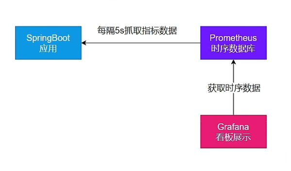

<b>步骤一：安装Prometheus+Grafana</b>

上面场景整合时已全部安装并运行

- Prometheus默认端口号为9090；
- Grafana默认端口号为3000，默认账号密码为 admin  admin

<b>步骤二：导入依赖</b>

导入Prometheus依赖

```xml
<dependency>
    <groupId>io.micrometer</groupId>
    <artifactId>micrometer-registry-prometheus</artifactId>
</dependency>
```

访问：[localhost:8080/actuator/prometheus验证，返回prometheus的所有指标](http://localhost:8080/actuator/prometheus%E9%AA%8C%E8%AF%81%EF%BC%8C%E8%BF%94%E5%9B%9Eprometheus%E7%9A%84%E6%89%80%E6%9C%89%E6%8C%87%E6%A0%87)

将本地jar包部署到服务器

```shell
# 安装上传工具
yum install lrzsz
# 安装openjdk
wget https://download.oracle.com/java/17/latest/jdk-17_linux-x64_bin.tar.gz
# 创建一个用于存放java安装包和配置文件的目录
mkdir -p /opt/java
# 解压安装包
tar -xzvf jdk-17_linux-x64_bin.tar.gz -C /opt/java/
# 将Java添加到环境变量中
vim /etc/profile
# 在末尾添加以下内容
export JAVA_HOME=/opt/java/jdk-17.0.7
export PATH=$PATH:$JAVA_HOME/bin
# 完成上述后，执行以下命令使生效
source /etc/profile

# 后台启动java应用
nohup java -jar xxxx.jar > output.log 2>&1 &
# output.1og:日志输出文件，指定为标准输出(stdout)并重定向到一个名为output.log的文件中。
# 2>&1:将标准错误输出(stderr)重定向到标准输出(stdout)。
# &:在后台运行进程。
```

<b>步骤三：配置Prometheus.yml文件去监控</b>

```yaml
#修改prometheus.yml配置文件
scrape_configs:
 - job_name: 'spring-boot-actuator-exporter'
  metrics_path: '/actuator/prometheus' #指定抓取的路径
  static_configs:
   - targets: [ '192.168.243.1:8001']
    labels:
     nodename: 'app-demo'
```

<b>步骤四：在Grafana面板中添加Prometheus数据源，配置好地址</b>

<b>步骤五：导入Grafana看板，并选择好数据源</b>

## 7、AOT

### 7.1 AOT与JIT

AOT：Ahead-of-Time：提前编译，程序执行前，全部被编译成机器码。比如：编译器

JIT：Just in Time ：即时编译，程序边编译、边运行。比如：解释器

### 7.1.1 JVM架构

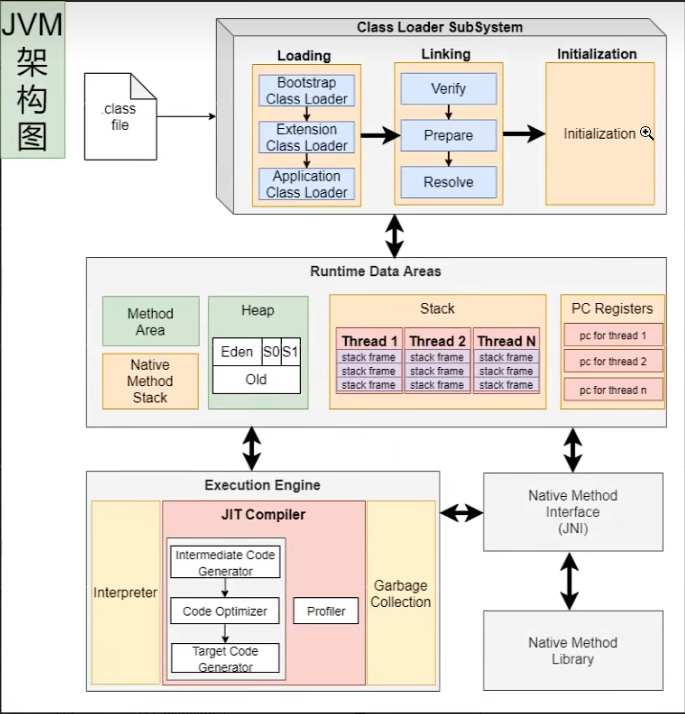

## GraalVM

<b>graalVM</b>是一个高性能的<b>JDK</b>旨在加速用Java和其他jvm语言编写的应用程序的执行

<b>GraalVM</b>提供了两种Java应用程序的方式：

- 1、在HotSpot JVM上使用Graal<b>即时编译器</b>
- 2、作为<b>预先编译</b>的本机可执行文件运行

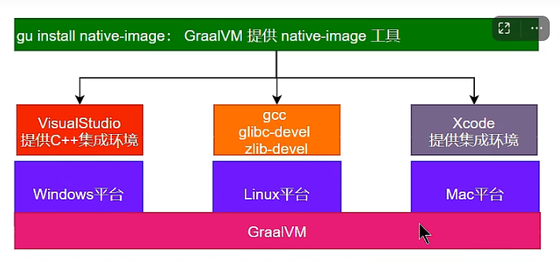

#### 安装

1、官网下载

[Download GraalVM](https://www.graalvm.org/downloads/)

需要下载 [graalvm-ce-java17-windows-amd64-22.3.2.zip](http://graalvm-ce-java17-windows-amd64-22.3.2.zip) 和 native-image-installable-svm-java17-windows-amd64-22.3.2.jar（在什么系统就下什么压缩包和jar包）

2、配置环境

将以前的JAVA\_HOME路径改为下载的GraalVM解压之后的路径。并集成下载下来的 jar包，使用下面的命令

```shell
gu install --file native-image-installable-svm-java17-windows-amd64-22.3.2.jar
```

3、验证

```shell
java -version
```

就可以看到是graalvm下的jdk了

#### 测试

1、进入<code>native-tools </code>终端（这个要下vs Studio）

编译为原生镜像，使用命令<code>native-image</code>

```shell
# 方式一：指定jar包编译。编译整个jar  -o：输出为一个名为Haha的可执行包
native-image -cp boot3-15-aot-common-1.0-SNAPSHOT.jar com.huang.MainApplication -o Haha
# 方式二：从classes文件编译。编译某个类时必须有main入口方法，否则无法编译
native-image -cp .\classes org.example.Main
```

## 8、邮件发送：Mail

SpringBoot已经给我们提供了封装好的邮件模块

```xml
<dependency>
    <groupId>org.springframework.boot</groupId>
    <artifactId>spring-boot-starter-mail</artifactId>
</dependency>
```

邮件协议：

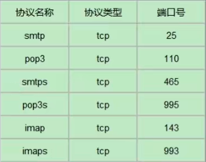

常用的协议有两种：

- SMTP协议(主要用于发送邮件 Simple Mail Transfer Protocol)
- POP3协议（主要用于接收邮件 Post Office Protocol 3)

### 邮件发送

这里以163邮箱[https:/mail163.com](https://mail163.com/)为例，我们需要在配置文件中告诉SpringBootMail我们的smtp服务器的地址以及你的邮箱账号和密码，首先我们要去设置中开启smtp/pop3服务才可以，开启后会得到一个随机生成的密钥，这个就是我们的密码。

```yaml
spring:
  mail:
    # 163邮箱地址为smtp.163.com，直接填写
    host: smtp.163.com
    # 邮箱账号
    username: huangyilei2001@163.com
    # 自动生成的授权码
    password: KDOFLEWAHBZVJITE
```

配置完成，接下来测试

```java
@SpringBootTest
class Boot316MailApplicationTests {

    //JavaMailSender是专门用于发送邮件的对象
    @Autowired
    JavaMailSender sender;

    @Test
    void contextLoads() {
        //SimpleMailMessage是一个简易的邮件封装
        SimpleMailMessage message = new SimpleMailMessage();
        //设置邮件标题
        message.setSubject("邮件标题");
        //设置邮件内容
        message.setText("邮件内容");
        //设置邮件发送给谁
        message.setTo("1575863127@qq.com");
        //设置发送者
        message.setFrom("huangyilei2001@163.com");
        //发送
        sender.send(message);
    }

}
```

如果需要添加附件等更多功能，可以使用MimeMessageHelper来实现：

```java
@SpringBootTest
class Boot316MailApplicationTests {

    //JavaMailSender是专门用于发送邮件的对象
    @Autowired
    JavaMailSender sender;

    @Test
    void contextLoads() {
        MimeMessage message = sender.createMimeMessage();
        MimeMessageHelper messageHelper = new MimeMessageHelper(message,true);
        //设置邮件标题
        messageHelper.setSubject("邮件标题");
        //设置邮件内容
        messageHelper.setText("邮件内容");
        //设置邮件发送给谁
        messageHelper.setTo("1575863127@qq.com");
        //设置发送者
        messageHelper.setFrom("huangyilei2001@163.com");
        //发送
        sender.send(message);
    }
}
```

### 邮件注册

配置

```yaml
spring:
  mail:
    # 163邮箱地址为smtp.163.com，直接填写
    host: smtp.163.com
    # 邮箱账号
    username: xxxxxxxxx@163.com
    # 自动生成的授权码
    password: xxxxxxxx

  datasource:
    url: jdbc:mysql://localhost:3306/db1
    driver-class-name: com.mysql.cj.jdbc.Driver
    username: xxxxx
    password: xxxxx
  data:
    redis:
      host: 111.230.48.114
  mvc:
    static-path-pattern: /static/**
```

代码实现

```java
@Service
public class VerifyServiceImpl implements VerifyService {

    @Resource
    JavaMailSender sender;

    @Resource
    StringRedisTemplate stringRedisTemplate;

    @Value("${spring.mail.username}")
    String from;

    @Override
    public void sendVerifyCode(String email) {
        SimpleMailMessage message = new SimpleMailMessage();
        message.setSubject("【xxx网站】你的注册验证码");
        StringBuilder stringBuilder = new StringBuilder();
        for (int i = 0; i < 6; i++) {
            Random random = new Random();
            stringBuilder.append(random.nextInt(10));
        }
        String code = String.valueOf(stringBuilder);
        stringRedisTemplate.opsForValue().set("verify.code:" + email, code, 3, TimeUnit.MINUTES);
        message.setText("您的注册验证码为：" + code + "，三分钟内有效，请及时完成注册，如果不是本人，请忽略。");
        message.setTo(email);
        message.setFrom(from);
        sender.send(message);
    }

    @Override
    public boolean doVerify(String email, String code) {
        String s = stringRedisTemplate.opsForValue().get("verify.code:" + email);
        if (s == null || !s.equalsIgnoreCase(code)) return false;
        stringRedisTemplate.delete("verify.code:" + email);
        return true;
    }
}
```

```java
public interface VerifyService {

    public void sendVerifyCode(String email);

    boolean doVerify(String email,String code);
}
```

```java
@RestController
@RequestMapping("/api/auth")
public class ApiController {

    @Resource
    VerifyService verifyService;

    @RequestMapping(value = "/verify-code", method = RequestMethod.GET)
    public void verifyCode(@RequestParam("email") String email) {
        verifyService.sendVerifyCode(email);
    }

    @RequestMapping(value = "/register", method = RequestMethod.POST)
    public void register(String username,
                         String password,
                         String email,
                         String verifyCode) {
        if (verifyService.doVerify(email, verifyCode)) {
            System.out.println("注册成功");
        } else {
            System.out.println("注册失败");
        }
    }
}
```

## 9、持久层框架JPA

什么是JPA?

JPA (Java Persistence API)和JDBC类似，也是官方定义的一组接口，但是它相比传统的JDBC，它是为了实现ORM而生的，即（Object-Relationl Mapping），它的作用是在关系型数据库和对象之间形成一个映射，这样，我们在具体的操作数据库的时候，就不需要再去和复杂的SQL语句打交道，只要像平时操作对象一样操作它就可以了。

在之前，我们使用JDBC或是Mybatis来操作数据，通过直接编写对应的SQL语句来实现数据访问，但是我们发现实际上我们在Java中大部分操作数据库的情况都是读取数据并封装为一个实体类，因此，为什么不直接将实体类直接对应到一个数据库表呢?也就是说，一张表里面有什么属性，那么我们的对象就有什么属性，所有属性跟数据库里面的字段一—对应，而读取数据时，只需要读取一行的数据并封装为我们定义好的实体类既可以，而具体的SQL语句执行，完全可以交给框架根据我们定义的映射关系去生成，不再由我们去编写，因为这些SQL实际上都是千篇一律的。

而实现JPA规范的框架一般最常用的就是<code>Hibernate</code>，它是一个重量级框架，学习难度相比Mybatis也更高一些，而SpringDataJPA也是采用Hibernate框架作为底层实现,并对其加以封装。

### 使用

因为SpringBoot封装了JPA，所以只要导入坐标就行了，SpringBoot底层能够自动配置

```xml
<dependency>
    <groupId>org.springframework.boot</groupId>
    <artifactId>spring-boot-starter-data-jpa</artifactId>
</dependency>
```

因为JPA不需要操作复杂的SQL语句，所有数据库中的表都封装成对象来操作，所有首先创建一个实体类

```java
@Data
public class Account {
    private int id;
    private String username;
    private String password;
}
```

我们可以通过注解的形式，在属性上添加数据库的映射关系，这样能够让JPA知道我们的实体类对应的数据库是什么样的

```java
@Data
@Entity
@Table(name = "tb_user")
public class Account {

    @Column(name = "id")  // 对应表中的id
    @GeneratedValue(strategy = GenerationType.IDENTITY)  // 生成策略，表中为自增，这里为自增
    @Id
    private int id;
    @Column(name = "username")
    private String username;
    @Column(name = "password")
    private String password;
}
```

配置文件

```yaml
spring:
  jpa:
    #开启SQL语句执行日志信息
    show-sql: true
    hibernate:
      #配置为自动创建
      ddl-auto: create
```

<code>ddl-auto</code>属性用于设置自动表定义，可以实现自动在数据库中为我们创建一个表，表的结构会根据我们定义的实体类决定，它有4种

- <code>create</code>启动时删数据库中的表，然后创建，退出时不删除数据表
- <code>create-drop</code>启动时删数据库中的表，然后创建，退出时删除数据表如果表不存在报错
- <code>update </code>如果启动时表格式不一致则更新表，原有数据保留
- <code>validate</code>项目启动表结构进行校验如果不一致则报错

创建表之后，如何访问数据？需要先建一个实体类实现<code>JpaRepository<></code>接口：

```java
@Repository
public interface AccountRepository extends JpaRepository<Account, Integer> {
}
```

JpaRepository有两个泛型，第一个是具体操作的对象实体，也是对应的表，第二个是ID的类型，接口中已经定义了比较常用的数据库操作，直接使用即可。

```java
@SpringBootTest
class Boot316MailApplicationTests {
    @Resource
    AccountRepository repository;

    @Test
    void repositoryTest(){
        //根据id查询
        repository.findById(1).ifPresent(System.out::println);
    }
}
```

新增

```java
@SpringBootTest
class Boot316MailApplicationTests {
    @Resource
    AccountRepository repository;

    @Test
    void repositoryTest(){
        Account account = new Account();
        account.setUsername("admin");
        account.setPassword("123456");
        account = repository.save(account);
        System.out.println(account.getId());
    }
}
```

还能够删除，等等。

分页

```java
@SpringBootTest
class Boot316MailApplicationTests {
    @Resource
    AccountRepository repository;

    @Test
    void repositoryTest(){
        //第一个参数：第几页；第二个参数：这一页多少个数据
        repository.findAll(PageRequest.of(0,2)).forEach(System.out::println);
    }
}
```

### 关联查询

创建一个用户详细信息表

```java
@Entity
@Table(name = "tb_user_detail")
@Data
public class AccountDetail {
    @Column(name = "id")
    @GeneratedValue(strategy = GenerationType.IDENTITY)
    @Id
    private int id;

    @Column(name = "address")
    private String address;

    @Column(name = "email")
    private String email;

    @Column(name = "real_name")
    private String realName;
}
```

指定两个表之间的关系（1：1，1：n，m：n）

```java
@Data
@Entity
@Table(name = "tb_user")
public class Account {

    @Column(name = "id")  // 对应表中的id
    @GeneratedValue(strategy = GenerationType.IDENTITY)  // 生成策略，表中为自增，这里为自增
    @Id
    private int id;

    @Column(name = "username")
    private String username;

    @Column(name = "password")
    private String password;

    @JoinColumn(name = "detail_id")  //指定外键名称
    @OneToOne  //指定关系
    AccountDetail detail;
}
```

后续操作直接通过repository就可以直接查询了。
