# 微服务基础

## 什么是微服务

微服务既是一种架构，也是构建软件的方法。在微服务中，应用被拆分成最小的组件，彼此独立。不同于将所有组件内置于一个架构中的传统单体式应用构建方法，在微服务架构中，所有部分相互独立，通过合作来完成同一个任务。其中的每一个组件或流程都是一个微服务。这种软件开发方法强调细粒度、轻量化，力求[在多个应用中共享相似的流程](https://www.redhat.com/zh/topics/integration)。它是[针对云原生模型优化应用开发](https://www.redhat.com/zh/topics/cloud-native-apps)的主要组件。

但现在更应思考的一个问题是：为什么要使用基于微服务的基础架构？简单来说，微服务架构有助于更快地交付高质量的软件。使用微服务有助实现这一点，但也需要注意一些细节。仅仅将应用拆分成微服务是不够的，还必须对微服务进行管理和编排，处理微服务创建和修改的数据。

我们可以先从技术的演变开始看起，在我们学习JavaWeb之后，一般的网站开发模式为Servlet+-JSP，但是实际上我们在学习了SSM之后，会发现这种模式已经远远落后了，第一，一个公司不可能去招那么多同时会前端+后端的开发人员，就算招到，也并不一定能保证两个方面都比较擅长，相比前后端分开学习的开发人员，显然后者的学习成本更低，专注度更高。因此前后端分离成为了一种新的趋势。通过使用SpringBoot，我们几乎可以很快速地开发一个高性能的单体应用，只需要启动一个服务端，我们整个项目就开始运行了，各项功能融于一体，开发起来也更加轻松。

但是随着我们项目的不断扩大，单体应用似乎显得有点乏力了。

随着越来越多的功能不断地加入到一个SpringBoot项目中，随着接口不断增加，整个系统就要在同一时间内响应更多类型的请求，显然，这种扩展方式是不可能无限使用下去的，总有一天，这个SpringBoot项目会庞大到运行缓慢。并且所有的功能如果都集成在单端上，那么所有的请求都会全部汇集到一台服务器上，对此服务器造成巨大压力。

可以试想一下，如果我们的电脑已经升级到i9-12900K，但是依然在运行项目的时候缓慢，无法同一时间响应成千上万的请求，那么这个问题就已经不是单纯升级机器配置可以解决的了。

## SpringCloud

前面我们介绍了微服务架构的优点，那么同样的，这些优点的背后也存在着诸多的问题：

- 要实现微服务并不是说只需要简单地将项目进行拆分，我们还需要考虑对各个微服务进行管理、监控等，这样我们才能够及时地寻找和排查问题。因此微服务往往需要的是一整套解决方案，包括服务注册和发现、容灾处理、负载均衡、配置管理等。
- 它不像单体架构那种方便维护，由于部署在多个服务器，我们不得不去保证各个微服务能够稳定运行，在管理难度上肯定是高于传统单体应用的。
- 在分布式的环境下，单体应用的某些功能可能会变得比较麻烦，比如分布式事务。

所以，为了更好地解决这些问题,SpringCloud正式登场。

SpringCloud是Spring提供的一套分布式解决方案，集合了一些大型互联网公司的开源产品，包括诸多组件，共同组成SpringCloud框架。并且，它利用Spring Boot的开发便利性巧妙地简化了分布式系统基础设施的开发，如服务发现注册、配置中心、消息总线、负载均衡、熔断机制、数据监控等，都可以用Spring Boot的开发风格做到一键启动和部署。

由于中小型公司没有独立开发自己的分布式基础设施的能力，使用SpringCloud解决方案能够以最低的成本应对当前时代的业务发展。

SpringCloud整体分布式架构下的各个场景，都有对应的组件来处理，比如基于Netfix(奈飞)的开源分布式解决方案提供的组件：

- <code>Eureka</code> ：实现服务治理(服务注册与发现)，我们可以对所有的微服务进行集中管理，包括他们的运行状态、信息等。
- <code>Ribbon</code> ：为服务之间相互调用提供负载均衡算法(现在被SpringCloudLoadBalancer取代)
- <code>Hystrix</code>：断路器，保护系统，控制故障范围。暂时可以跟家里电闸的保险丝类比，当触电危险发生时能够防止进一步的发展。
- <code>Zuul </code>     ：api网关，路由，负载均衡等多种作用，就像我们的路由器，可能有很多个设备都连接了路由器，但是数据包要转发给谁则是由路由器在进行(已经被SpringCloudGateway取代)
- <code>Config</code> ：配置管理，可以实现配置文件集中管理

## Eureka 注册中心

[Eureka 官方文档](https://docs.spring.io/spring-cloud-netflix/docs/current/reference/html/)

### 微服务项目结构

我们假设以下场景来模拟

<ul>
<li></li>
</ul>

登录验证服务：用于处理用户注册、登录、密码重置等，反正就是一切与账户相关的内容，包括用户信息获取等。

<ul>
<li></li>
</ul>

图书管理服务：用于进行图书添加、删除、更新等操作，图书管理相关的服务，包括图书的存储等和信息获取。

<ul>
<li></li>
</ul>

图书借阅服务：交互性比较强的服务，需要和登陆验证服务和图书管理服务进行交互。

过程：

- 首先我们创建一个父级别的SpringBoot项目，删除其他无用的文件
- 然后在此项目下创建三个Maven子项目分别继承父级别的SpringBoot项目，

```xml
<parent>
    <groupId>com.huang</groupId>
    <artifactId>SpringCloudStudy</artifactId>
    <version>0.0.1-SNAPSHOT</version>
</parent>
```

效果图如下：

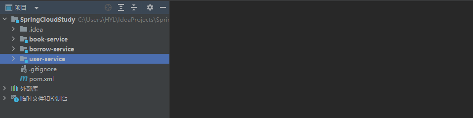

- 创建好子项目之后在各个子项目中创建SpringBoot启动类

这样一个模拟的微服务结构就创建好了。

然后创建一下表，表的数量根据业务来定

接下来就可以稍微写业务了，比如用户信息查询业务，我们先把数据库相关的依赖进行导入，这里依然使用Mybatis框架，首先在父项目中添加MySQL驱动和Lombok依赖：

```xml
<dependency>
    <groupId>org.projectlombok</groupId>
    <artifactId>lombok</artifactId>
</dependency>

<dependency>
    <groupId>com.mysql</groupId>
    <artifactId>mysql-connector-j</artifactId>
</dependency>
```

由于不是所有的子项目都需要用到Mybatis，我们在父项目中只进行版本管理即可

```xml
<dependencyManagement>
    <dependencies>
        <dependency>
            <groupId>org.mybatis.spring.boot</groupId>
            <artifactId>mybatis-spring-boot-starter</artifactId>
            <version>3.0.2</version>
        </dependency>
    </dependencies>
</dependencyManagement>
```

接着我们就可以在用户服务子项目中添加此依赖

```xml
<dependencies>
    <dependency>
        <groupId>org.mybatis.spring.boot</groupId>
        <artifactId>mybatis-spring-boot-starter</artifactId>
    </dependency>
</dependencies>
```

接着添加数据源信息

```yaml
spring:
  datasource:
    url: jdbc:mysql://localhost:3306/cloudstudy
    driver-class-name: com.mysql.cj.jdbc.Driver
    username: root
    password: 123456
```

接着编写用户相应的业务

```java
@Data
public class User {
    private int uid;
    private String name;
    private String sex;
}
```

```java
@Mapper
public interface UserMapper {
    @Select("select uid,name,sex from tb_user where uid=#{uid}")
    User findUserById(int uid);
}
```

```java
public interface UserService {
    User findUserById(int uid);
}
```

```java
@Service
public class UserServiceImpl implements UserService {

    @Resource
    UserMapper userMapper;

    @Override
    public User findUserById(int uid) {
        return userMapper.findUserById(uid);
    }
}
```

```java
@RestController
public class UserController {

    @Resource
    UserService userService;

    @GetMapping("/user/{uid}")
    public User findUserById(@PathVariable("uid") int uid) {
        return userService.findUserById(uid);
    }
}
```

接着就可以访问地址了。其他两个也类似

### 服务间调用

前面我们完成了用户信息查询和图书信息查询，现在我们来接着完成借阅服务。

借阅服务是一个关联性比较强的服务，它不仅仅需要查询借阅信息，同时可能还需要获取借阅信息下的详细信息，比如具体那个用户借阅了哪本书，并且用户和书籍的详情也需要同时出现，那么这种情况下，我们就需要去访问除了借阅表以外的用户表和图书表。

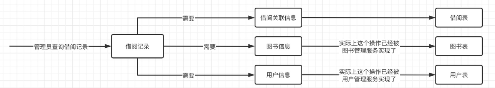

但是这显然是违反我们之前所说的单一职责的，相同的业务功能不应该重复出现，但是现在由需要在此服务中查询用户的信息和图书信息，那怎么办呢？我们可以让一个服务去调用另一个服务来获取信息。

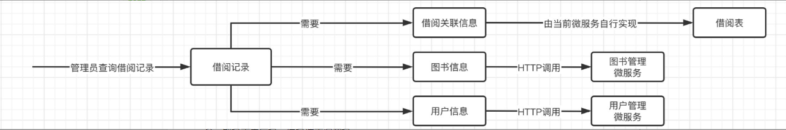

这样，图书管理微服务和用户管理微服务相对于借阅记录，就形成了一个生产者和消费者的关系，前者是生产者，后者便是消费者。

我们先将借阅关联信息查询完善：

```java
@Data
public class Borrow {
    private int id;
    private int uid;
    private int bid;
}
```

```java
@Mapper
public interface BorrowMapper {
    @Select("select * from tb_borrow where uid=#{uid}")
    List<Borrow> getBorrowByUid(int uid);

    @Select("select * from tb_borrow where bid=#{bid}")
    List<Borrow> getBorrowByBid(int bid);

    @Select("select * from tb_borrow where uid=#{uid} and bid=#{bid}")
    List<Borrow> getBorrow(int uid,int bid);
}
```

现在有一个需求，需要查询用户的借阅详细信息，也就是说需要查询某个用户具体借了那些书，并且需要此用户的信息和所有已借阅的书籍信息一起返回，那么我们先来设计一下返回实体：

```java
@Data
@AllArgsConstructor
public class UserBorrowDetail {
    User user;
    List<Book> bookList;
}
```

我们发现User和Book实体实际上是在另外两个微服务中定义的，相当于当前项目并没有定义这些实体类，那么怎么解决呢？

因此，我们可以将所有服务需要用到的实体类单独放入另一个一个项目中，然后让这些项目引用集中存放实体类的那个项目，这样就可以保证每个微服务的实体类信息都可以共用了：


然后只需要在对应的类中引用此项目作为依赖即可：

```xml
<dependency>
    <groupId>com.huang</groupId>
    <artifactId>commons</artifactId>
    <version>0.0.1-SNAPSHOT</version>
</dependency>
```

之后新的公共实体类都可以在<code>commons</code>项目中进行定义了，现在我们接着来完成刚刚的需求，先定义接口：

```java
public interface BorrowService {
    UserBorrowDetail getUserBorrowDetailByUid(int uid);
}
```

```java
@Service
public class BorrowServiceImpl implements BorrowService{

    @Resource
    BorrowMapper mapper;

    @Override
    public UserBorrowDetail getUserBorrowDetailByUid(int uid) {
        List<Borrow> borrow = mapper.getBorrowsByUid(uid);
        //现在拿到借阅关联信息了，怎么调用其他服务获取信息呢？
    }
}
```

需要进行服务远程调用我们需要用到<code>RestTemplate</code>来进行：

```java
@Service
public class BorrowServiceImpl implements BorrowService {

    @Resource
    BorrowMapper borrowMapper;

    @Override
    public UserBorrowDetail getUserBorrowDetailByUid(int uid) {
        List<Borrow> borrow = borrowMapper.getBorrowByUid(uid);
        System.out.println(borrow);
        //现在拿到借阅关联信息了，怎么调用其他服务获取信息呢？
        //RestTemplate支持多种方式的远程调用
        RestTemplate template = new RestTemplate();
        //这里通过调用getForObject来请求其他服务，并将结果自动进行封装
        //获取User信息
        User user = template.getForObject("http://localhost:9002/user/" + uid, User.class);
        //获取每一本书的详细信息
        List<Book> books = borrow
                .stream()
                .map(b -> template.getForObject("http://localhost:9000/book/" + b.getBid(), Book.class))
                .collect(Collectors.toList());
        return new UserBorrowDetail(user, books);

    }
}
```

再最后完善一下<code>Controller</code>：

```java
@RestController
public class BorrowController {
    @Resource
    BorrowService service;

    @RequestMapping("/borrow/{uid}")
    UserBorrowDetail findUserBorrows(@PathVariable("uid") int uid) {
        return service.getUserBorrowDetailByUid(uid);
    }
}
```

此时我们访问<code>/borrow/{uid}</code>这个接口就实现了获取当前uid学生的详细信息，以及他的详细借阅信息。这样一个简易的分布式项目就搭建完成了。

注意：一定要保证三个服务都处于开启状态，否则远程调用会失败。

### 服务注册与发现

前面我们了解了如何对单体应用进行拆分，并且也学习了如何进行服务之间的相互调用，但是存在一个问题，就是虽然服务拆分完成，但是没有一个比较合理的管理机制，如果单纯只是这样编写，在部署和维护起来，肯定是很麻烦的。可以想象一下，如果某一天这些微服务的端口或是地址大规模地发生改变，我们就不得不将服务之间的调用路径大规模的同步进行修改，这是多么可怕的事情。我们需要削弱这种服务之间的强关联性，因此我们需要一个集中管理微服务的平台，这时就要借助我们这一部分的主角了。

Eureka能够自动注册并发现微服务，然后对服务的状态、信息进行集中管理，这样当我们需要获取其他服务的信息时，我们只需要向Eureka进行查询就可以了。


接下来，搭建一个Eureka服务器。需要创建一个新的Maven项目，然后在父工程中添加SpringCloud的依赖：

```xml
<properties>
    <spring-cloud.version>2022.0.3</spring-cloud.version>
</properties>
<dependencyManagement>
    <dependencies>
        <dependency>
            <groupId>org.springframework.cloud</groupId>
            <artifactId>spring-cloud-dependencies</artifactId>
            <version>${spring-cloud.version}</version>
            <type>pom</type>
            <scope>import</scope>
        </dependency>
    </dependencies>
</dependencyManagement>
```

接着为新创建的项目添加依赖：

```xml
<dependency>
    <groupId>org.springframework.cloud</groupId>
    <artifactId>spring-cloud-starter-netflix-eureka-server</artifactId>
    <version>4.0.2</version>
</dependency>
```

接着创建主类

注意：创建好主类，除了加上<code>@SpringBootApplication</code>注解之外，还需要开启eureka服务，需要加上<code>@EnableEurekaServer</code>注解

接着配置配置文件：

```yaml
server:
  port: 9999
#配置eureka信息
eureka:
  client:
    #由于是作为服务端角色，所以不需要获取服务器
    fetch-registry: false
    #暂时也不需要自己注册到eureka，如果是做集群就改为true
    register-with-eureka: false
    #设置eureka服务的名称和地址（k:v），目的为了让需要被管理的服务来指向它。key可以自定义
    service-url:
      defaultZone: http://localhost:9999/eureka
```

此时就可以直接访问eureka的管理平台了

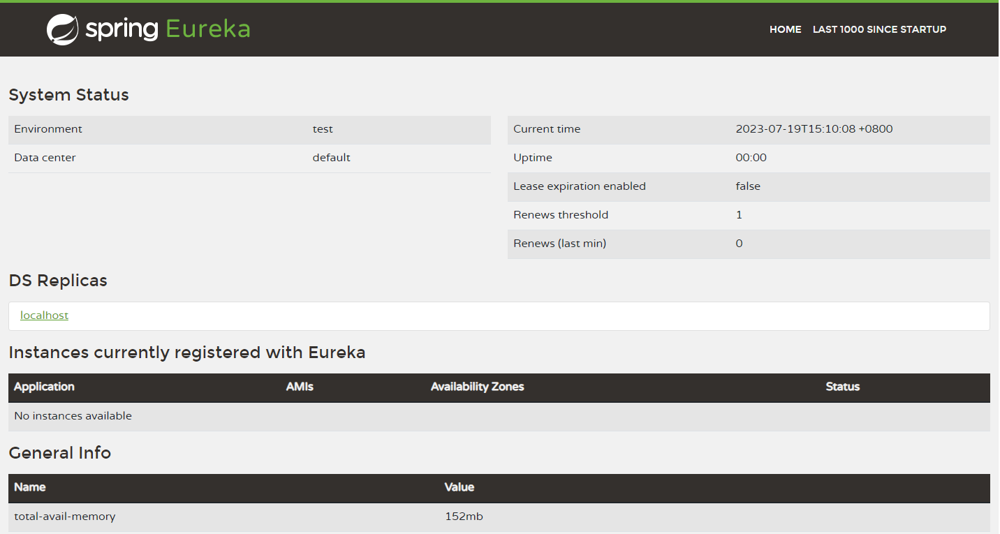

目前还没有任何的服务注册到Eureka，我们接着来配置一下我们的三个微服务，首先还是需要导入Eureka客户端依赖：

```xml
<dependency>
    <groupId>org.springframework.cloud</groupId>
    <artifactId>spring-cloud-starter-netflix-eureka-client</artifactId>
</dependency>
```

然后修改配置文件：

```yaml
eureka:
  client:
      # 跟上面一样，需要指向Eureka服务端地址，这样才能进行注册
    service-url:
      defaultZone: http://localhost:9999/eureka
```

无需在启动类添加注解，直接启动就可以了，然后打开Eureka的服务管理页面，可以看到我们刚刚开启的服务：

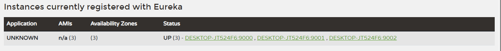

就可以看到我们三个被注册到eureka上了，由于没有指定名称所以显示的是UNKNOWN，只需要修改一下：

<code>book项目里的配置文件</code>

```yaml
spring:
  application:
    name: bookservice
```

其他两个操作都一样。

当我们的服务启动之后，会每隔一段时间跟Eureka发送一次心跳包，这样Eureka就能够感知到我们的服务是否处于正常运行状态。

那么，现在我们怎么实现服务发现呢？

也就是说，我们之前如果需要对其他微服务进行远程调用，那么就必须要知道其他服务的地址：

```java
User user = template.getForObject("http://localhost:9002/user/" + uid, User.class);
```

而现在有了Eureka之后，我们可以直接向其进行查询，得到对应的微服务地址，这里直接将服务名称替换即可：

```java
@Service
public class BorrowServiceImpl implements BorrowService {

    @Resource
    BorrowMapper borrowMapper;

    @Resource
    RestTemplate template;

    @Override
    public UserBorrowDetail getUserBorrowDetailByUid(int uid) {
        List<Borrow> borrow = borrowMapper.getBorrowByUid(uid);
        System.out.println(borrow);
// 注意看地址有变化
        User user = template.getForObject("http://userservice/user/" + uid, User.class);
//这里不用再写IP，直接写服务名称bookservice
        List<Book> books = borrow
            .stream()
            .map(b -> template.getForObject("http://bookservice/book/" + b.getBid(), Book.class))
            .collect(Collectors.toList());
        return new UserBorrowDetail(user, books);
    }
}
```

接着我们手动将RestTemplate声明为一个Bean，然后添加<code>@LoadBalanced</code>注解，这样Eureka就会对服务的调用进行自动发现，并提供负载均衡：

```java
@Configuration
public class BeanConfiguration {

    @Bean
    @LoadBalanced
    public RestTemplate restTemplate(){
        return new RestTemplate();
    }
}
```

怎么个负载均衡呢？

我们先来看看，同一个服务器实际上是可以注册很多个的，但是它们的端口不同，比如我们这里创建多个用户查询服务，我们现在将原有的端口配置修改一下，由IDEA中设定启动参数来决定，这样就可以多创建几个不同端口的启动项了：

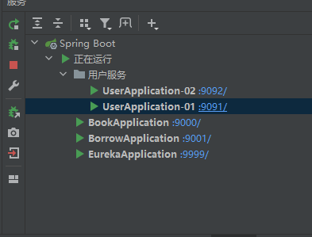

eureka中也会有两个实例。

现在我们稍微修改一下用户查询，然后进行远程调用，看看请求是不是均匀地分配到这两个服务端：

```java
@RestController
public class UserController {

    private final static Logger log = LoggerFactory.getLogger(UserController.class);

    @Resource
    UserService userService;

    @GetMapping("/user/{uid}")
    public User findUserById(@PathVariable("uid") int uid) {
        log.info("被调用了");
        return userService.findUserById(uid);
    }

}
```

我们查看控制台，两个实例都能够均匀地被分配请求：

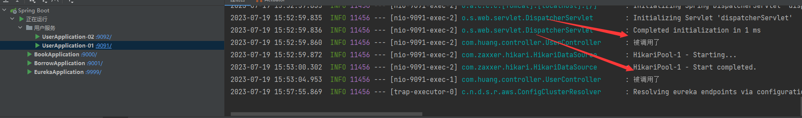

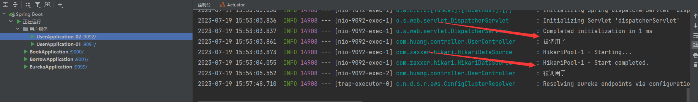

这样，服务自动发现以及简单的负载均衡就实现完成了，并且，如果某个微服务挂掉了，只要存在其他同样的微服务实例在运行，那么就不会导致整个微服务不可用，极大地保证了安全性。

### 注册中心高可用

虽然Eureka能够实现服务注册和发现，但是如果Eureka服务器崩溃了，岂不是所有需要用到服务发现的微服务就挂了？

为了避免，这种问题，我们也可以像上面那样，搭建Eureka集群，存在多个Eureka服务器，这样就算挂掉其中一个，其他的也还在正常运行，就不会使得服务注册与发现不可用。

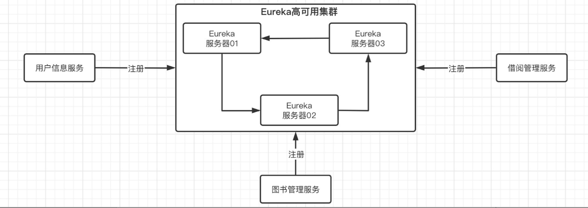

如何搭建Eureka集群呢？（此实验只配置两个）

首先我们需要修改一下Eureka服务端的配置文件，这里我们创建两个配置文件：

<code>application-01.yml</code>

```yaml
server:
  port: 9901
spring:
  application:
    name: eurekaserver
#配置eureka信息
eureka:
  # 由于不支持多个localhost的Eureka服务器，但是又只有本地测试环境，所以就只能自定义主机名称了
  # 主机名称改为eureka01
  instance:
    hostname: eureka01
  client:
    #由于是作为服务端角色，所以不需要获取服务器
    fetch-registry: false
    #暂时也不需要自己注册到eureka，如果是做集群就改为true
    register-with-eureka: true
    #设置eureka服务的名称和地址（k:v），目的为了让需要被管理的服务来指向它
    service-url:
      defaultZone: http://eureka02:9902/eureka
```

<code>application-02.yml</code>

```yaml
server:
  port: 9902
spring:
  application:
    name: eurekaserver
#配置eureka信息
eureka:
  instance:
    hostname: eureka02
  client:
    #由于是作为服务端角色，所以不需要获取服务器
    fetch-registry: false
    #暂时也不需要自己注册到eureka，如果是做集群就改为true
    register-with-eureka: true
    #设置eureka服务的名称和地址（k:v），目的为了让需要被管理的服务来指向它
    service-url:
      defaultZone: http://eureka01:9901/eureka
```

这里由于我们修改成自定义的地址，需要在本机的hosts文件中将其解析到127.0.0.1才能回到[localhost](http://localhost)。

对创建的两个配置文件分别添加启动配置，直接使用<code>spring.profiles.active</code>指定启用的配置文件即可：

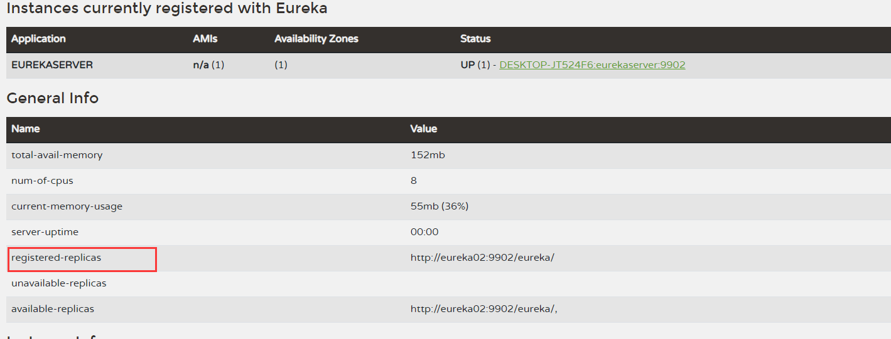

可以看到下方<code>replicas</code>中已经包含了另一个Eureka服务器的地址，并且是可用状态。

接着我们需要将我们的微服务配置也进行修改：

```yaml
eureka:
  client:
    # 指定eureka服务，将自己注册进去
    service-url:
      defaultZone: http://eureka01:9901/eureka,http://eureka02:9902/eureka
```

接着启动。可以看到，服务全部成功注册，并且两个Eureka服务端都显示为已注册：

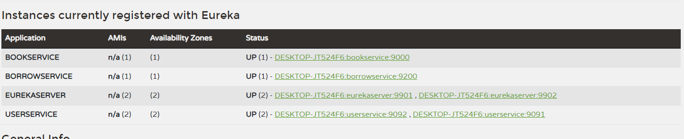

接着我们模拟一下，将其中一个Eureka服务器关闭掉，可以看到它会直接变成不可用状态，但是另一个还会继续服务。

## LoadBalancer 负载均衡

前面我们讲解了如何对服务进行拆分、如何通过Eureka服务器进行服务注册与发现，那么现在我们来看看，它的负载均衡到底是如何实现的，实际上之前演示的负载均衡是依靠LoadBalancer实现的。

在2020年前的SpringCloud版本是采用Ribbon作为负载均衡实现，但是2020年的版本之后SpringCloud把Ribbon移除了，进而用自己编写的LoadBalancer替代。

那么，负载均衡是如何进行的呢？

### 负载均衡

实际上，在添加<code>@LoadBalanced</code>注解之后，会启用拦截器对我们发起的服务调用请求进行拦截（注意这里是针对我们发起的请求进行拦截），叫做<code>LoadBalancerInterceptor</code>，它实现<code>ClientHttpRequestInterceptor</code>接口：

```java
@FunctionalInterface
public interface ClientHttpRequestInterceptor {
    ClientHttpResponse intercept(HttpRequest request, byte[] body, ClientHttpRequestExecution execution) throws IOException;
}
```

主要是对<code>intercept</code>方法的实现：

```java
public ClientHttpResponse intercept(final HttpRequest request, final byte[] body, final ClientHttpRequestExecution execution) throws IOException {
    URI originalUri = request.getURI();
    String serviceName = originalUri.getHost();
    Assert.state(serviceName != null, "Request URI does not contain a valid hostname: " + originalUri);
    return (ClientHttpResponse)this.loadBalancer.execute(serviceName, this.requestFactory.createRequest(request, body, execution));
}
```

服务端会在发起请求时执行这些拦截器。

那么这个拦截器做了什么事情呢，首先我们要明确，我们给过来的请求地址，并不是一个有效的主机名称，而是服务名称，那么怎么才能得到真正需要访问的主机名称呢，肯定是得找Eureka获取的。

我们来看看<code>loadBalancer.execute()</code>做了什么，它的具体实现为<code>BlockingLoadBalancerClient</code>：

```java
//从上面给进来了服务的名称和具体的请求实体
public <T> T execute(String serviceId, LoadBalancerRequest<T> request) throws IOException {
    String hint = this.getHint(serviceId);
    LoadBalancerRequestAdapter<T, DefaultRequestContext> lbRequest = new LoadBalancerRequestAdapter(request, new DefaultRequestContext(request, hint));
    Set<LoadBalancerLifecycle> supportedLifecycleProcessors = this.getSupportedLifecycleProcessors(serviceId);
    supportedLifecycleProcessors.forEach((lifecycle) -> {
        lifecycle.onStart(lbRequest);
    });
    //可以看到在这里会调用choose方法自动获取对应的服务实例信息，此时的serviceInstance就是进行选择之后的了
    ServiceInstance serviceInstance = this.choose(serviceId, lbRequest);
    if (serviceInstance == null) {
        supportedLifecycleProcessors.forEach((lifecycle) -> {
            lifecycle.onComplete(new CompletionContext(Status.DISCARD, lbRequest, new EmptyResponse()));
        });
        //没有发现任何此服务的实例就抛异常（之前的测试中可能已经遇到了）
        throw new IllegalStateException("No instances available for " + serviceId);
    } else {
        //成功获取到对应服务的实例，这时就可以发起HTTP请求获取信息了
        return this.execute(serviceId, serviceInstance, lbRequest);
    }
}
```

### 自定义负载均衡策略

LoadBalancer默认提供了两种负载均衡策略：

- RandomLoadBalancer - 随机分配策略
- <b>(默认)</b> RoundRobinLoadBalancer - 轮询分配策略

现在我们希望修改默认的负载均衡策略，可以进行指定，比如我们现在希望用户服务采用随机分配策略，我们需要先创建随机分配策略的配置类（不用加<code>@Configuration</code>）：

```java
public class LoadBalancerConfig {
    //将官方提供的 RandomLoadBalancer 注册为Bean
    @Bean
    public ReactorLoadBalancer<ServiceInstance> randomLoadBalancer(Environment environment, LoadBalancerClientFactory loadBalancerClientFactory){
        String name = environment.getProperty(LoadBalancerClientFactory.PROPERTY_NAME);
        return new RandomLoadBalancer(loadBalancerClientFactory.getLazyProvider(name, ServiceInstanceListSupplier.class), name);
    }
}
```

接着我们需要为对应的服务指定负载均衡策略，直接使用注解即可：

```java
@Configuration
@LoadBalancerClient(value = "userservice",      //指定为 userservice 服务，只要是调用此服务都会使用我们指定的策略
        configuration = LoadBalancerConfiguration.class)   //指定我们刚刚定义好的配置类
public class BeanConfiguration {

    @Bean
    @LoadBalanced
    public RestTemplate restTemplate(){
        return new RestTemplate();
    }
}
```

此时访问userservice服务的策略已经更改为我们指定的策略了。

### OpenFeign实现负载均衡

Feign和RestTemplate一样，也是HTTP客户端请求工具，但是它的使用方式更加便捷。首先导入依赖：

```xml
<dependency>
    <groupId>org.springframework.cloud</groupId>
    <artifactId>spring-cloud-starter-openfeign</artifactId>
</dependency>
```

接着在启动类添加<code>@EnableFeignClients</code>注解：

```java
@SpringBootApplication
@EnableFeignClients
public class BorrowApplication {
    public static void main(String[] args) {
        SpringApplication.run(BorrowApplication.class, args);
    }
}
```

此时我们的这个服务需要调用其他微服务接口，创建一个对应的服务接口类，然后写对应的方法：

```java
@FeignClient("userservice")  //声明为userservice服务的HTTP请求客户端
public interface UserClient {
    @RequestMapping("/user/{uid}")
    public User findUserById(@PathVariable("uid") int uid);
}
```

我们之前的写法需要使用RestTemplate的：

```java
RestTemplate template = new RestTemplate();
User user = template.getForObject("http://userservice/user/"+uid, User.class);
```

而现在不需要了。然后我们直接注入使用：

```java
@Service
public class BorrowServiceImpl implements BorrowService {

    @Resource
    BorrowMapper borrowMapper;

    @Resource
    UserClient userClient;

    @Resource
    BookClient bookClient;

    @Override
    public UserBorrowDetail getUserBorrowDetailByUid(int uid) {
        List<Borrow> borrow = borrowMapper.getBorrowByUid(uid);
        System.out.println(borrow);
        User user = userClient.findUserById(uid);
        List<Book> books = borrow
            .stream()
            .map(b -> bookClient.findBookById(b.getBid()))
            .collect(Collectors.toList());
        return new UserBorrowDetail(user, books);

    }
}
```

\*\*上面代码流程：\*\*就是直接通过注入的<code>Client</code>类对象调用里面的方法，而这个方法呢就是通过<code>@FeignClient("userservice")</code>来声明去访问userservice这个服务的（名字是之前在配置文件里取的），访问的路径呢是通过<code>@RequestMapping("/user/{uid}")</code>来告诉的，<code>{uid}</code>是通过<code>(@PathVariable("uid")</code>这个注解来解析然后将<code>int uid</code>的uid传入路径的。

最后测试，启动所有服务并且访问，也是能够访问到的。

## Hystrix 服务熔断

微服务之间可以相互调用，但是如果出现了其中一个服务出现故障，怎么办呢？就像如下的情况一样。

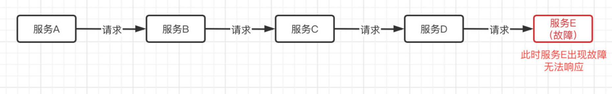

由于位于最底端的服务提供者E发生故障，那么此时会直接导致服务ABCD全线崩溃，就像雪崩了一样。

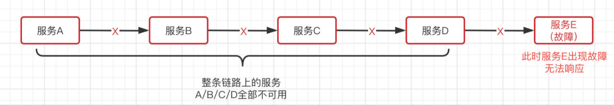

这种问题实际上是不可避免的，由于多种因素，比如网络卡顿、系统故障、硬件问题等，都存在一定可能，会导致这种极端的情况发生。因此，我们需要寻找一个应对这种极端情况的解决方案。

为了解决分布式系统的雪崩问题，SpringCloud提供了Hystrix熔断器组件。

我们来详细看看它的工作机制。

### 服务降级

首先我们来看看服务降级，注意一定要区分开服务降级和服务熔断的区别，服务降级并不会直接返回错误，而是可以提供一个补救措施，正常响应给请求者。这样相当于服务依然可用，但是服务能力肯定是下降了的。

我们就基于借阅管理服务来进行讲解，我们不开启用户服务和图书服务，表示用户服务和图书服务已经挂掉了。

这里我们导入Hystrix的依赖（此项目已经停止维护，SpringCloud依赖中已经不自带了，所以说需要自己单独导入）：

```xml
<dependency>
    <groupId>org.springframework.cloud</groupId>
    <artifactId>spring-cloud-starter-netflix-hystrix</artifactId>
    <version>2.2.10.RELEASE</version>
</dependency>
```

接着我们在需要使用hystrix的服务的启动类上添加注解开启：

```java
@EnableHystrix  //启用Hystrix
@SpringBootApplication
@EnableFeignClients  //启用FeignClients
public class BorrowApplication {
    public static void main(String[] args) {
        SpringApplication.run(BorrowApplication.class, args);
    }
}
```

那么现在，由于用户服务和图书服务不可用，所以查询借阅信息的请求肯定是没办法正常响应的，这时我们可以提供一个备选方案，也就是说当服务出现异常时，返回我们的备选方案：

```java
@RestController
public class BorrowController {
    @Resource
    BorrowService service;

    @HystrixCommand(fallbackMethod = "onError") //指定指定备选方案
    @RequestMapping("/borrow/{uid}")
    UserBorrowDetail findUserBorrows(@PathVariable("uid") int uid) {
        return service.getUserBorrowDetailByUid(uid);
    }

    //备选方案
    //注意：参数和返回值要和被备选的一致
    UserBorrowDetail onError(int uid) {
        return new UserBorrowDetail(null, Collections.emptyList());
    }
}
```

然后我们启动服务并访问，可以看到虽然我们服务无法正常运行了，但是依然还是会响应给浏览器我们设置的备选方案的数据。

服务降级是一种比较温柔的解决方案，虽然服务本身的不可用，但是能够保证正常响应数据。

### 服务熔断

熔断机制是应对雪崩效应的一种微服务链路保护机制，当检测出链路的某个微服务不可用或者响应时间太长时，会进行服务的降级，进而熔断该节点微服务的调用，快速返回”错误”的响应信息。当检测到该节点微服务响应正常后恢复调用链路。

实际上，熔断就是在降级的基础上进一步升级形成的，在一段时间内多次调用失败，那么就直接升级为熔断。

比如说：当我们访问一个故障了的服务时，刚开始还会正常先去访问原来该访问的服务，看是否真的故障了，true就访问备选方案，当我们访问到一定次数且每次都是true的时候，就会升级到熔断状态（就不会访问原来的服务了，而是直接访问备选方案）。在一定次数中（次数非常多的），过一段时间，它会尝试的访问原来服务，如果还是true，熔断会保持，否则说明服务正常了，熔断关闭。

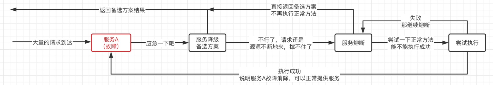

### OpenFeign实现降级

Hystrix也可以配合Feign进行降级，我们可以对应接口中定义的远程调用单独进行降级操作。

比如我们还是以用户服务挂掉为例，那么这个时候肯定是会远程调用失败的，也就是说我们的Controller中的方法在执行过程中会直接抛出异常，进而被Hystrix监控到并进行服务降级。

而实际上导致方法执行异常的根源就是远程调用失败，所以我们换个思路，既然用户服务调用失败，那么我就给这个远程调用添加一个替代方案，如果此远程调用失败，那么就直接上替代方案。那么怎么实现替代方案呢？我们知道Feign都是以接口的形式来声明远程调用，那么既然远程调用已经失效，我们就自行对其进行实现，创建一个实现类，对原有的接口方法进行替代方案实现：

```java
@Component   //注意，需要将其注册为Bean，Feign才能自动注入
public class UserFallbackClient implements UserClient{
    @Override
    public User getUserById(int uid) {   //这里我们自行对其进行实现，并返回我们的替代方案
        User user = new User();
        user.setName("我是替代方案");
        return user;
    }
}
```

实现完成后，我们只需要在原有的接口中指定失败替代实现<code>fallback</code>即可：

```java
//fallback参数指定为我们刚刚编写的实现类
@FeignClient(value = "userservice", fallback = UserFallbackClient.class)
public interface UserClient {

    @RequestMapping("/user/{uid}")
    User getUserById(@PathVariable("uid") int uid);
}
```

最后我们在配置文件中开启<code>feign</code>熔断支持：

```yaml
feign:
  circuitbreaker:
    enabled: true
```

启动服务，调用接口，返回的就是备选。

### 监控页面部署

除了对服务的降级和熔断处理，我们也可以对其进行实时监控，只需要安装监控页面即可，这里我们创建一个新的项目，导入依赖：

```xml
<dependency>
    <groupId>org.springframework.cloud</groupId>
    <artifactId>spring-cloud-starter-netflix-hystrix-dashboard</artifactId>
    <version>2.2.10.RELEASE</version>
</dependency>
```

接着添加配置文件：

```yaml
server:
  port: 8900
hystrix:
  dashboard:
    # 将localhost添加到白名单，默认是不允许的
    proxy-stream-allow-list: "localhost"
```

接着创建主类，注意需要添加<code>@EnableHystrixDashboard</code>注解开启管理页面：

```java
@SpringBootApplication
@EnableHystrixDashboard
public class HystrixDashBoardApplication {
    public static void main(String[] args) {
        SpringApplication.run(HystrixDashBoardApplication.class, args);
    }
}
```

启动Hystrix管理页面服务，然后我们需要在要进行监控的服务中添加Actuator依赖：

```xml
<dependency>
    <groupId>org.springframework.boot</groupId>
    <artifactId>spring-boot-starter-actuator</artifactId>
</dependency>
```

Actuator是SpringBoot程序的监控系统，可以实现健康检查，记录信息等。在使用之前需要引入spring-boot-starter-actuator，并做简单的配置即可。

然后在配置文件中配置Actuator添加暴露：

```yaml
management:
  endpoints:
    web:
      exposure:
        include: '*'
```

不添加暴露，Actuator将不能在浏览器被访问、

接着我们打开刚刚启动的管理页面，地址为：`http://localhost:自定义的端口号/hystrix/`

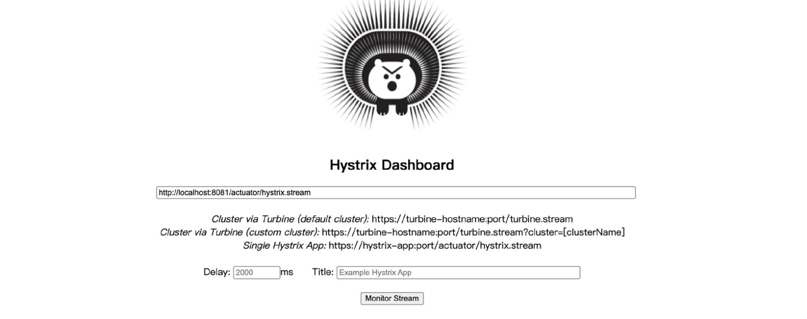

在中间填写要监控的服务：比如借阅服务：`http://localhost:服务的端口号/actuator/hystrix.stream`，注意后面要添加<code>/actuator/hystrix.stream</code>，然后点击Monitor Stream即可进入监控页面：

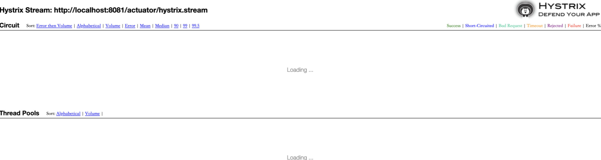

可以看到现在都是Loading状态，这是因为还没有开始统计，我们现在尝试调用我们的服务，就可以看到有信息数据了。

## Gateway 路由网关

这里的路由网关就跟平时使用的路由器一样，充当一个中转站以及一个守卫的作用。比如，我们的微服务一般情况下，可能并不是所有的微服务都需要直接暴露给外部调用，这时我们就可以使用路由机制，添加一层防护，让所有的请求全部通过路由来转发到各个微服务，并且转发给多个相同微服务实例也可以实现负载均衡。

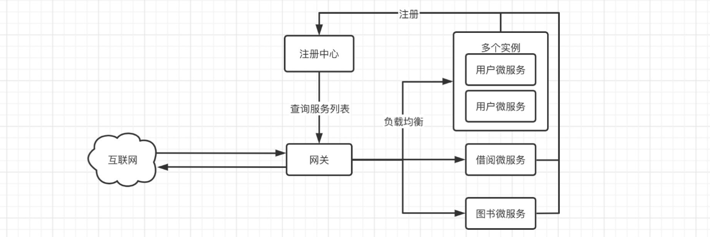

之前的时候，路由的实现一般使用Zuul，但是已经停更，而现在新出现了由SpringCloud官方开发的Gateway路由，它相比Zuul不仅性能上得到了一定的提升，并且是官方推出，契合性也会更好。

### 部署路由网关

首先创建一个新的项目，来作为路由网关，需要添加两个依赖：

```xml
<dependencies>
    <dependency>
        <groupId>org.springframework.cloud</groupId>
        <artifactId>spring-cloud-starter-gateway</artifactId>
    </dependency>
    <dependency>
        <groupId>org.springframework.cloud</groupId>
        <artifactId>spring-cloud-starter-netflix-eureka-client</artifactId>
    </dependency>
</dependencies>
```

第一个依赖就是网关的依赖，而第二个则跟其他微服务一样，需要注册到Eureka才能生效

\*\*注意：\*\*此项目不要添加Web依赖，因为使用的WebFlux框架。但是因为此项目继承的父项目中有Web依赖，继承了那个项目就自动使用了Web依赖，所以我们需要添加配置文件：

```yaml
spring:
  main:
    web-application-type: reactive
```

然后就是添加其他配置信息：

```yaml
server:
  port: 9500
eureka:
  client:
    service-url:
      defaultZone: http://eureka01:9901/eureka,http://eureka02:9902/eureka
spring:
  application:
    name: gateway
```

现在就将此服务注册到Eureka中去了。

但是现在还没有配置任何的路由功能，我们接着将路由功能进行配置：

```yaml
spring:
  cloud:
    gateway:
        # 配置路由，注意这里是个列表，每一项都包含了很多信息
      routes:
        - id: borrow-service   # 路由名称
          uri: lb://borrowservice  # 路由的地址，lb表示使用负载均衡到微服务，也可以使用http正常转发
          predicates: # 路由规则，断言什么请求会被路由
            - Path=/borrow/**  # 只要是访问的这个路径，一律都被路由到上面指定的服务
```

路由规则的详细列表（断言工厂列表）在这里：[Spring Cloud Gateway](https://docs.spring.io/spring-cloud-gateway/docs/current/reference/html/#gateway-request-predicates-factories)，可以指定多种类型，包括指定时间段、Cookie携带情况、Header携带情况、访问的域名地址、访问的方法、路径、参数、访问者IP等。也可以使用配置类进行配置，但是还是推荐直接配置文件，省事。

接着启动网关，然后我们就可以直接通过访问网关来访问我们的服务了。不过此时依然还是可以使用原来的服务地址进行访问。

这样我们就可以将不需要外网直接访问的微服务全部放到内网环境下，而只依靠网关来对外进行交涉。

### 路由过滤器

路由过滤器支持以某种方式修改传入的 HTTP 请求或传出的 HTTP 响应，路由过滤器的范围是某一个路由，跟之前的断言一样，Spring Cloud Gateway 也包含许多内置的路由过滤器工厂，详细列表：[Spring Cloud Gateway](https://docs.spring.io/spring-cloud-gateway/docs/current/reference/html/#gatewayfilter-factories)

比如我们现在希望在请求到达时，在请求头中添加一些信息再转发给我们的服务，那么这个时候就可以使用路由过滤器来完成，我们只需要对配置文件进行修改：

```yaml
spring:
  application:
    name: gateway
  cloud:
    gateway:
      routes:
      - id: borrow-service
        uri: lb://borrowservice
        predicates:
        - Path=/borrow/**
      # 继续添加新的路由配置，这里就以书籍管理服务为例
      # 注意-要对齐routes:
      - id: book-service
        uri: lb://bookservice
        predicates:
        - Path=/book/**
        filters:   # 添加过滤器
        - AddRequestHeader=Test, HelloWorld!
        # AddRequestHeader 就是添加请求头信息，其他工厂请查阅官网
```

接着我们在BorrowController中获取并输出一下，看看是不是成功添加了：

```java
@RestController
public class BorrowController {
    
    @Resource
    BorrowService service;
    
    @RequestMapping("/borrow/{uid}")
    UserBorrowDetail findUserBorrows(@PathVariable("uid") int uid,
                                     HttpServletRequest request) {
        String test = request.getHeader("Test");
        System.out.println(test);
        return service.getUserBorrowDetailByUid(uid);
    }
}
```

现在我们通过Gateway访问我们的图书管理服务：

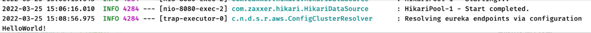

可以看到这里成功获取到由网关添加的请求头信息了。

除了针对于某一个路由配置过滤器之外，我们也可以自定义全局过滤器，它能够作用于全局。但是我们需要通过代码的方式进行编写，比如我们要实现拦截没有携带指定请求参数的请求：

```java
@Component   //需要注册为Bean
public class TestFilter implements GlobalFilter {
    @Override
    public Mono<Void> filter(ServerWebExchange exchange, GatewayFilterChain chain) {   //只需要实现此方法
        return null;
    }
}
```

接着我们编写业务：

```java
@Override
public Mono<Void> filter(ServerWebExchange exchange, GatewayFilterChain chain) {
    //先获取ServerHttpRequest对象，注意不是HttpServletRequest
    ServerHttpRequest request = exchange.getRequest();
    //打印一下所有的请求参数
    System.out.println(request.getQueryParams());
    //判断是否包含test参数，且参数值为1
    List<String> value = request.getQueryParams().get("test");
    if(value != null && value.contains("1")) {
        //将ServerWebExchange向过滤链的下一级传递（跟JavaWeb中介绍的过滤器其实是差不多的）
        return chain.filter(exchange);
    }else {
        //直接在这里不再向下传递，然后返回响应
        return exchange.getResponse().setComplete();
    }
}
```

然后通过网关地址访问，可以看到成功实现拦截操作。

当然，过滤器肯定是可以存在很多个的，所以我们可以手动指定过滤器之间的顺序：

```java
@Component
public class TestFilter implements GlobalFilter, Ordered {   //实现Ordered接口
  
    @Override
    public int getOrder() {
        return 0;
    }
```

注意Order的值越小优先级越高，并且无论是在配置文件中编写的单个路由过滤器还是全局路由过滤器，都会受到Order值影响（单个路由的过滤器Order值按从上往下的顺序从1开始递增），最终是按照Order值决定哪个过滤器优先执行，当Order值一样时 全局路由过滤器执行 <code>优于</code> 单独的路由过滤器执行。

## Config 配置中心

通过前面的学习我们能够发现，当所有的配置都设置在当前项目中，如果后期随着微服务的增多并且又需要更改配置文件中的信息。那肯定是非常麻烦的。

所以，就可以使用一种更加高级的集中化地配置文件管理工具，集中地对配置文件进行配置。

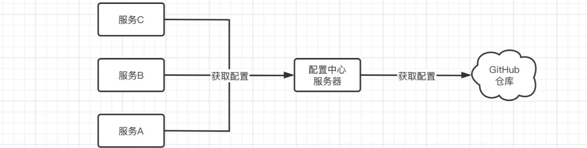

实际上Spring Cloud Config就是一个配置中心，所有的服务都可以从配置中心取出配置，而配置中心又可以从GitHub远程仓库中获取云端的配置文件，这样我们只需要修改GitHub中的配置即可对所有的服务进行配置管理了。

### 部署配置中心

这里我们接着创建一个新的项目，并导入依赖：

```xml
<dependencies>
    <dependency>
        <groupId>org.springframework.cloud</groupId>
        <artifactId>spring-cloud-config-server</artifactId>
    </dependency>
    <dependency>
        <groupId>org.springframework.cloud</groupId>
        <artifactId>spring-cloud-starter-netflix-eureka-client</artifactId>
    </dependency>
</dependencies>
```

启动类，注意使用注解<code>@EnableConfigServer</code>开启config的服务：

```java
@EnableConfigServer
@SpringBootApplication
public class ConfigApplication {
    public static void main(String[] args) {
        SpringApplication.run(ConfigApplication.class);
    }
}
```

配置文件：

```yaml
server:
  port: 9700
spring:
  application:
    name: configserver
eureka:
  client:
    service-url:
      defaultZone: http://eureka01:9901/eureka,http://eureka02:9902/eureka
```

接着我们创建远程仓库（gitee、github都行），如果远程仓库卡的话在学习阶段也可以使用本地仓库。

创建好之后，在本地创建好配置文件然后推送上去，注意：名称最好是<code>{服务名称}-{环境}.yml</code>


然后我们在配置文件中，添加远程仓库的一些信息（本地仓库同理），详细使用教程：[Spring Cloud Config](https://docs.spring.io/spring-cloud-config/docs/current/reference/html/#_git_backend)

```yaml
spring:
  application:
    name: configserver
  cloud:
    config:
      server:
        git:
          #这里填写配置的地址，本地仓库的话：file://${user.home}/Desktop/config-repo
          uri: https://gitee.com/xxxxx/config-repo
          #默认分支设定为本地或者远程的分支名称
          default-label: master
#          force-pull: true
          username: xxxxx
          password: xxxxx
```

\*\*注意：\*\*本地仓库不用使用用户名（远程仓库用户名）和密码。

然后启动我们的配置服务器，通过以下格式进行访问：

- [http://localhost:9700/\{服务名称\}/\{环境\}/\{Git分支\}](http://localhost:9700/%7B%E6%9C%8D%E5%8A%A1%E5%90%8D%E7%A7%B0%7D/%7B%E7%8E%AF%E5%A2%83%7D/%7BGit%E5%88%86%E6%94%AF%7D)
- [http://localhost:9700/\{Git分支\}/\{服务名称\}-\{环境\}.yml](http://localhost:9700/%7BGit%E5%88%86%E6%94%AF%7D/%7B%E6%9C%8D%E5%8A%A1%E5%90%8D%E7%A7%B0%7D-%7B%E7%8E%AF%E5%A2%83%7D.yml)

通过访问之后就可以看到浏览器上显示有自己编写的配置信息。

当然，除了使用Git来保存之外，还支持一些其他的方式，详细情况请查阅官网。

### 客户端配置

服务端配置完成之后，我们接着来配置一下客户端，那么现在我们的服务既然需要从服务器读取配置文件，那么就需要进行一些配置，我们删除原来的<code>application.yml</code>文件（也可以保留，最后无论是远端配置还是本地配置都会被加载），改用<code>bootstrap.yml</code>（在application.yml之前加载，可以实现配置文件远程获取）：

```xml
<!--连接云端配置-->
<dependency>
    <groupId>org.springframework.cloud</groupId>
    <artifactId>spring-cloud-starter-config</artifactId>
</dependency>
<dependency>
    <groupId>org.springframework.cloud</groupId>
    <artifactId>spring-cloud-starter-bootstrap</artifactId>
</dependency>
```

```yaml
spring:
  cloud:
    config:
      #名称：文件名称
      name: bookservice
      #配置服务器的地址
      uri: http://localhost:9700
      #环境
      profile: dev
      #分支
      label: master
```

配置完成之后，启动图书服务，就可以正常访问了。
